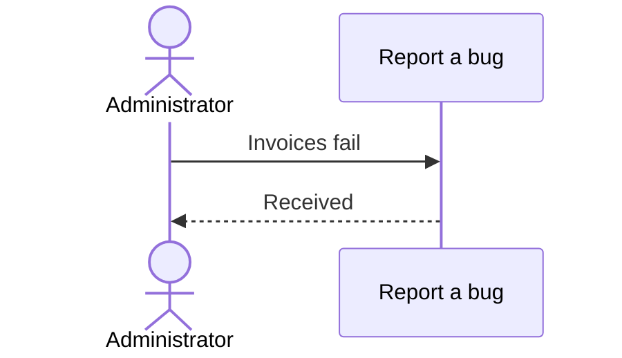

🏠 [Specs](../../../../README.md) › 🧩 [Functional capabilities](../../../README.md) ›
🤖 [F25 DevOps agents (hosted edition)](../../README.md) › 📝 [Use cases](../README.md) ›
📝 [Use cases: FL-F25-01 Intake](README.md) › 📝 UC-F25-01 Report a bug from simple-ERP

# 📝 UC-F25-01 Report a bug from simple-ERP

**Status:** ✅ specified

## Summary

An administrator or the owner reports a bug from simple-ERP in plain words; a possible vulnerability goes to the private
advisory.

## Personas

- [U07 Administrator](../../../../01-users/personas/u07-administrator.md)
- [U13 Owner](../../../../01-users/personas/u13-owner.md)

## Goal

Bugs reported easily.

## Trigger

A bug.

## Frequency

Occasional.

## Preconditions

- Signed in.

## Postconditions

- Success: sent.
- Failure: none.

## Main flow

1. Open Report a bug (S-F25-01).
2. Describe.
3. Add a masked screenshot if needed.
4. Send; status "received" (BR-F25-09).

## Alternative flows

- 4a. Security: private advisory (UC-F25-22).

## Error flows

- 4e. Send fails: retried.
- Any step: a service does not answer; the call is retried first (BR-F3-32), then the message follows the error pattern
  (D122) and what was typed stays on the screen.

## Business rules

- [BR-F25-02 One USER feature, one ticket](../../business-rules/br-f25-02-one-user-feature-one-ticket.md)
- [BR-F25-09 The customer is told in plain words](../../business-rules/br-f25-09-customer-told-in-plain-words.md)
- [BR-F25-12 Security reports stay private](../../business-rules/br-f25-12-security-reports-stay-private.md)
- [BR-F25-15 Vulnerabilities handled under the CRA](../../business-rules/br-f25-15-vulnerabilities-handled-under-the-cra.md)

## Entities

- [E-F25-01 Bug or feature request](../../data/e-f25-01-bug-or-feature-request.md)
- [E-F25-12 Vulnerability case](../../data/e-f25-12-vulnerability-case.md)

## Permissions

Administrator, owner.

## Notifications

- Status changes.

## Audit events

Reports.

## AI involvement

Helps describe.

## API, MCP and A2A exposure

Through T5 and T6 with the caller's rights (BR-F3-34).

## Screens

- [S-F25-01 Report a bug](../../screens/01-intake/s-f25-01-report-a-bug.md)

## Flowchart

See [FL-F25-01 Intake](../../flows/fl-f25-01-intake.md#flowchart).

## Sequence diagram

## Acceptance criteria

1. **Given** a bug **when** sent **then** received.
2. **Given** a security issue **when** sent **then** private.
3. **Given** a screenshot **when** added **then** masked.

## Non-functional notes

D408's targets ([Performance](../../../../05-non-functional/performance.md)): 95 % of screens within 1 second; lists
paged on the server, the first page within 1 second; reports within 5 seconds or in the background.

## Regulatory references

Rules of the France country pack the agents follow:
[CR-FR-049 Processors and transfers outside the EU](../../../../10-country-packs/france/data-protection/cr-fr-049-processors-and-transfers.md),
[CR-FR-199 Notifying a personal data breach](../../../../10-country-packs/france/data-protection/cr-fr-199-personal-data-breach-notification.md),
[CR-FR-056 People know they deal with an AI](../../../../10-country-packs/france/ai-and-recording/cr-fr-056-people-know-they-deal-with-an-ai.md),
[CR-FR-057 A person confirms what the AI does](../../../../10-country-packs/france/ai-and-recording/cr-fr-057-human-oversight.md),
[CR-FR-168 Cyber Resilience Act reporting](../../../../10-country-packs/france/digital/cr-fr-168-cyber-resilience-reporting.md),
[CR-FR-052 Personal data kept no longer than needed](../../../../10-country-packs/france/data-protection/cr-fr-052-storage-limitation.md).

## Related use cases

- [UC-F25-03 Open the USER feature with its ticket](uc-f25-03-open-the-user-feature-with-its-ticket.md)
- [UC-F25-22 Handle a reported vulnerability under the CRA](../06-vulnerability-handling/uc-f25-22-handle-a-reported-vulnerability-under-the-cra.md)

## Open questions

None.

---

⬆️ [Up](README.md) · ➡️ [UC-F25-02 Request a feature from simple-ERP](uc-f25-02-request-a-feature-from-simple-erp.md)
