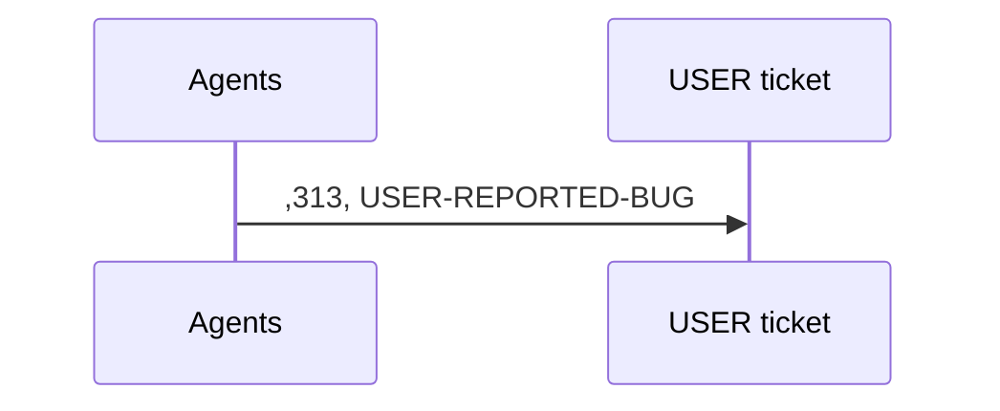

🏠 [Specs](../../../../README.md) › 🧩 [Functional capabilities](../../../README.md) ›
🤖 [F25 DevOps agents (hosted edition)](../../README.md) › 📝 [Use cases](../README.md) ›
📝 [Use cases: FL-F25-01 Intake](README.md) › 📝 UC-F25-03 Open the USER feature with its ticket

# 📝 UC-F25-03 Open the USER feature with its ticket

**Status:** ✅ specified

## Summary

The maintainer and agents open one USER feature with one ticket, labelled, linked to the reporter, then triage it.

## Personas

- [U47 simple-ERP maintainer](../../../../01-users/personas/u47-simple-erp-maintainer.md)

## Goal

One ticket per request.

## Trigger

Request received.

## Frequency

Daily.

## Preconditions

- Request.

## Postconditions

- Success: filed.
- Failure: private advisory.

## Main flow

1. Write the ticket (S-F25-03).
2. Label it (BR-F25-02).
3. Link the reporter.
4. Triage (UC-F25-21).

## Alternative flows

- 2a. Security: private (BR-F25-12).

## Error flows

- 1e. Duplicate: linked (UC-F25-04).
- Any step: a service does not answer; the call is retried first (BR-F3-32), then the message follows the error pattern
  (D122) and what was typed stays on the screen.

## Business rules

- [BR-F25-02 One USER feature, one ticket](../../business-rules/br-f25-02-one-user-feature-one-ticket.md)
- [BR-F25-12 Security reports stay private](../../business-rules/br-f25-12-security-reports-stay-private.md)
- [BR-F25-14 Triage with severity, priority and target times](../../business-rules/br-f25-14-triage-with-severity-priority-and-target-times.md)

## Entities

- [E-F25-02 USER feature](../../data/e-f25-02-user-feature.md)
- [E-F25-03 USER ticket](../../data/e-f25-03-user-ticket.md)
- [E-F25-11 Triage](../../data/e-f25-11-triage.md)

## Permissions

Maintainer; agents.

## Notifications

- Reporter.

## Audit events

Tickets.

## AI involvement

Agents write.

## API, MCP and A2A exposure

Through T5 and T6 with the caller's rights (BR-F3-34).

## Screens

- [S-F25-03 USER ticket](../../screens/01-intake/s-f25-03-user-ticket.md)

## Flowchart

See [FL-F25-01 Intake](../../flows/fl-f25-01-intake.md#flowchart).

## Sequence diagram

## Acceptance criteria

1. **Given** a bug **when** filed **then** one feature and one ticket.
2. **Given** security **when** filed **then** private.
3. **Given** filed **when** done **then** triaged.

## Non-functional notes

D408's targets ([Performance](../../../../05-non-functional/performance.md)): 95 % of screens within 1 second; lists
paged on the server, the first page within 1 second; reports within 5 seconds or in the background.

## Regulatory references

Rules of the France country pack the agents follow:
[CR-FR-049 Processors and transfers outside the EU](../../../../10-country-packs/france/data-protection/cr-fr-049-processors-and-transfers.md),
[CR-FR-199 Notifying a personal data breach](../../../../10-country-packs/france/data-protection/cr-fr-199-personal-data-breach-notification.md),
[CR-FR-056 People know they deal with an AI](../../../../10-country-packs/france/ai-and-recording/cr-fr-056-people-know-they-deal-with-an-ai.md),
[CR-FR-057 A person confirms what the AI does](../../../../10-country-packs/france/ai-and-recording/cr-fr-057-human-oversight.md),
[CR-FR-168 Cyber Resilience Act reporting](../../../../10-country-packs/france/digital/cr-fr-168-cyber-resilience-reporting.md),
[CR-FR-052 Personal data kept no longer than needed](../../../../10-country-packs/france/data-protection/cr-fr-052-storage-limitation.md).

## Related use cases

- [UC-F25-21 Triage requests by severity and priority](uc-f25-21-triage-requests-by-severity-and-priority.md)

## Open questions

None.

---

⬅️ [UC-F25-02 Request a feature from simple-ERP](uc-f25-02-request-a-feature-from-simple-erp.md) · ⬆️ [Up](README.md) ·
➡️ [UC-F25-04 Deduplicate against open issues](uc-f25-04-deduplicate-against-open-issues.md)
