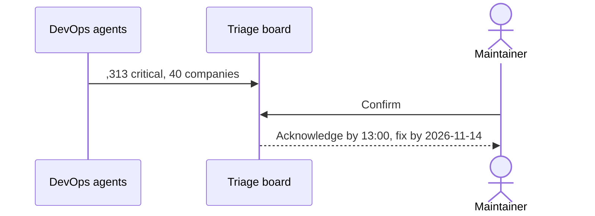

🏠 [Specs](../../../../README.md) › 🧩 [Functional capabilities](../../../README.md) ›
🤖 [F25 DevOps agents (hosted edition)](../../README.md) › 📝 [Use cases](../README.md) ›
📝 [Use cases: FL-F25-01 Intake](README.md) › 📝 UC-F25-21 Triage requests by severity and priority

# 📝 UC-F25-21 Triage requests by severity and priority

**Status:** ✅ specified

## Summary

The maintainer, helped by the agents, gives each USER ticket a severity and a priority with target times; the triage
board shows the time left and flags late tickets.

## Personas

- [U47 SimpleERP maintainer](../../../../01-users/personas/u47-simpleerp-maintainer.md)

## Goal

The most serious requests handled first and on time.

## Trigger

A USER ticket opened (UC-F25-03).

## Frequency

Daily.

## Preconditions

- The ticket exists.

## Postconditions

- Success: triaged with targets.
- Failure: flagged late.

## Main flow

1. The agents propose a severity and a priority from the effect, the reach and the votes (S-F25-21).
2. The maintainer confirms or changes them.
3. SimpleERP sets the acknowledgement and resolution targets (BR-F25-14).
4. The board sorts tickets by priority with the time left.
5. A late ticket is flagged; the customer sees "planned" with the expected release.

## Alternative flows

- 1a. A possible vulnerability: goes to the private advisory (UC-F25-22).

## Error flows

- 5e. Target passed: flagged to the maintainers.
- Any step: a service does not answer; the call is retried first (BR-F3-32), then the message follows the error pattern
  (D122) and what was typed stays on the screen.

## Business rules

- [BR-F25-14 Triage with severity, priority and target times](../../business-rules/br-f25-14-triage-with-severity-priority-and-target-times.md)
- [BR-F25-07 Approval before Ready](../../business-rules/br-f25-07-approval-before-ready.md)

## Entities

- [E-F25-11 Triage](../../data/e-f25-11-triage.md)
- [E-F25-03 USER ticket](../../data/e-f25-03-user-ticket.md)

## Permissions

Maintainers; agents propose.

## Notifications

- Maintainers when a critical ticket arrives and when a target is near.

## Audit events

Triage changes.

## AI involvement

The agents propose severity and priority; a maintainer confirms.

## API, MCP and A2A exposure

Through the API (T5) and as AI assistant tools (T6), with the caller's rights (BR-F3-34).

## Screens

- [S-F25-21 Triage board](../../screens/01-intake/s-f25-21-triage-board.md)

## Flowchart

See [FL-F25-01 Intake](../../flows/fl-f25-01-intake.md#flowchart).

## Sequence diagram

## Acceptance criteria

1. **Given** invoices failing for 40 companies **when** triaged **then** critical with targets 4 hours and 2 days.
2. **Given** a label typo **when** triaged **then** low, next release.
3. **Given** a target passed **when** the time comes **then** flagged.

## Non-functional notes

D408's targets ([Performance](../../../../05-non-functional/performance.md)): 95 % of screens within 1 second; lists
paged on the server, the first page within 1 second; reports within 5 seconds or in the background.

## Regulatory references

None.

## Related use cases

- [UC-F25-03 Open the USER feature with its ticket](uc-f25-03-open-the-user-feature-with-its-ticket.md)
- [UC-F25-22 Handle a reported vulnerability under the CRA](../06-vulnerability-handling/uc-f25-22-handle-a-reported-vulnerability-under-the-cra.md)

## Open questions

None.

---

⬅️ [UC-F25-20](../05-tell-the-customer/uc-f25-20-ask-the-assistant-about-my-requests.md) · ⬆️ [Up](README.md) ·
➡️ [UC-F25-22](../06-vulnerability-handling/uc-f25-22-handle-a-reported-vulnerability-under-the-cra.md)
