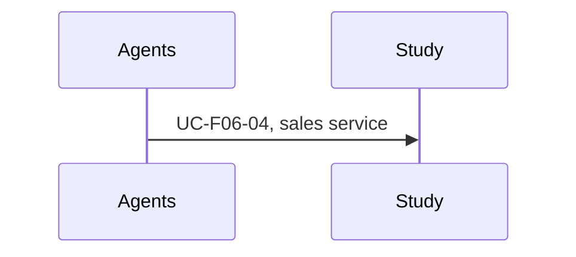

🏠 [Specs](../../../../README.md) › 🧩 [Functional capabilities](../../../README.md) ›
🤖 [F25 DevOps agents (hosted edition)](../../README.md) › 📝 [Use cases](../README.md) ›
📝 [Use cases: FL-F25-02 Feature requests](README.md) › 📝 UC-F25-05 Study the code and the specs for a feature

# 📝 UC-F25-05 Study the code and the specs for a feature

**Status:** ✅ specified

## Summary

Agents study the specs and code for a feature.

## Personas

- [U47 simple-ERP maintainer](../../../../01-users/personas/u47-simple-erp-maintainer.md)

## Goal

Informed answer.

## Trigger

Feature request.

## Frequency

Weekly.

## Preconditions

- Ticket.

## Postconditions

- Success: summary.
- Failure: none.

## Main flow

1. Read specs (S-F25-05).
2. Read code.
3. Summarise (BR-F25-06).
4. Cite pages and files.

## Alternative flows

- 3a. Already possible: told.

## Error flows

- 2e. Unknown area.
- Any step: a service does not answer; the call is retried first (BR-F3-32), then the message follows the error pattern
  (D122) and what was typed stays on the screen.

## Business rules

- [BR-F25-06 Specs and code studied first](../../business-rules/br-f25-06-specs-and-code-studied-first.md)

## Entities

- [E-F25-04 Study note](../../data/e-f25-04-study-note.md)

## Permissions

Agents.

## Notifications

- None.

## Audit events

Study.

## AI involvement

Agents.

## API, MCP and A2A exposure

Through T5 and T6 with the caller's rights (BR-F3-34).

## Screens

- [S-F25-05 Study](../../screens/02-feature-requests/s-f25-05-study.md)

## Flowchart

See [FL-F25-02 Feature requests](../../flows/fl-f25-02-feature-requests.md#flowchart).

## Sequence diagram

## Acceptance criteria

1. **Given** a request **when** studied **then** pages cited.
2. **Given** possible **when** found **then** told.
3. **Given** summary **when** done **then** saved.

## Non-functional notes

D408's targets ([Performance](../../../../05-non-functional/performance.md)): 95 % of screens within 1 second; lists
paged on the server, the first page within 1 second; reports within 5 seconds or in the background.

## Regulatory references

Rules of the France country pack the agents follow:
[CR-FR-049 Processors and transfers outside the EU](../../../../10-country-packs/france/data-protection/cr-fr-049-processors-and-transfers.md),
[CR-FR-199 Notifying a personal data breach](../../../../10-country-packs/france/data-protection/cr-fr-199-personal-data-breach-notification.md),
[CR-FR-056 People know they deal with an AI](../../../../10-country-packs/france/ai-and-recording/cr-fr-056-people-know-they-deal-with-an-ai.md),
[CR-FR-057 A person confirms what the AI does](../../../../10-country-packs/france/ai-and-recording/cr-fr-057-human-oversight.md),
[CR-FR-168 Cyber Resilience Act reporting](../../../../10-country-packs/france/digital/cr-fr-168-cyber-resilience-reporting.md),
[CR-FR-052 Personal data kept no longer than needed](../../../../10-country-packs/france/data-protection/cr-fr-052-storage-limitation.md).

## Related use cases

- [UC-F25-06 Draft the spec changes as a pull request](uc-f25-06-draft-the-spec-changes-as-a-pull-request.md)

## Open questions

None.

---

⬅️ [UC-F25-04 Deduplicate against open issues](../01-intake/uc-f25-04-deduplicate-against-open-issues.md) ·
⬆️ [Up](README.md) ·
➡️ [UC-F25-06 Draft the spec changes as a pull request](uc-f25-06-draft-the-spec-changes-as-a-pull-request.md)
