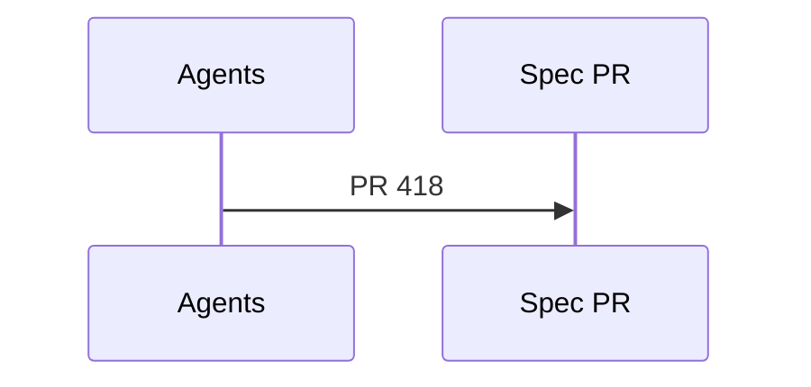

🏠 [Specs](../../../../README.md) › 🧩 [Functional capabilities](../../../README.md) ›
🤖 [F25 DevOps agents (hosted edition)](../../README.md) › 📝 [Use cases](../README.md) ›
📝 [Use cases: FL-F25-02 Feature requests](README.md) › 📝 UC-F25-06 Draft the spec changes as a pull request

# 📝 UC-F25-06 Draft the spec changes as a pull request

**Status:** ✅ specified

## Summary

Agents draft the spec changes as a pull request, checked before review.

## Personas

- [U47 SimpleERP maintainer](../../../../01-users/personas/u47-simpleerp-maintainer.md)

## Goal

Spec change proposed.

## Trigger

Study done.

## Frequency

Weekly.

## Preconditions

- Study.

## Postconditions

- Success: PR.
- Failure: none.

## Main flow

1. Branch (S-F25-06).
2. Edit specs.
3. Pull request (BR-F25-05).
4. Spec checks (UC-F25-23).

## Alternative flows

- 4a. Revise.

## Error flows

- 4e. Checks fail.
- Any step: a service does not answer; the call is retried first (BR-F3-32), then the message follows the error pattern
  (D122) and what was typed stays on the screen.

## Business rules

- [BR-F25-06 Specs and code studied first](../../business-rules/br-f25-06-specs-and-code-studied-first.md)
- [BR-F25-05 Agents never merge or deploy](../../business-rules/br-f25-05-agents-never-merge-or-deploy.md)
- [BR-F25-16 Agents' spec pull requests checked first](../../business-rules/br-f25-16-agents-spec-pull-requests-checked-first.md)

## Entities

- [E-F25-05 Agent pull request](../../data/e-f25-05-agent-pull-request.md)
- [E-F25-13 Spec check report](../../data/e-f25-13-spec-check-report.md)

## Permissions

Agents.

## Notifications

- Maintainer after checks.

## Audit events

PRs.

## AI involvement

Agents.

## API, MCP and A2A exposure

Through T5 and T6 with the caller's rights (BR-F3-34).

## Screens

- [S-F25-06 Spec pull request](../../screens/02-feature-requests/s-f25-06-spec-pull-request.md)

## Flowchart

See [FL-F25-02 Feature requests](../../flows/fl-f25-02-feature-requests.md#flowchart).

## Sequence diagram

## Acceptance criteria

1. **Given** edits **when** pushed **then** PR.
2. **Given** checks fail **when** run **then** back.
3. **Given** passed **when** run **then** review.

## Non-functional notes

D408's targets ([Performance](../../../../05-non-functional/performance.md)): 95 % of screens within 1 second; lists
paged on the server, the first page within 1 second; reports within 5 seconds or in the background.

## Regulatory references

Rules of the France country pack the agents follow:
[CR-FR-049 Processors and transfers outside the EU](../../../../10-country-packs/france/data-protection/cr-fr-049-processors-and-transfers.md),
[CR-FR-199 Notifying a personal data breach](../../../../10-country-packs/france/data-protection/cr-fr-199-personal-data-breach-notification.md),
[CR-FR-056 People know they deal with an AI](../../../../10-country-packs/france/ai-and-recording/cr-fr-056-people-know-they-deal-with-an-ai.md),
[CR-FR-057 A person confirms what the AI does](../../../../10-country-packs/france/ai-and-recording/cr-fr-057-human-oversight.md),
[CR-FR-168 Cyber Resilience Act reporting](../../../../10-country-packs/france/digital/cr-fr-168-cyber-resilience-reporting.md),
[CR-FR-052 Personal data kept no longer than needed](../../../../10-country-packs/france/data-protection/cr-fr-052-storage-limitation.md).

## Related use cases

- [UC-F25-23 Check an agent's spec pull request](uc-f25-23-check-an-agents-spec-pull-request.md)

## Open questions

None.

---

⬅️ [UC-F25-05 Study the code and the specs for a feature](uc-f25-05-study-the-code-and-the-specs-for-a-feature.md) ·
⬆️ [Up](README.md) ·
➡️ [UC-F25-07 Create the SPECS feature and its tickets](uc-f25-07-create-the-specs-feature-and-its-tickets.md)
