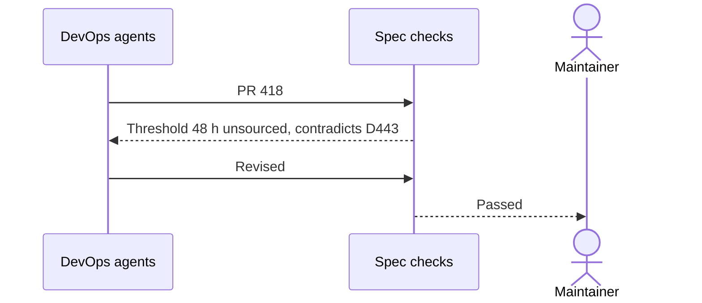

🏠 [Specs](../../../../README.md) › 🧩 [Functional capabilities](../../../README.md) ›
🤖 [F25 DevOps agents (hosted edition)](../../README.md) › 📝 [Use cases](../README.md) ›
📝 [Use cases: FL-F25-02 Feature requests](README.md) › 📝 UC-F25-23 Check an agent's spec pull request

# 📝 UC-F25-23 Check an agent's spec pull request

**Status:** ✅ specified

## Summary

Before a maintainer reads an agent's spec pull request, the spec checks list unsourced statements, contradictions with
decisions and the tool checks' findings; the agent revises until they pass.

## Personas

- [U47 SimpleERP maintainer](../../../../01-users/personas/u47-simpleerp-maintainer.md)

## Goal

Maintainers review only sourced, consistent spec changes.

## Trigger

A spec pull request opened by the agents (UC-F25-06).

## Frequency

Each spec pull request.

## Preconditions

- The pull request is open.

## Postconditions

- Success: checks passed, review requested.
- Failure: back to the agent.

## Main flow

1. The pull request opens; the spec checks run (S-F25-23) (BR-F25-16).
2. They list statements with no source and no "Proposed" marker.
3. They compare new statements with the decided decisions.
4. They run the project's link, template, prose and coverage checks.
5. Passed: the maintainer is asked to review; failed: the agent revises.

## Alternative flows

- 5a. The agent marks unsourced values with the "Proposed" marker and they pass.

## Error flows

- 3e. A contradiction with a decision: listed with the decision.
- Any step: a service does not answer; the call is retried first (BR-F3-32), then the message follows the error pattern
  (D122) and what was typed stays on the screen.

## Business rules

- [BR-F25-16 Agents' spec pull requests checked first](../../business-rules/br-f25-16-agents-spec-pull-requests-checked-first.md)
- [BR-F25-06 Specs and code studied first](../../business-rules/br-f25-06-specs-and-code-studied-first.md)

## Entities

- [E-F25-13 Spec check report](../../data/e-f25-13-spec-check-report.md)
- [E-F25-05 Agent pull request](../../data/e-f25-05-agent-pull-request.md)

## Permissions

Maintainers read; agents revise.

## Notifications

- The maintainer when checks pass.

## Audit events

Check runs.

## AI involvement

An AI checker finds statements; the tool checks are deterministic.

## API, MCP and A2A exposure

Through the API (T5) and as AI assistant tools (T6), with the caller's rights (BR-F3-34).

## Screens

- [S-F25-23 Spec checks](../../screens/02-feature-requests/s-f25-23-spec-checks.md)

## Flowchart

See [FL-F25-02 Feature requests](../../flows/fl-f25-02-feature-requests.md#flowchart).

## Sequence diagram

## Acceptance criteria

1. **Given** "48 hours" with no source **when** checked **then** listed.
2. **Given** "seats per user" **when** checked **then** the contradiction with D443 is listed.
3. **Given** a broken link **when** checked **then** the link check lists it.
4. **Given** all passed **when** done **then** the maintainer is asked.

## Non-functional notes

D408's targets ([Performance](../../../../05-non-functional/performance.md)): 95 % of screens within 1 second; lists
paged on the server, the first page within 1 second; reports within 5 seconds or in the background.

## Regulatory references

None.

## Related use cases

- [UC-F25-06 Draft the spec changes as a pull request](uc-f25-06-draft-the-spec-changes-as-a-pull-request.md)
- [UC-F25-12 Approve or refuse agents' tickets](../04-approve-and-govern/uc-f25-12-approve-or-refuse-agents-tickets.md)

## Open questions

None.

---

⬅️ [UC-F25-22](../06-vulnerability-handling/uc-f25-22-handle-a-reported-vulnerability-under-the-cra.md) ·
⬆️ [Up](README.md) ·
➡️ [UC-F25-24 Vote on declined requests](../05-tell-the-customer/uc-f25-24-vote-on-declined-requests.md)
