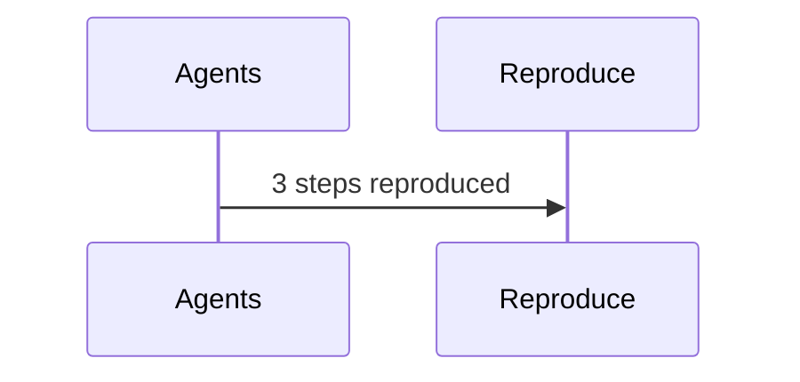

🏠 [Specs](../../../../README.md) › 🧩 [Functional capabilities](../../../README.md) ›
🤖 [F25 DevOps agents (hosted edition)](../../README.md) › 📝 [Use cases](../README.md) ›
📝 [Use cases: FL-F25-03 Bugs](README.md) › 📝 UC-F25-08 Reproduce a bug on the managed SimpleERP

# 📝 UC-F25-08 Reproduce a bug on the managed SimpleERP

**Status:** ✅ specified

## Summary

Agents and the hosting engineer reproduce a bug on the managed SimpleERP read-only.

## Personas

- [U47 SimpleERP maintainer](../../../../01-users/personas/u47-simpleerp-maintainer.md)
- [U48 Hosting engineer](../../../../01-users/personas/u48-hosting-engineer.md)

## Goal

Bug reproduced.

## Trigger

Bug ticket.

## Frequency

Daily.

## Preconditions

- Ticket.

## Postconditions

- Success: steps.
- Failure: more info.

## Main flow

1. Read logs (S-F25-08) (BR-F25-04).
2. Reproduce on a copy.
3. Record steps.
4. Mask data.

## Alternative flows

- 1a. Health data excluded (BR-F25-13).

## Error flows

- 2e. Not reproduced: ask.
- Any step: a service does not answer; the call is retried first (BR-F3-32), then the message follows the error pattern
  (D122) and what was typed stays on the screen.

## Business rules

- [BR-F25-04 Read-only on production](../../business-rules/br-f25-04-read-only-on-production.md)
- [BR-F25-01 Agents follow the country pack](../../business-rules/br-f25-01-agents-follow-the-country-pack.md)
- [BR-F25-13 Health data out of the agents' reach](../../business-rules/br-f25-13-health-data-out-of-reach.md)

## Entities

- [E-F25-07 Reproduction](../../data/e-f25-07-reproduction.md)

## Permissions

Agents, hosting engineer.

## Notifications

- None.

## Audit events

Reads.

## AI involvement

Agents.

## API, MCP and A2A exposure

Through T5 and T6 with the caller's rights (BR-F3-34).

## Screens

- [S-F25-08 Reproduce](../../screens/03-bugs/s-f25-08-reproduce.md)

## Flowchart

See [FL-F25-03 Bugs](../../flows/fl-f25-03-bugs.md#flowchart).

## Sequence diagram

## Acceptance criteria

1. **Given** logs **when** read **then** masked.
2. **Given** reproduced **when** done **then** steps.
3. **Given** health data **when** found **then** excluded.

## Non-functional notes

D408's targets ([Performance](../../../../05-non-functional/performance.md)): 95 % of screens within 1 second; lists
paged on the server, the first page within 1 second; reports within 5 seconds or in the background.

## Regulatory references

Rules of the France country pack the agents follow:
[CR-FR-049 Processors and transfers outside the EU](../../../../10-country-packs/france/data-protection/cr-fr-049-processors-and-transfers.md),
[CR-FR-199 Notifying a personal data breach](../../../../10-country-packs/france/data-protection/cr-fr-199-personal-data-breach-notification.md),
[CR-FR-056 People know they deal with an AI](../../../../10-country-packs/france/ai-and-recording/cr-fr-056-people-know-they-deal-with-an-ai.md),
[CR-FR-057 A person confirms what the AI does](../../../../10-country-packs/france/ai-and-recording/cr-fr-057-human-oversight.md),
[CR-FR-168 Cyber Resilience Act reporting](../../../../10-country-packs/france/digital/cr-fr-168-cyber-resilience-reporting.md),
[CR-FR-052 Personal data kept no longer than needed](../../../../10-country-packs/france/data-protection/cr-fr-052-storage-limitation.md).

## Related use cases

- [UC-F25-09 Find the cause in the code](uc-f25-09-find-the-cause-in-the-code.md)

## Open questions

None.

---

⬅️ [UC-F25-07](../02-feature-requests/uc-f25-07-create-the-specs-feature-and-its-tickets.md) · ⬆️ [Up](README.md) ·
➡️ [UC-F25-09 Find the cause in the code](uc-f25-09-find-the-cause-in-the-code.md)
