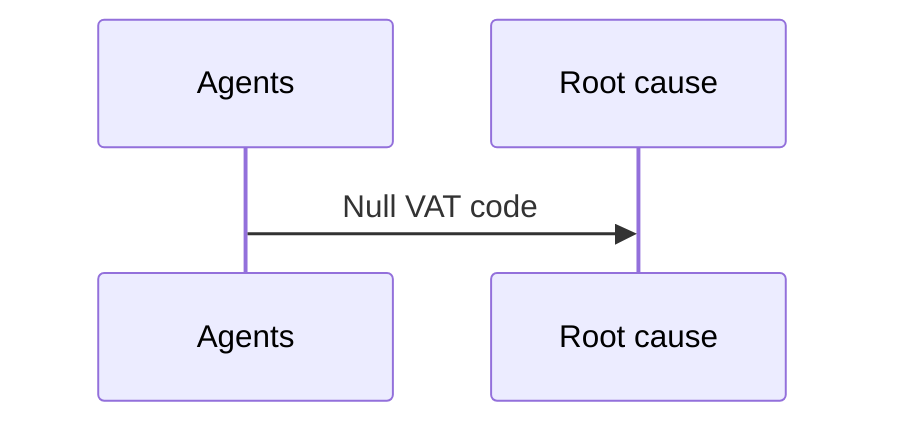

🏠 [Specs](../../../../README.md) › 🧩 [Functional capabilities](../../../README.md) ›
🤖 [F25 DevOps agents (hosted edition)](../../README.md) › 📝 [Use cases](../README.md) ›
📝 [Use cases: FL-F25-03 Bugs](README.md) › 📝 UC-F25-09 Find the cause in the code

# 📝 UC-F25-09 Find the cause in the code

**Status:** ✅ specified

## Summary

Agents find the cause in the code.

## Personas

- [U47 SimpleERP maintainer](../../../../01-users/personas/u47-simpleerp-maintainer.md)

## Goal

Cause found.

## Trigger

Reproduced.

## Frequency

Daily.

## Preconditions

- Reproduction.

## Postconditions

- Success: cause.
- Failure: maintainer.

## Main flow

1. Trace (S-F25-09).
2. Locate.
3. Explain.
4. Link.

## Alternative flows

- 2a. Several causes.

## Error flows

- 2e. Unknown.
- Any step: a service does not answer; the call is retried first (BR-F3-32), then the message follows the error pattern
  (D122) and what was typed stays on the screen.

## Business rules

- [BR-F25-06 Specs and code studied first](../../business-rules/br-f25-06-specs-and-code-studied-first.md)

## Entities

- [E-F25-07 Reproduction](../../data/e-f25-07-reproduction.md)

## Permissions

Agents.

## Notifications

- None.

## Audit events

Study.

## AI involvement

Agents.

## API, MCP and A2A exposure

Through T5 and T6 with the caller's rights (BR-F3-34).

## Screens

- [S-F25-09 Root cause](../../screens/03-bugs/s-f25-09-root-cause.md)

## Flowchart

See [FL-F25-03 Bugs](../../flows/fl-f25-03-bugs.md#flowchart).

## Sequence diagram

## Acceptance criteria

1. **Given** a trace **when** done **then** cause.
2. **Given** unknown **when** found **then** maintainer.
3. **Given** located **when** done **then** linked.

## Non-functional notes

D408's targets ([Performance](../../../../05-non-functional/performance.md)): 95 % of screens within 1 second; lists
paged on the server, the first page within 1 second; reports within 5 seconds or in the background.

## Regulatory references

Rules of the France country pack the agents follow:
[CR-FR-049 Processors and transfers outside the EU](../../../../10-country-packs/france/data-protection/cr-fr-049-processors-and-transfers.md),
[CR-FR-199 Notifying a personal data breach](../../../../10-country-packs/france/data-protection/cr-fr-199-personal-data-breach-notification.md),
[CR-FR-056 People know they deal with an AI](../../../../10-country-packs/france/ai-and-recording/cr-fr-056-people-know-they-deal-with-an-ai.md),
[CR-FR-057 A person confirms what the AI does](../../../../10-country-packs/france/ai-and-recording/cr-fr-057-human-oversight.md),
[CR-FR-168 Cyber Resilience Act reporting](../../../../10-country-packs/france/digital/cr-fr-168-cyber-resilience-reporting.md),
[CR-FR-052 Personal data kept no longer than needed](../../../../10-country-packs/france/data-protection/cr-fr-052-storage-limitation.md).

## Related use cases

- [UC-F25-10 Propose the fix as a pull request, tests first](uc-f25-10-propose-the-fix-as-a-pull-request-tests-first.md)

## Open questions

None.

---

⬅️ [UC-F25-08 Reproduce a bug on the managed SimpleERP](uc-f25-08-reproduce-a-bug-on-the-managed-simpleerp.md) ·
⬆️ [Up](README.md) · ➡️ [UC-F25-10](uc-f25-10-propose-the-fix-as-a-pull-request-tests-first.md)
