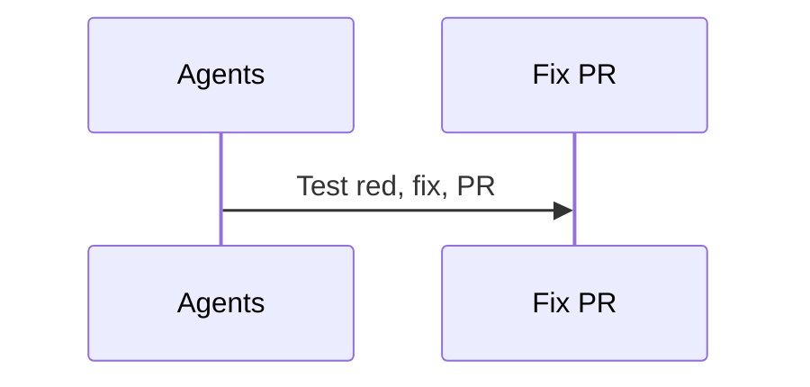

🏠 [Specs](../../../../README.md) › 🧩 [Functional capabilities](../../../README.md) ›
🤖 [F25 DevOps agents (hosted edition)](../../README.md) › 📝 [Use cases](../README.md) ›
📝 [Use cases: FL-F25-03 Bugs](README.md) › 📝 UC-F25-10 Propose the fix as a pull request, tests first

# 📝 UC-F25-10 Propose the fix as a pull request, tests first

**Status:** ✅ specified

## Summary

Agents propose the fix as a pull request, tests first.

## Personas

- [U47 simple-ERP maintainer](../../../../01-users/personas/u47-simple-erp-maintainer.md)

## Goal

Fix proposed.

## Trigger

Cause.

## Frequency

Daily.

## Preconditions

- Cause.

## Postconditions

- Success: PR.
- Failure: none.

## Main flow

1. Failing test (S-F25-10) (BR-F25-08).
2. Fix.
3. Pull request.
4. Maintainer review.

## Alternative flows

- 4a. Vulnerability fix (UC-F25-22).

## Error flows

- 1e. Test passes: not reproduced.
- Any step: a service does not answer; the call is retried first (BR-F3-32), then the message follows the error pattern
  (D122) and what was typed stays on the screen.

## Business rules

- [BR-F25-08 Fixes start with a failing test](../../business-rules/br-f25-08-fixes-test-first.md)
- [BR-F25-05 Agents never merge or deploy](../../business-rules/br-f25-05-agents-never-merge-or-deploy.md)

## Entities

- [E-F25-05 Agent pull request](../../data/e-f25-05-agent-pull-request.md)

## Permissions

Agents.

## Notifications

- Maintainer.

## Audit events

PRs.

## AI involvement

Agents.

## API, MCP and A2A exposure

Through T5 and T6 with the caller's rights (BR-F3-34).

## Screens

- [S-F25-10 Fix pull request](../../screens/03-bugs/s-f25-10-fix-pull-request.md)

## Flowchart

See [FL-F25-03 Bugs](../../flows/fl-f25-03-bugs.md#flowchart).

## Sequence diagram

## Acceptance criteria

1. **Given** test red **when** fixed **then** green.
2. **Given** PR **when** opened **then** review.
3. **Given** test passes first **when** run **then** stop.

## Non-functional notes

D408's targets ([Performance](../../../../05-non-functional/performance.md)): 95 % of screens within 1 second; lists
paged on the server, the first page within 1 second; reports within 5 seconds or in the background.

## Regulatory references

Rules of the France country pack the agents follow:
[CR-FR-049 Processors and transfers outside the EU](../../../../10-country-packs/france/data-protection/cr-fr-049-processors-and-transfers.md),
[CR-FR-199 Notifying a personal data breach](../../../../10-country-packs/france/data-protection/cr-fr-199-personal-data-breach-notification.md),
[CR-FR-056 People know they deal with an AI](../../../../10-country-packs/france/ai-and-recording/cr-fr-056-people-know-they-deal-with-an-ai.md),
[CR-FR-057 A person confirms what the AI does](../../../../10-country-packs/france/ai-and-recording/cr-fr-057-human-oversight.md),
[CR-FR-168 Cyber Resilience Act reporting](../../../../10-country-packs/france/digital/cr-fr-168-cyber-resilience-reporting.md),
[CR-FR-052 Personal data kept no longer than needed](../../../../10-country-packs/france/data-protection/cr-fr-052-storage-limitation.md).

## Related use cases

- [UC-F25-22 Handle a reported vulnerability under the CRA](../06-vulnerability-handling/uc-f25-22-handle-a-reported-vulnerability-under-the-cra.md)

## Open questions

None.

---

⬅️ [UC-F25-09 Find the cause in the code](uc-f25-09-find-the-cause-in-the-code.md) · ⬆️ [Up](README.md) ·
➡️ [UC-F25-11 Create the PRODUCT ticket](uc-f25-11-create-the-product-ticket.md)
