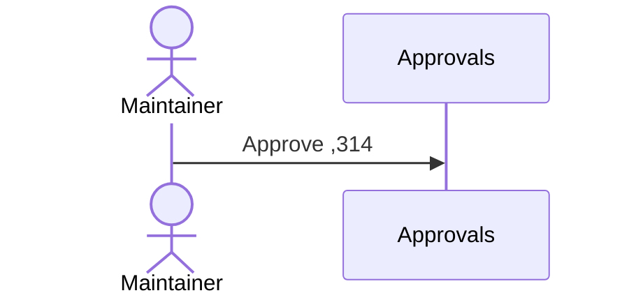

🏠 [Specs](../../../../README.md) › 🧩 [Functional capabilities](../../../README.md) ›
🤖 [F25 DevOps agents (hosted edition)](../../README.md) › 📝 [Use cases](../README.md) ›
📝 [Use cases: FL-F25-04 Approve and govern](README.md) › 📝 UC-F25-12 Approve or refuse agents' tickets

# 📝 UC-F25-12 Approve or refuse agents' tickets

**Status:** ✅ specified

## Summary

The maintainer approves or refuses agents' tickets after the spec checks.

## Personas

- [U47 SimpleERP maintainer](../../../../01-users/personas/u47-simpleerp-maintainer.md)

## Goal

Control.

## Trigger

Tickets.

## Frequency

Daily.

## Preconditions

- Tickets.

## Postconditions

- Success: Ready.
- Failure: refused.

## Main flow

1. Review (S-F25-12).
2. Check the spec checks.
3. Approve or refuse.
4. Move to Ready.

## Alternative flows

- 3a. Refused: declined, public vote.

## Error flows

- 2e. Checks failing: wait.
- Any step: a service does not answer; the call is retried first (BR-F3-32), then the message follows the error pattern
  (D122) and what was typed stays on the screen.

## Business rules

- [BR-F25-07 Approval before Ready](../../business-rules/br-f25-07-approval-before-ready.md)
- [BR-F25-05 Agents never merge or deploy](../../business-rules/br-f25-05-agents-never-merge-or-deploy.md)
- [BR-F25-17 Declined requests stay public as votes](../../business-rules/br-f25-17-declined-requests-stay-public-as-votes.md)

## Entities

- [E-F25-06 Agent ticket](../../data/e-f25-06-agent-ticket.md)
- [E-F25-08 Approval](../../data/e-f25-08-approval.md)
- [E-F25-14 Vote](../../data/e-f25-14-vote.md)

## Permissions

Maintainer.

## Notifications

- Reporter.

## Audit events

Approvals.

## AI involvement

None.

## API, MCP and A2A exposure

Through T5 and T6 with the caller's rights (BR-F3-34).

## Screens

- [S-F25-12 Approvals](../../screens/04-approve-and-govern/s-f25-12-approvals.md)

## Flowchart

See [FL-F25-04 Approve and govern](../../flows/fl-f25-04-approve-and-govern.md#flowchart).

## Sequence diagram

## Acceptance criteria

1. **Given** approved **when** done **then** Ready.
2. **Given** refused **when** done **then** public vote.
3. **Given** checks failing **when** reviewing **then** wait.

## Non-functional notes

D408's targets ([Performance](../../../../05-non-functional/performance.md)): 95 % of screens within 1 second; lists
paged on the server, the first page within 1 second; reports within 5 seconds or in the background.

## Regulatory references

Rules of the France country pack the agents follow:
[CR-FR-049 Processors and transfers outside the EU](../../../../10-country-packs/france/data-protection/cr-fr-049-processors-and-transfers.md),
[CR-FR-199 Notifying a personal data breach](../../../../10-country-packs/france/data-protection/cr-fr-199-personal-data-breach-notification.md),
[CR-FR-056 People know they deal with an AI](../../../../10-country-packs/france/ai-and-recording/cr-fr-056-people-know-they-deal-with-an-ai.md),
[CR-FR-057 A person confirms what the AI does](../../../../10-country-packs/france/ai-and-recording/cr-fr-057-human-oversight.md),
[CR-FR-168 Cyber Resilience Act reporting](../../../../10-country-packs/france/digital/cr-fr-168-cyber-resilience-reporting.md),
[CR-FR-052 Personal data kept no longer than needed](../../../../10-country-packs/france/data-protection/cr-fr-052-storage-limitation.md).

## Related use cases

- [UC-F25-24 Vote on declined requests](../05-tell-the-customer/uc-f25-24-vote-on-declined-requests.md)

## Open questions

None.

---

⬅️ [UC-F25-11 Create the PRODUCT ticket](../03-bugs/uc-f25-11-create-the-product-ticket.md) · ⬆️ [Up](README.md) ·
➡️ [UC-F25-13 Ask the agents for changes](uc-f25-13-ask-the-agents-for-changes.md)
