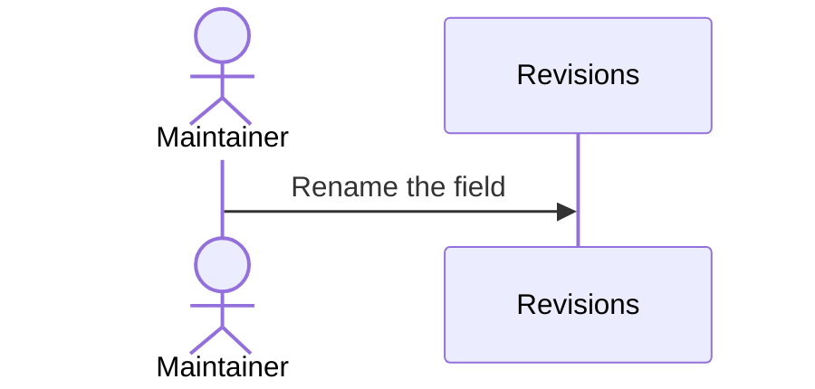

🏠 [Specs](../../../../README.md) › 🧩 [Functional capabilities](../../../README.md) ›
🤖 [F25 DevOps agents (hosted edition)](../../README.md) › 📝 [Use cases](../README.md) ›
📝 [Use cases: FL-F25-04 Approve and govern](README.md) › 📝 UC-F25-13 Ask the agents for changes

# 📝 UC-F25-13 Ask the agents for changes

**Status:** ✅ specified

## Summary

The maintainer asks the agents for changes.

## Personas

- [U47 SimpleERP maintainer](../../../../01-users/personas/u47-simpleerp-maintainer.md)

## Goal

Better work.

## Trigger

Review.

## Frequency

Weekly.

## Preconditions

- PR.

## Postconditions

- Success: revised.
- Failure: none.

## Main flow

1. Comment (S-F25-13).
2. Agent revises.
3. Checks run.
4. Review again.

## Alternative flows

- 2a. Several rounds.

## Error flows

- 2e. Cannot revise: maintainer.
- Any step: a service does not answer; the call is retried first (BR-F3-32), then the message follows the error pattern
  (D122) and what was typed stays on the screen.

## Business rules

- [BR-F25-05 Agents never merge or deploy](../../business-rules/br-f25-05-agents-never-merge-or-deploy.md)

## Entities

- [E-F25-05 Agent pull request](../../data/e-f25-05-agent-pull-request.md)
- [E-F25-08 Approval](../../data/e-f25-08-approval.md)

## Permissions

Maintainer.

## Notifications

- Maintainer.

## Audit events

Revisions.

## AI involvement

Agents.

## API, MCP and A2A exposure

Through T5 and T6 with the caller's rights (BR-F3-34).

## Screens

- [S-F25-13 Revisions](../../screens/04-approve-and-govern/s-f25-13-revisions.md)

## Flowchart

See [FL-F25-04 Approve and govern](../../flows/fl-f25-04-approve-and-govern.md#flowchart).

## Sequence diagram

## Acceptance criteria

1. **Given** a comment **when** sent **then** revised.
2. **Given** checks **when** run **then** passed.
3. **Given** cannot **when** stuck **then** maintainer.

## Non-functional notes

D408's targets ([Performance](../../../../05-non-functional/performance.md)): 95 % of screens within 1 second; lists
paged on the server, the first page within 1 second; reports within 5 seconds or in the background.

## Regulatory references

Rules of the France country pack the agents follow:
[CR-FR-049 Processors and transfers outside the EU](../../../../10-country-packs/france/data-protection/cr-fr-049-processors-and-transfers.md),
[CR-FR-199 Notifying a personal data breach](../../../../10-country-packs/france/data-protection/cr-fr-199-personal-data-breach-notification.md),
[CR-FR-056 People know they deal with an AI](../../../../10-country-packs/france/ai-and-recording/cr-fr-056-people-know-they-deal-with-an-ai.md),
[CR-FR-057 A person confirms what the AI does](../../../../10-country-packs/france/ai-and-recording/cr-fr-057-human-oversight.md),
[CR-FR-168 Cyber Resilience Act reporting](../../../../10-country-packs/france/digital/cr-fr-168-cyber-resilience-reporting.md),
[CR-FR-052 Personal data kept no longer than needed](../../../../10-country-packs/france/data-protection/cr-fr-052-storage-limitation.md).

## Related use cases

- [UC-F25-23 Check an agent's spec pull request](../02-feature-requests/uc-f25-23-check-an-agents-spec-pull-request.md)

## Open questions

None.

---

⬅️ [UC-F25-12 Approve or refuse agents' tickets](uc-f25-12-approve-or-refuse-agents-tickets.md) · ⬆️ [Up](README.md) ·
➡️ [UC-F25-14 Follow my request's status](../05-tell-the-customer/uc-f25-14-follow-my-request-s-status.md)
