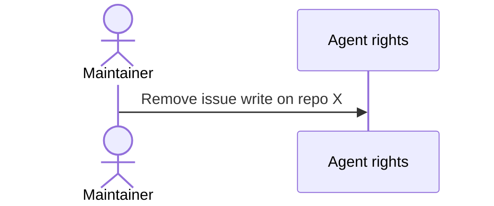

🏠 [Specs](../../../../README.md) › 🧩 [Functional capabilities](../../../README.md) ›
🤖 [F25 DevOps agents (hosted edition)](../../README.md) › 📝 [Use cases](../README.md) ›
📝 [Use cases: FL-F25-04 Approve and govern](README.md) › 📝 UC-F25-17 Control the agents' rights and audit

# 📝 UC-F25-17 Control the agents' rights and audit

**Status:** ✅ specified

## Summary

Maintainers and hosting engineers control the agents' rights and audit.

## Personas

- [U47 simple-ERP maintainer](../../../../01-users/personas/u47-simple-erp-maintainer.md)
- [U48 Hosting engineer](../../../../01-users/personas/u48-hosting-engineer.md)

## Goal

Least rights.

## Trigger

Review.

## Frequency

Quarterly.

## Preconditions

- Rights.

## Postconditions

- Success: changed.
- Failure: none.

## Main flow

1. Review (S-F25-17).
2. Change.
3. Audit trail.
4. Save.

## Alternative flows

- 2a. Revoke.

## Error flows

- 2e. Merge right asked: refused (BR-F25-05).
- Any step: a service does not answer; the call is retried first (BR-F3-32), then the message follows the error pattern
  (D122) and what was typed stays on the screen.

## Business rules

- [BR-F25-04 Read-only on production](../../business-rules/br-f25-04-read-only-on-production.md)
- [BR-F25-05 Agents never merge or deploy](../../business-rules/br-f25-05-agents-never-merge-or-deploy.md)
- [BR-F25-11 Agents are metered and audited](../../business-rules/br-f25-11-agents-metered-and-audited.md)

## Entities

- [E-F25-10 Agent run](../../data/e-f25-10-agent-run.md)

## Permissions

Maintainer, hosting engineer.

## Notifications

- None.

## Audit events

Changes.

## AI involvement

None.

## API, MCP and A2A exposure

Through T5 and T6 with the caller's rights (BR-F3-34).

## Screens

- [S-F25-17 Agent rights](../../screens/04-approve-and-govern/s-f25-17-agent-rights.md)

## Flowchart

See [FL-F25-04 Approve and govern](../../flows/fl-f25-04-approve-and-govern.md#flowchart).

## Sequence diagram

## Acceptance criteria

1. **Given** removed **when** saved **then** applied.
2. **Given** merge **when** asked **then** refused.
3. **Given** audit **when** opened **then** all reads.

## Non-functional notes

D408's targets ([Performance](../../../../05-non-functional/performance.md)): 95 % of screens within 1 second; lists
paged on the server, the first page within 1 second; reports within 5 seconds or in the background.

## Regulatory references

Rules of the France country pack the agents follow:
[CR-FR-049 Processors and transfers outside the EU](../../../../10-country-packs/france/data-protection/cr-fr-049-processors-and-transfers.md),
[CR-FR-199 Notifying a personal data breach](../../../../10-country-packs/france/data-protection/cr-fr-199-personal-data-breach-notification.md),
[CR-FR-056 People know they deal with an AI](../../../../10-country-packs/france/ai-and-recording/cr-fr-056-people-know-they-deal-with-an-ai.md),
[CR-FR-057 A person confirms what the AI does](../../../../10-country-packs/france/ai-and-recording/cr-fr-057-human-oversight.md),
[CR-FR-168 Cyber Resilience Act reporting](../../../../10-country-packs/france/digital/cr-fr-168-cyber-resilience-reporting.md),
[CR-FR-052 Personal data kept no longer than needed](../../../../10-country-packs/france/data-protection/cr-fr-052-storage-limitation.md).

## Related use cases

- [UC-F25-18 Follow the agents' costs and budgets](uc-f25-18-follow-the-agents-costs-and-budgets.md)

## Open questions

None.

---

⬅️ [UC-F25-16](../05-tell-the-customer/uc-f25-16-offer-the-feature-factory-for-a-custom-need.md) · ⬆️ [Up](README.md) ·
➡️ [UC-F25-18 Follow the agents' costs and budgets](uc-f25-18-follow-the-agents-costs-and-budgets.md)
