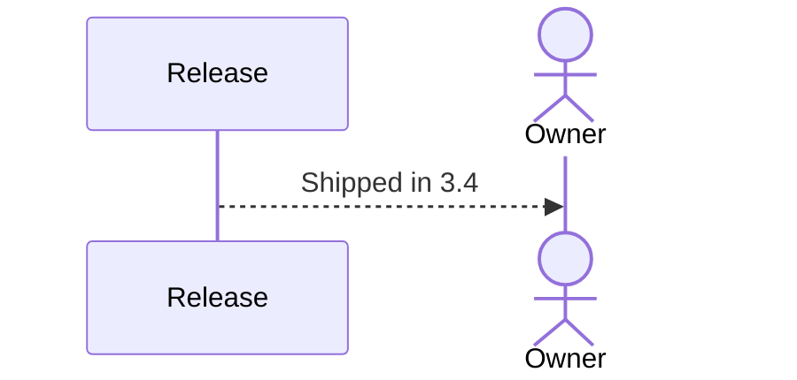

🏠 [Specs](../../../../README.md) › 🧩 [Functional capabilities](../../../README.md) ›
🤖 [F25 DevOps agents (hosted edition)](../../README.md) › 📝 [Use cases](../README.md) ›
📝 [Use cases: FL-F25-05 Tell the customer](README.md) › 📝 UC-F25-15 Be told when it ships

# 📝 UC-F25-15 Be told when it ships

**Status:** ✅ specified

## Summary

The owner is told when it ships.

## Personas

- [U13 Owner](../../../../01-users/personas/u13-owner.md)

## Goal

Know.

## Trigger

Release.

## Frequency

Occasional.

## Preconditions

- Request.

## Postconditions

- Success: told.
- Failure: none.

## Main flow

1. Shipped.
2. Told (S-F25-15).
3. Try it.
4. Rate.

## Alternative flows

- 2a. Voters told too.

## Error flows

- 2e. None.
- Any step: a service does not answer; the call is retried first (BR-F3-32), then the message follows the error pattern
  (D122) and what was typed stays on the screen.

## Business rules

- [BR-F25-09 The customer is told in plain words](../../business-rules/br-f25-09-customer-told-in-plain-words.md)

## Entities

- [E-F25-09 Request status](../../data/e-f25-09-request-status.md)

## Permissions

Owner.

## Notifications

- Owner, voters.

## Audit events

None.

## AI involvement

None.

## API, MCP and A2A exposure

Through T5 and T6 with the caller's rights (BR-F3-34).

## Screens

- [S-F25-15 Shipped](../../screens/05-tell-the-customer/s-f25-15-shipped.md)

## Flowchart

See [FL-F25-05 Tell the customer](../../flows/fl-f25-05-tell-the-customer.md#flowchart).

## Sequence diagram

## Acceptance criteria

1. **Given** shipped **when** released **then** told.
2. **Given** voters **when** shipped **then** told.
3. **Given** tried **when** rated **then** saved.

## Non-functional notes

D408's targets ([Performance](../../../../05-non-functional/performance.md)): 95 % of screens within 1 second; lists
paged on the server, the first page within 1 second; reports within 5 seconds or in the background.

## Regulatory references

Rules of the France country pack the agents follow:
[CR-FR-049 Processors and transfers outside the EU](../../../../10-country-packs/france/data-protection/cr-fr-049-processors-and-transfers.md),
[CR-FR-199 Notifying a personal data breach](../../../../10-country-packs/france/data-protection/cr-fr-199-personal-data-breach-notification.md),
[CR-FR-056 People know they deal with an AI](../../../../10-country-packs/france/ai-and-recording/cr-fr-056-people-know-they-deal-with-an-ai.md),
[CR-FR-057 A person confirms what the AI does](../../../../10-country-packs/france/ai-and-recording/cr-fr-057-human-oversight.md),
[CR-FR-168 Cyber Resilience Act reporting](../../../../10-country-packs/france/digital/cr-fr-168-cyber-resilience-reporting.md),
[CR-FR-052 Personal data kept no longer than needed](../../../../10-country-packs/france/data-protection/cr-fr-052-storage-limitation.md).

## Related use cases

- [UC-F25-14 Follow my request's status](uc-f25-14-follow-my-request-s-status.md)

## Open questions

None.

---

⬅️ [UC-F25-14 Follow my request's status](uc-f25-14-follow-my-request-s-status.md) · ⬆️ [Up](README.md) ·
➡️ [UC-F25-16 Offer the feature factory for a custom need](uc-f25-16-offer-the-feature-factory-for-a-custom-need.md)
