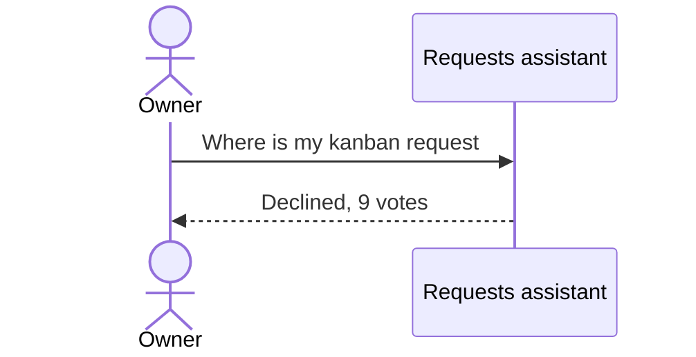

🏠 [Specs](../../../../README.md) › 🧩 [Functional capabilities](../../../README.md) ›
🤖 [F25 DevOps agents (hosted edition)](../../README.md) › 📝 [Use cases](../README.md) ›
📝 [Use cases: FL-F25-05 Tell the customer](README.md) › 📝 UC-F25-20 Ask the AI assistant about my requests

# 📝 UC-F25-20 Ask the AI assistant about my requests

**Status:** ✅ specified

## Summary

The owner asks the AI assistant about their requests and may vote.

## Personas

- [U13 Owner](../../../../01-users/personas/u13-owner.md)
- [U07 Administrator](../../../../01-users/personas/u07-administrator.md)

## Goal

Answers.

## Trigger

Question.

## Frequency

Occasional.

## Preconditions

- None.

## Postconditions

- Success: answered.
- Failure: none.

## Main flow

1. Ask (S-F25-20).
2. Answer.
3. Comment or vote.
4. Done.

## Alternative flows

- 3a. Vote on a declined request (UC-F25-24).

## Error flows

- 2e. Other company: refused.
- Any step: a service does not answer; the call is retried first (BR-F3-32), then the message follows the error pattern
  (D122) and what was typed stays on the screen.

## Business rules

- [BR-F25-09 The customer is told in plain words](../../business-rules/br-f25-09-customer-told-in-plain-words.md)
- [BR-F25-17 Declined requests stay public as votes](../../business-rules/br-f25-17-declined-requests-stay-public-as-votes.md)

## Entities

- [E-F25-01 Bug or feature request](../../data/e-f25-01-bug-or-feature-request.md)
- [E-F25-09 Request status](../../data/e-f25-09-request-status.md)
- [E-F25-14 Vote](../../data/e-f25-14-vote.md)

## Permissions

Own company.

## Notifications

- None.

## Audit events

Questions.

## AI involvement

Answers.

## API, MCP and A2A exposure

Through T5 and T6 with the caller's rights (BR-F3-34).

## Screens

- [S-F25-20 Requests assistant](../../screens/05-tell-the-customer/s-f25-20-requests-assistant.md)

## Flowchart

See [FL-F25-05 Tell the customer](../../flows/fl-f25-05-tell-the-customer.md#flowchart).

## Sequence diagram

## Acceptance criteria

1. **Given** a request **when** asked **then** status.
2. **Given** another company's **when** asked **then** refused.
3. **Given** vote **when** asked **then** counted.

## Non-functional notes

D408's targets ([Performance](../../../../05-non-functional/performance.md)): 95 % of screens within 1 second; lists
paged on the server, the first page within 1 second; reports within 5 seconds or in the background.

## Regulatory references

Rules of the France country pack the agents follow:
[CR-FR-049 Processors and transfers outside the EU](../../../../10-country-packs/france/data-protection/cr-fr-049-processors-and-transfers.md),
[CR-FR-199 Notifying a personal data breach](../../../../10-country-packs/france/data-protection/cr-fr-199-personal-data-breach-notification.md),
[CR-FR-056 People know they deal with an AI](../../../../10-country-packs/france/ai-and-recording/cr-fr-056-people-know-they-deal-with-an-ai.md),
[CR-FR-057 A person confirms what the AI does](../../../../10-country-packs/france/ai-and-recording/cr-fr-057-human-oversight.md),
[CR-FR-168 Cyber Resilience Act reporting](../../../../10-country-packs/france/digital/cr-fr-168-cyber-resilience-reporting.md),
[CR-FR-052 Personal data kept no longer than needed](../../../../10-country-packs/france/data-protection/cr-fr-052-storage-limitation.md).

## Related use cases

- [UC-F25-24 Vote on declined requests](uc-f25-24-vote-on-declined-requests.md)

## Open questions

None.

---

⬅️ [UC-F25-19](../04-approve-and-govern/uc-f25-19-measure-the-quality-of-the-agents-work.md) · ⬆️ [Up](README.md) ·
➡️ [UC-F25-21](../01-intake/uc-f25-21-triage-requests-by-severity-and-priority.md)
