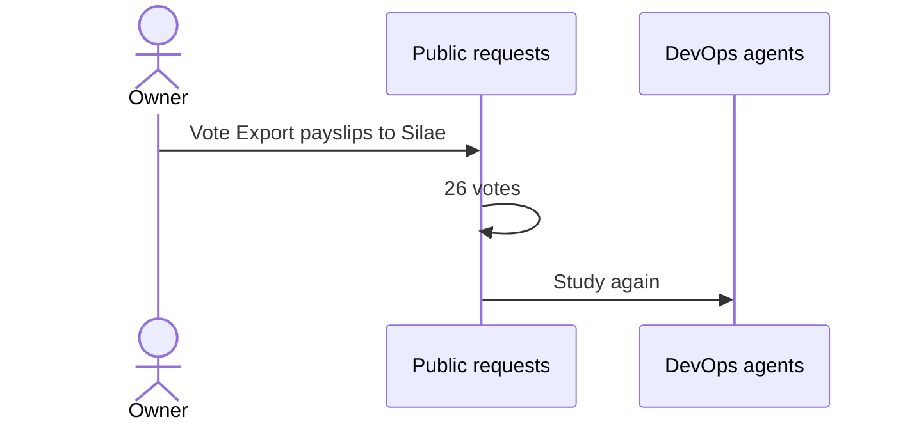

🏠 [Specs](../../../../README.md) › 🧩 [Functional capabilities](../../../README.md) ›
🤖 [F25 DevOps agents (hosted edition)](../../README.md) › 📝 [Use cases](../README.md) ›
📝 [Use cases: FL-F25-05 Tell the customer](README.md) › 📝 UC-F25-24 Vote on declined requests

# 📝 UC-F25-24 Vote on declined requests

**Status:** ✅ specified

## Summary

Owners and administrators of hosted companies browse the public list of declined requests, anonymised, and vote; a
request passing the threshold is studied again.

## Personas

- [U13 Owner](../../../../01-users/personas/u13-owner.md)
- [U07 Administrator](../../../../01-users/personas/u07-administrator.md)

## Goal

Customers weigh in on what the product does next.

## Trigger

Browsing requests; a request declined.

## Frequency

Occasional.

## Preconditions

- Hosted company.

## Postconditions

- Success: vote counted.
- Failure: none.

## Main flow

1. The owner opens Public requests (S-F25-24).
2. They read declined requests with reasons and vote counts.
3. They vote (one vote per company).
4. Past the threshold, the request is studied again (BR-F25-17).

## Alternative flows

- 3a. Withdraw a vote.

## Error flows

- 3e. Second vote of the same company: refused.
- Any step: a service does not answer; the call is retried first (BR-F3-32), then the message follows the error pattern
  (D122) and what was typed stays on the screen.

## Business rules

- [BR-F25-17 Declined requests stay public as votes](../../business-rules/br-f25-17-declined-requests-stay-public-as-votes.md)

## Entities

- [E-F25-14 Vote](../../data/e-f25-14-vote.md)
- [E-F25-03 USER ticket](../../data/e-f25-03-user-ticket.md)

## Permissions

Owners and administrators of hosted companies.

## Notifications

- Voters when a request they voted for is studied again or shipped.

## Audit events

Votes.

## AI involvement

The AI assistant finds similar requests.

## API, MCP and A2A exposure

Through the API (T5) and as AI assistant tools (T6), with the caller's rights (BR-F3-34).

## Screens

- [S-F25-24 Public requests](../../screens/05-tell-the-customer/s-f25-24-public-requests.md)

## Flowchart

See [FL-F25-05 Tell the customer](../../flows/fl-f25-05-tell-the-customer.md#flowchart).

## Sequence diagram

## Acceptance criteria

1. **Given** a declined request **when** listed **then** no company or person name shows.
2. **Given** a second vote of the same company **when** cast **then** refused.
3. **Given** 26 votes with a threshold of 25 **when** reached **then** studied again.

## Non-functional notes

D408's targets ([Performance](../../../../05-non-functional/performance.md)): 95 % of screens within 1 second; lists
paged on the server, the first page within 1 second; reports within 5 seconds or in the background.

## Regulatory references

None.

## Related use cases

- [UC-F25-14 Follow my request's status](uc-f25-14-follow-my-request-s-status.md)
- [UC-F25-16 Offer the feature factory for a custom need](uc-f25-16-offer-the-feature-factory-for-a-custom-need.md)

## Open questions

None.

---

⬅️ [UC-F25-23](../02-feature-requests/uc-f25-23-check-an-agents-spec-pull-request.md) · ⬆️ [Up](README.md) ·
➡️ [UC-F25-25 Read the public roadmap](../07-roadmap-beta-and-credits/uc-f25-25-read-the-public-roadmap.md)
