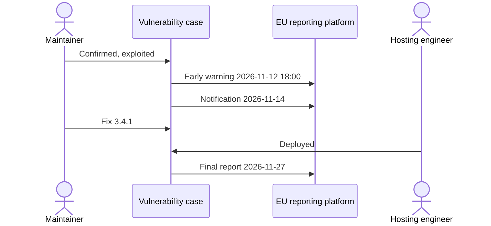

🏠 [Specs](../../../../README.md) › 🧩 [Functional capabilities](../../../README.md) ›
🤖 [F25 DevOps agents (hosted edition)](../../README.md) › 📝 [Use cases](../README.md) ›
📝 [Use cases: FL-F25-06 Vulnerability handling](README.md) › 📝 UC-F25-22 Handle a reported vulnerability under the CRA

# 📝 UC-F25-22 Handle a reported vulnerability under the CRA

**Status:** ✅ specified

## Summary

The maintainers assess a private vulnerability report, fix it with a failing test first, report it through the EU
platform when actively exploited within 24 and 72 hours, and disclose it once fixed.

## Personas

- [U47 simple-ERP maintainer](../../../../01-users/personas/u47-simple-erp-maintainer.md)
- [U48 Hosting engineer](../../../../01-users/personas/u48-hosting-engineer.md), who deploys the fix to the hosted
  edition

## Goal

Vulnerabilities fixed and reported as the law requires.

## Trigger

A report sent to the private advisory (BR-F25-12).

## Frequency

Rare.

## Preconditions

- The report is in a private advisory.

## Postconditions

- Success: fixed, reported, disclosed.
- Failure: escalated.

## Main flow

1. A maintainer opens the Vulnerability case (S-F25-22) and confirms the flaw.
2. They set the severity and whether it is actively exploited.
3. If exploited, the early warning and notification are sent within their deadlines (BR-F25-15).
4. The fix is written with a failing test first (BR-F25-08), reviewed and released; the hosting engineer deploys it.
5. The final report is sent and the advisory disclosed with credit to the reporter.

## Alternative flows

- 2a. Not exploited: fixed by severity, no EU report.

## Error flows

- 1e. Not a vulnerability: closed, reporter told.
- 3e. A deadline near: maintainers alerted.
- Any step: a service does not answer; the call is retried first (BR-F3-32), then the message follows the error pattern
  (D122) and what was typed stays on the screen.

## Business rules

- [BR-F25-15 Vulnerabilities handled under the CRA](../../business-rules/br-f25-15-vulnerabilities-handled-under-the-cra.md)
- [BR-F25-12 Security reports stay private](../../business-rules/br-f25-12-security-reports-stay-private.md)
- [BR-F25-08 Fixes start with a failing test](../../business-rules/br-f25-08-fixes-test-first.md)

## Entities

- [E-F25-12 Vulnerability case](../../data/e-f25-12-vulnerability-case.md)

## Permissions

Maintainers and hosting engineers only.

## Notifications

- Maintainers at each deadline; the reporter when fixed and disclosed.

## Audit events

Every step with dates.

## AI involvement

Agents may draft the fix; maintainers decide everything else.

## API, MCP and A2A exposure

Through the API (T5) and as AI assistant tools (T6), with the caller's rights (BR-F3-34).

## Screens

- [S-F25-22 Vulnerability case](../../screens/06-vulnerability-handling/s-f25-22-vulnerability-case.md)

## Flowchart

See [FL-F25-06 Vulnerability handling](../../flows/fl-f25-06-vulnerability-handling.md#flowchart).

## Sequence diagram

## Acceptance criteria

1. **Given** an exploited flaw confirmed on 2026-11-12 09:00 **when** handled **then** the early warning is sent by
   2026-11-13 09:00.
2. **Given** a fix released on 2026-11-14 **when** released **then** the final report is due by 2026-11-28.
3. **Given** a public disclosure before the fix **when** tried **then** refused.
4. **Given** not a vulnerability **when** closed **then** the reporter is told.

## Non-functional notes

D408's targets ([Performance](../../../../05-non-functional/performance.md)): 95 % of screens within 1 second; lists
paged on the server, the first page within 1 second; reports within 5 seconds or in the background.

## Regulatory references

[CR-FR-168](../../../../10-country-packs/france/digital/cr-fr-168-cyber-resilience-reporting.md).

## Related use cases

- [UC-F25-03 Open the USER feature with its ticket](../01-intake/uc-f25-03-open-the-user-feature-with-its-ticket.md)
- [UC-F25-10 Propose the fix as a pull request, tests first](../03-bugs/uc-f25-10-propose-the-fix-as-a-pull-request-tests-first.md)

## Open questions

None.

---

⬅️ [UC-F25-21](../01-intake/uc-f25-21-triage-requests-by-severity-and-priority.md) · ⬆️ [Up](README.md) ·
➡️ [UC-F25-23](../02-feature-requests/uc-f25-23-check-an-agents-spec-pull-request.md)
