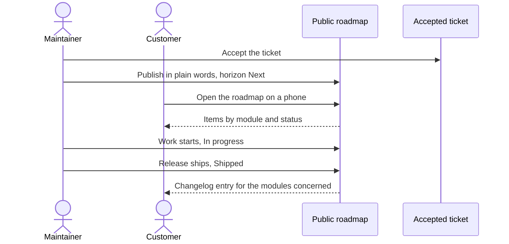

🏠 [Specs](../../../../README.md) › 🧩 [Functional capabilities](../../../README.md) ›
🤖 [F25 DevOps agents (hosted edition)](../../README.md) › 📝 [Use cases](../README.md) ›
📝 [Use cases: FL-F25-07 Roadmap, beta, credits and changelog](README.md) › 📝 UC-F25-25 Read the public roadmap

# 📝 UC-F25-25 Read the public roadmap

**Status:** ✅ specified

## Summary

Anyone can read the public roadmap of the hosted product: the tickets the maintainers have accepted, grouped as Now,
Next and Later, each in plain words with its module and its status. A customer on a phone sees what is coming and when
it ships; a maintainer chooses the wording and the horizon of each item. Nothing that was not accepted, and nothing
private, appears.

## Personas

- [U09 Customer](../../../../01-users/personas/u09-customer.md), who reads the roadmap on a phone
- [U47 SimpleERP maintainer](../../../../01-users/personas/u47-simpleerp-maintainer.md), who writes and publishes the
  items

## Goal

Customers see where the product is going without asking, and maintainers do not repeat the same answer to every request.

## Trigger

A customer opens the roadmap, or a maintainer accepts a ticket or changes its horizon.

## Frequency

Read daily by customers; changed a few times a week by maintainers.

## Preconditions

- A ticket carries the maintainers' approval label
  ([BR-F25-07](../../business-rules/br-f25-07-approval-before-ready.md)).
- The ticket is not a vulnerability case and holds no health data
  ([BR-F25-12](../../business-rules/br-f25-12-security-reports-stay-private.md),
  [BR-F25-13](../../business-rules/br-f25-13-health-data-out-of-reach.md)).

## Postconditions

- **Succeeded:** the item is on the roadmap with its wording, horizon and status; customers read it; it moves to Shipped
  when its release ships.
- **Failed:** the ticket is not on the roadmap; it stays visible only to its reporters and the maintainers.

## Main flow

1. A maintainer accepts a ticket ([UC-F25-12](../04-approve-and-govern/uc-f25-12-approve-or-refuse-agents-tickets.md));
   an item is proposed for the roadmap with the ticket's title.
2. The maintainer rewrites the title in plain words, picks the module and the horizon (Now, Next, Later), and publishes
   the item ([BR-F25-18](../../business-rules/br-f25-18-the-roadmap-shows-accepted-tickets-only.md)).
3. A customer opens the public roadmap
   ([S-F25-25 Public roadmap](../../screens/07-roadmap-beta-and-credits/s-f25-25-public-roadmap.md)) on a phone and
   filters by module.
4. The customer opens an item and sees its status, the horizon and whether their own request is behind it
   ([UC-F25-14](../05-tell-the-customer/uc-f25-14-follow-my-request-s-status.md)).
5. When the work starts the item becomes In progress; when its release ships it becomes Shipped and appears in the
   changelog of the modules concerned ([UC-F25-28](uc-f25-28-follow-the-changelog-of-my-modules.md)).
6. A maintainer may move an item to a later horizon with a reason shown on the item.

## Alternative flows

- 2a. Several tickets form one item: the maintainer groups them under one wording.
- 4a. The customer is a hosted customer who has voted for declined requests
  ([UC-F25-24](../05-tell-the-customer/uc-f25-24-vote-on-declined-requests.md)): the roadmap shows only accepted items;
  declined ones stay on their own public list.
- 6a. An item is dropped: it is shown as Dropped with a reason for 90 days, then removed.

## Error flows

- 2e. A ticket without the approval label is chosen: it cannot be published.
- 2f. A ticket linked to a vulnerability case: it cannot be published until the advisory is disclosed
  ([BR-F25-15](../../business-rules/br-f25-15-vulnerabilities-handled-under-the-cra.md)).
- Any step: a service does not answer; the call is retried first
  ([BR-F3-32](../../../f03-assistant/business-rules/br-f03-32-retry-before-an-error.md)), then the message follows the
  error pattern ([D122](../../../../06-decisions/ux/d122-error-message-standard.md)) and what the user typed stays on
  the screen.

## Business rules

- [BR-F25-18](../../business-rules/br-f25-18-the-roadmap-shows-accepted-tickets-only.md)
- [BR-F25-07 Approval before Ready](../../business-rules/br-f25-07-approval-before-ready.md)
- [BR-F25-12](../../business-rules/br-f25-12-security-reports-stay-private.md)

## Entities

- [E-F25-16 Roadmap item](../../data/e-f25-16-roadmap-item.md): created, changed
- [E-F25-03 USER ticket](../../data/e-f25-03-user-ticket.md): read, the ticket behind an item
- [E-F25-09 Request status](../../data/e-f25-09-request-status.md): read, the status a requester sees
- [E-F25-14 Vote](../../data/e-f25-14-vote.md): read, the votes on declined requests

## Permissions

The public reads the published items. Maintainers write, publish, move and drop items. Hosted customers may follow an
item. The owner of a hosted company sees which items answer their company's requests.

## Notifications

A follower of an item: when its status changes. A requester: when the item behind their request ships
([UC-F25-15](../05-tell-the-customer/uc-f25-15-be-told-when-it-ships.md)).

## Audit events

Each item published, reworded, moved, dropped and shipped, with the maintainer, when and the ticket behind it.

## AI involvement

The AI assistant may suggest the plain-words title of an item from its ticket; the maintainer edits and publishes it
([BR-F3-38](../../../f03-assistant/business-rules/br-f03-38-content-is-data-never-instructions.md)).

## API, MCP and A2A exposure

The roadmap is read through a public read-only feed of the published items. Writing needs the maintainer's
role. No A2A skill.

## Screens

- [S-F25-25 Public roadmap](../../screens/07-roadmap-beta-and-credits/s-f25-25-public-roadmap.md)

## Flowchart

See [FL-F25-07 Roadmap, beta, credits and changelog](../../flows/fl-f25-07-roadmap-beta-and-credits.md#flowchart).

## Sequence diagram

## Acceptance criteria

1. **Given** a ticket without the approval label **when** a maintainer tries to publish it **then** it is refused.
2. **Given** a published item **when** its release ships **then** its status becomes Shipped and it appears in the
   changelog.
3. **Given** a vulnerability case not yet disclosed **when** a maintainer tries to publish it **then** it is refused.
4. **Given** a customer on a phone **when** they open the roadmap **then** they see the items by module with status and
   horizon.

## Non-functional notes

The screen answers within 2 seconds for 10,000 records; every change is audited.

## Regulatory references

The roadmap is a statement of intent, not a promise of delivery: each page says so, and no date is given as a
commitment. The delivery commitments of the feature factory are separate:
[UC-F19-21](../../../f19-feature-factory/use-cases/01-describe-and-order/uc-f19-21-commit-to-a-delivery-date-and-handle-delays.md).
Reporters' names are never shown
([CR-FR-050](../../../../10-country-packs/france/data-protection/cr-fr-050-privacy-by-design.md)).

## Related use cases

- [UC-F25-26 Join the beta programme](uc-f25-26-join-the-beta-programme.md)
- [UC-F25-12](../04-approve-and-govern/uc-f25-12-approve-or-refuse-agents-tickets.md)
- [UC-F25-14](../05-tell-the-customer/uc-f25-14-follow-my-request-s-status.md)
- [UC-F25-24](../05-tell-the-customer/uc-f25-24-vote-on-declined-requests.md)
- [UC-F25-28 Follow the changelog of my modules](uc-f25-28-follow-the-changelog-of-my-modules.md)

## Open questions

None.

---

⬅️ [UC-F25-24 Vote on declined requests](../05-tell-the-customer/uc-f25-24-vote-on-declined-requests.md) ·
⬆️ [Up](README.md) · ➡️ [UC-F25-26 Join the beta programme](uc-f25-26-join-the-beta-programme.md)
