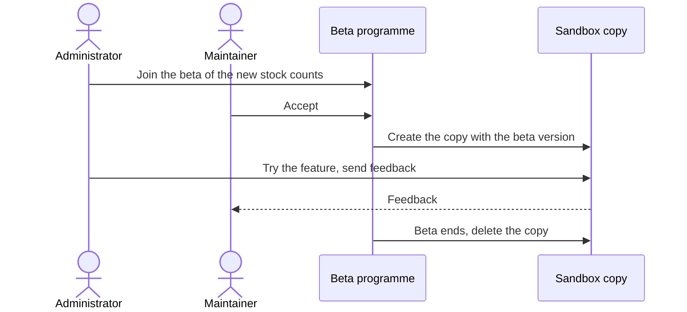

🏠 [Specs](../../../../README.md) › 🧩 [Functional capabilities](../../../README.md) ›
🤖 [F25 DevOps agents (hosted edition)](../../README.md) › 📝 [Use cases](../README.md) ›
📝 [Use cases: FL-F25-07 Roadmap, beta, credits and changelog](README.md) › 📝 UC-F25-26 Join the beta programme

# 📝 UC-F25-26 Join the beta programme

**Status:** ✅ specified

## Summary

A hosted company's administrator enrols in the beta programme to try new features before release. A beta feature runs
only on a sandbox copy of the company's data, never on its live data; the administrator chooses the features, gives
feedback from the copy, and leaves at any time, which deletes the copy.

## Personas

- [U07 Administrator](../../../../01-users/personas/u07-administrator.md), who enrols, chooses the colleagues and gives
  feedback

## Goal

Companies that want early features get them safely, and the product gets real feedback without risk to any live company.

## Trigger

The administrator opens the beta programme and asks to join for a feature, or a maintainer opens a beta feature to
enrolments.

## Frequency

A few enrolments a year per interested company.

## Preconditions

- The company is a hosted customer ([D388](../../../../06-decisions/vision/d388-hosted-edition-open-core.md)).
- A beta feature is open to enrolments by a maintainer.

## Postconditions

- **Succeeded:** the enrolment is Active; the sandbox copy holds the beta feature; the feedback reaches the maintainers;
  at the end the copy is deleted.
- **Failed:** no copy is made and the company's live data and live version are unchanged.

## Main flow

1. The administrator opens the beta programme screen
   ([S-F25-26 Beta programme](../../screens/07-roadmap-beta-and-credits/s-f25-26-beta-programme.md)) and sees the open
   beta features with their warnings.
2. The administrator asks to join for one or more features and accepts the beta terms: the feature may be wrong and runs
   on a copy only ([BR-F25-19](../../business-rules/br-f25-19-betas-run-on-a-sandbox-copy-only.md)).
3. A maintainer accepts the enrolment; SimpleERP creates the sandbox copy with the beta version and with personal data
   masked as set.
4. The administrator and chosen colleagues try the feature in the copy and send feedback from it.
5. When the feature is released or the beta ends, the enrolment ends and the copy is deleted.
6. The administrator may leave earlier; the copy is deleted at once.

## Alternative flows

- 3a. The company has many users: the administrator picks which colleagues may enter the copy.
- 4a. A bug found in the beta is reported through the usual way
  ([UC-F25-01](../01-intake/uc-f25-01-report-a-bug-from-simpleerp.md)) and may earn a credit
  ([UC-F25-27](uc-f25-27-receive-credits-for-confirmed-reports.md)).
- 5a. The feature is released: the administrator chooses whether to turn it on in the live company.

## Error flows

- 3e. A maintainer declines the enrolment: the administrator is told why.
- 3f. The copy cannot be made, for example for lack of room: the enrolment stays Requested and the administrator is
  told.
- Any step: a service does not answer; the call is retried first
  ([BR-F3-32](../../../f03-assistant/business-rules/br-f03-32-retry-before-an-error.md)), then the message follows the
  error pattern ([D122](../../../../06-decisions/ux/d122-error-message-standard.md)) and what the user typed stays on
  the screen.

## Business rules

- [BR-F25-19](../../business-rules/br-f25-19-betas-run-on-a-sandbox-copy-only.md)
- [BR-F25-04 Read-only on production](../../business-rules/br-f25-04-read-only-on-production.md)
- [BR-F25-13](../../business-rules/br-f25-13-health-data-out-of-reach.md)

## Entities

- [E-F25-17 Beta enrolment](../../data/e-f25-17-beta-enrolment.md): created, changed
- [E-F19-06 Try-out copy](../../../f19-feature-factory/data/e-f19-06-try-out-copy.md): read, the try-out copy it
  resembles
- [E-F14-22 Test instance](../../../f14-plugin-store/data/e-f14-22-test-instance.md): read, the test instance it
  resembles

## Permissions

Administrator enrols the company and picks the colleagues. Maintainers accept enrolments and open beta features.
Other employees enter the copy only when chosen.

## Notifications

The administrator: the enrolment accepted or declined, the beta ending in 7 days, the copy deleted. Maintainers: a new
enrolment, feedback received.

## Audit events

Each enrolment, acceptance, copy made, colleague added, feedback sent, ending and deletion, with who and when.

## AI involvement

No AI step of its own. The AI assistant may open the screen and prefill it from the user's words; the user checks and
confirms ([BR-F3-07](../../../f03-assistant/business-rules/br-f03-07-no-deletes-no-irreversible-acts.md)).

## API, MCP and A2A exposure

T5 operations of the capability for the personas above: create, read, update and list. The MCP tool of the
capability may read and propose, never confirm alone. No A2A skill.

## Screens

- [S-F25-26 Beta programme](../../screens/07-roadmap-beta-and-credits/s-f25-26-beta-programme.md)

## Flowchart

See [FL-F25-07 Roadmap, beta, credits and changelog](../../flows/fl-f25-07-roadmap-beta-and-credits.md#flowchart).

## Sequence diagram

## Acceptance criteria

1. **Given** an enrolment **when** the beta feature is used **then** it runs on the sandbox copy only and never on the
   live company.
2. **Given** a copy of live data **when** it is created **then** the personal data is masked as the company set.
3. **Given** an enrolment that ends **when** the date passes **then** the copy is deleted and the administrator is told.
4. **Given** an administrator who leaves **when** they confirm **then** the copy is deleted at once.

## Non-functional notes

The screen answers within 2 seconds for 10,000 records; every change is audited.

## Regulatory references

A sandbox copy of live data is a further processing of personal data: it keeps only what the beta needs, is
masked by default and is deleted when the beta ends
([CR-FR-050](../../../../10-country-packs/france/data-protection/cr-fr-050-privacy-by-design.md),
[CR-FR-052](../../../../10-country-packs/france/data-protection/cr-fr-052-storage-limitation.md)).

## Related use cases

- [UC-F25-25 Read the public roadmap](uc-f25-25-read-the-public-roadmap.md)
- [UC-F25-27](uc-f25-27-receive-credits-for-confirmed-reports.md)
- [UC-F25-25 Read the public roadmap](uc-f25-25-read-the-public-roadmap.md)
- [UC-F25-27](uc-f25-27-receive-credits-for-confirmed-reports.md)
- [UC-F19-07](../../../f19-feature-factory/use-cases/03-try-install-and-maintain/uc-f19-07-try-the-feature-on-a-copy-of-the-data.md)
- [UC-F14-29](../../../f14-plugin-store/use-cases/08-trials-instances-and-partners/uc-f14-29-get-a-publisher-test-instance.md)

## Open questions

None.

---

⬅️ [UC-F25-25 Read the public roadmap](uc-f25-25-read-the-public-roadmap.md) · ⬆️ [Up](README.md) ·
➡️ [UC-F25-27 Receive credits for confirmed reports](uc-f25-27-receive-credits-for-confirmed-reports.md)
