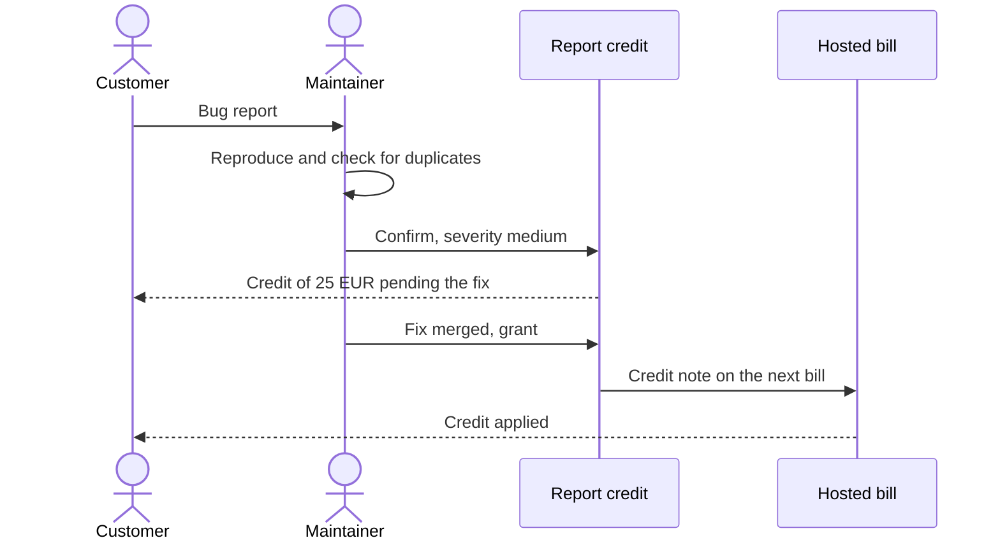

🏠 [Specs](../../../../README.md) › 🧩 [Functional capabilities](../../../README.md) ›
🤖 [F25 DevOps agents (hosted edition)](../../README.md) › 📝 [Use cases](../README.md) ›
📝 [Use cases: FL-F25-07 Roadmap, beta, credits and changelog](README.md) ›
📝 UC-F25-27 Receive credits for confirmed reports

# 📝 UC-F25-27 Receive credits for confirmed reports

**Status:** ✅ specified

## Summary

A hosted customer that reported a bug which the maintainers confirmed and which no one reported before receives a credit
on its hosted bill, by severity from a published schedule. Duplicates, reports that cannot be reproduced and reports of
the same fault by the same company receive nothing. A vulnerability report earns its credit only after the private
advisory has been handled and disclosed.

## Personas

- [U07 Administrator](../../../../01-users/personas/u07-administrator.md), who reads the credits of the company
- [U47 SimpleERP maintainer](../../../../01-users/personas/u47-simpleerp-maintainer.md), who confirms and grants them

## Goal

Customers are rewarded for useful reports, once, and the maintainers never pay for noise.

## Trigger

A maintainer confirms a report ([UC-F25-21](../01-intake/uc-f25-21-triage-requests-by-severity-and-priority.md)), or an
advisory is disclosed
([UC-F25-22](../06-vulnerability-handling/uc-f25-22-handle-a-reported-vulnerability-under-the-cra.md)).

## Frequency

A few credits a month.

## Preconditions

- The report exists as a user ticket ([E-F25-03 USER ticket](../../data/e-f25-03-user-ticket.md)) from a hosted
  customer.
- The duplicate check has run ([UC-F25-04](../01-intake/uc-f25-04-deduplicate-against-open-issues.md)).
- The schedule of credits by severity is published.

## Postconditions

- **Succeeded:** the credit is Granted and then Applied on the next hosted bill as a credit note; the reporter is told.
- **Failed:** no credit exists; the reporter is told why, in plain words.

## Main flow

1. A customer's bug report becomes a ticket ([UC-F25-01](../01-intake/uc-f25-01-report-a-bug-from-simpleerp.md)); a
   maintainer reproduces and confirms it and the duplicate check finds no earlier report
   ([BR-F25-20](../../business-rules/br-f25-20-credits-go-to-confirmed-non-duplicate-reports-only.md)).
2. SimpleERP creates the credit from the severity of the triage
   ([UC-F25-21](../01-intake/uc-f25-21-triage-requests-by-severity-and-priority.md)) and the published schedule; it is
   Pending until the fix is merged.
3. A maintainer grants the credit; the amount and the reason are shown to the administrator on the report credits screen
   ([S-F25-27 Report credits](../../screens/07-roadmap-beta-and-credits/s-f25-27-report-credits.md)).
4. The credit is applied on the next hosted bill as a credit note
   ([UC-F19-15](../../../f19-feature-factory/use-cases/05-bill-and-credit/uc-f19-15-receive-the-promotion-credit.md) for
   the same method).
5. The administrator reads the credit and its place on the bill; accounting receives the credit note.
6. The maintainer sees all credits granted and applied, per month, to follow the cost.

## Alternative flows

- 2a. The report is a vulnerability: the credit waits until the private advisory is fixed and disclosed
  ([BR-F25-15](../../business-rules/br-f25-15-vulnerabilities-handled-under-the-cra.md)).
- 3a. The report is the first of several that describe the same fault: the first confirmed gets the credit; the others
  are merged as duplicates.
- 4a. The company has left the hosted edition before the bill: the credit is paid out as a refund if the terms say so.

## Error flows

- 2e. The report is a duplicate of an earlier one: no credit is created and the reporter sees the earlier issue
  ([BR-F25-20](../../business-rules/br-f25-20-credits-go-to-confirmed-non-duplicate-reports-only.md)).
- 2f. The report cannot be reproduced: no credit; the reporter may add details and be reviewed again.
- 3e. A company tries to claim the same fault twice: the second claim is refused.
- Any step: a service does not answer; the call is retried first
  ([BR-F3-32](../../../f03-assistant/business-rules/br-f03-32-retry-before-an-error.md)), then the message follows the
  error pattern ([D122](../../../../06-decisions/ux/d122-error-message-standard.md)) and what the user typed stays on
  the screen.

## Business rules

- [BR-F25-20](../../business-rules/br-f25-20-credits-go-to-confirmed-non-duplicate-reports-only.md)
- [BR-F25-03 Duplicates are merged](../../business-rules/br-f25-03-duplicates-merged.md)
- [BR-F25-14](../../business-rules/br-f25-14-triage-with-severity-priority-and-target-times.md)

## Entities

- [E-F25-18 Report credit](../../data/e-f25-18-report-credit.md): created, changed
- [E-F25-03 USER ticket](../../data/e-f25-03-user-ticket.md): read, the ticket
- [E-F25-11 Triage](../../data/e-f25-11-triage.md): read, the severity
- [E-F25-12 Vulnerability case](../../data/e-f25-12-vulnerability-case.md): read, the vulnerability case when there is
  one
- [E-F19-08 Promotion credit](../../../f19-feature-factory/data/e-f19-08-promotion-credit.md): read, the promotion
  credit it resembles

## Permissions

Maintainers confirm and grant credits. The administrator and accounting read their company's credits. The
owner of the product reads the totals.

## Notifications

The administrator: a credit granted, a credit applied, a report refused with the reason. Accounting: the credit note.

## Audit events

Each credit created, granted, refused, applied and withdrawn, with the maintainer, the severity, the amount and the
bill.

## AI involvement

No AI step of its own. The AI assistant may open the screen and prefill it from the user's words; the user checks and
confirms ([BR-F3-07](../../../f03-assistant/business-rules/br-f03-07-no-deletes-no-irreversible-acts.md)).

## API, MCP and A2A exposure

T5 operations of the capability for the personas above: create, read, update and list. The MCP tool of the
capability may read and propose, never confirm alone. No A2A skill.

## Screens

- [S-F25-27 Report credits](../../screens/07-roadmap-beta-and-credits/s-f25-27-report-credits.md)

## Flowchart

See [FL-F25-07 Roadmap, beta, credits and changelog](../../flows/fl-f25-07-roadmap-beta-and-credits.md#flowchart).

## Sequence diagram

## Acceptance criteria

1. **Given** a confirmed first report of a fault **when** the maintainer grants the credit **then** the credit equals
   the schedule for the severity.
2. **Given** a report that duplicates an earlier one **when** the maintainer merges it **then** no credit is created.
3. **Given** a vulnerability report **when** the advisory is not yet disclosed **then** no credit is granted.
4. **Given** a granted credit **when** the next bill is made **then** the credit is applied as a credit note.

## Non-functional notes

The screen answers within 2 seconds for 10,000 records; every change is audited.

## Regulatory references

The credit is a price reduction on the hosted bill, treated like the promotion credit for VAT and invoicing
([CR-FR-205](../../../../10-country-packs/france/tax-and-vat/cr-fr-205-promotion-credit-vat-treatment.md),
[CR-FR-200](../../../../10-country-packs/france/invoicing/cr-fr-200-credit-notes.md)); the accountant confirms the
treatment. A vulnerability report follows the company's duties under the Cyber Resilience Act and is paid only after the
coordinated disclosure
([CR-FR-168](../../../../10-country-packs/france/digital/cr-fr-168-cyber-resilience-reporting.md)). A credit is not a
payment for finding a weakness by attacking the service: only reports made through the usual way qualify.

## Related use cases

- [UC-F25-26 Join the beta programme](uc-f25-26-join-the-beta-programme.md)
- [UC-F25-28 Follow the changelog of my modules](uc-f25-28-follow-the-changelog-of-my-modules.md)
- [UC-F25-01 Report a bug from SimpleERP](../01-intake/uc-f25-01-report-a-bug-from-simpleerp.md)
- [UC-F25-04](../01-intake/uc-f25-04-deduplicate-against-open-issues.md)
- [UC-F25-21](../01-intake/uc-f25-21-triage-requests-by-severity-and-priority.md)
- [UC-F25-22](../06-vulnerability-handling/uc-f25-22-handle-a-reported-vulnerability-under-the-cra.md)
- [UC-F19-15](../../../f19-feature-factory/use-cases/05-bill-and-credit/uc-f19-15-receive-the-promotion-credit.md)

## Open questions

None.

---

⬅️ [UC-F25-26 Join the beta programme](uc-f25-26-join-the-beta-programme.md) · ⬆️ [Up](README.md) ·
➡️ [UC-F25-28 Follow the changelog of my modules](uc-f25-28-follow-the-changelog-of-my-modules.md)
