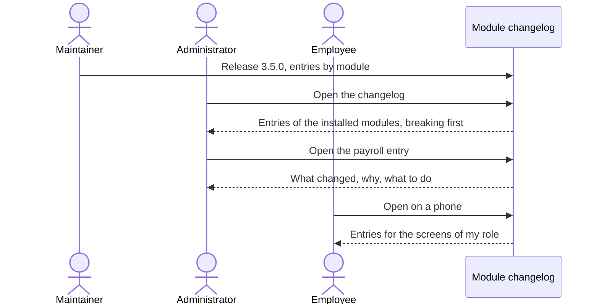

🏠 [Specs](../../../../README.md) › 🧩 [Functional capabilities](../../../README.md) ›
🤖 [F25 DevOps agents (hosted edition)](../../README.md) › 📝 [Use cases](../README.md) ›
📝 [Use cases: FL-F25-07 Roadmap, beta, credits and changelog](README.md) ›
📝 UC-F25-28 Follow the changelog of my modules

# 📝 UC-F25-28 Follow the changelog of my modules

**Status:** ✅ specified

## Summary

The administrator and the employees read a changelog that lists, in plain words, what changed in each release for the
modules the company has installed: what is new, what behaves differently, and what needs an action. An employee on a
phone sees the changes that touch their own screens; the administrator sees them all, with breaking changes first.
Modules the company has not installed never appear.

## Personas

- [U07 Administrator](../../../../01-users/personas/u07-administrator.md), who reads every entry and does the actions
- [U01 Employee](../../../../01-users/personas/u01-employee.md), who reads what touches their screens, on a phone

## Goal

People learn what changed in the tools they use, in words they understand, without reading release notes of modules they
do not have.

## Trigger

A release ships, or a user opens the changelog.

## Frequency

A release a week; read when users want to know what changed.

## Preconditions

- The company has installed modules
  ([UC-F21-01](../../../f21-onboarding-and-modules/use-cases/01-first-run/uc-f21-01-start-the-first-run-guide.md)).
- The release's changes are written in plain words by the maintainers
  ([BR-F25-09](../../business-rules/br-f25-09-customer-told-in-plain-words.md)).

## Postconditions

- **Succeeded:** the changelog shows the entries of the installed modules, newest first; an entry that needs an action
  is flagged to the administrator.
- **Failed:** no entry is shown for a release not yet written; the changelog says so.

## Main flow

1. A release ships; its changes are tagged by module
   ([UC-F25-15](../05-tell-the-customer/uc-f25-15-be-told-when-it-ships.md)).
2. The administrator opens the module changelog
   ([S-F25-28](../../screens/07-roadmap-beta-and-credits/s-f25-28-module-changelog.md)) and sees the entries of the
   installed modules, newest first, breaking changes at the top
   ([BR-F25-21](../../business-rules/br-f25-21-the-changelog-shows-installed-modules-only.md)).
3. The administrator filters by module or release, and opens an entry to read what changed, why and what to do.
4. An employee opens the changelog on a phone and sees the entries that touch the screens their role uses.
5. An entry that needs an action (a setting to review, a template to update) is flagged and links to the screen.
6. The administrator marks an entry as read; the changelog keeps the history.

## Alternative flows

- 3a. The administrator asks the AI assistant what the last release changes for the company: it answers from the entries
  of the installed modules only
  ([BR-F3-02](../../../f03-assistant/business-rules/br-f03-02-answers-use-only-what-the-user-may-see.md)).
- 4a. A module is installed after a release: its older entries are shown, marked as before installation.
- 5a. A module is removed: its entries leave the list and stay in the history.

## Error flows

- 2e. A release has no entry for an installed module: the changelog says that nothing changed in it.
- 3e. A change that needs an action is not done in 30 days: the administrator is reminded once.
- Any step: a service does not answer; the call is retried first
  ([BR-F3-32](../../../f03-assistant/business-rules/br-f03-32-retry-before-an-error.md)), then the message follows the
  error pattern ([D122](../../../../06-decisions/ux/d122-error-message-standard.md)) and what the user typed stays on
  the screen.

## Business rules

- [BR-F25-21](../../business-rules/br-f25-21-the-changelog-shows-installed-modules-only.md)
- [BR-F25-09](../../business-rules/br-f25-09-customer-told-in-plain-words.md)

## Entities

- [E-F25-09 Request status](../../data/e-f25-09-request-status.md): read, the status of a request that shipped
- [E-F20-14](../../../f20-hosted-support-assistant/data/e-f20-14-upgrade-release-note.md): read, the release note of an
  upgrade

## Permissions

Administrator reads every entry of the installed modules. Employees read the entries touching the screens their role
uses. Maintainers write the entries. The owner reads all entries.

## Notifications

The administrator: a release with a breaking change or an action. Employees: none by default; they open the changelog
when they want.

## Audit events

Each entry published, each entry opened by the administrator and each action marked done.

## AI involvement

The AI assistant may summarise the entries for the company's installed modules and answer questions on them; it never
lists a module the company has not installed.

## API, MCP and A2A exposure

The changelog is read through the same feed as the release notes of an upgrade, filtered by the company's
installed modules. No write access. No A2A skill.

## Screens

- [S-F25-28](../../screens/07-roadmap-beta-and-credits/s-f25-28-module-changelog.md)

## Flowchart

See [FL-F25-07 Roadmap, beta, credits and changelog](../../flows/fl-f25-07-roadmap-beta-and-credits.md#flowchart).

## Sequence diagram

## Acceptance criteria

1. **Given** a company without the manufacturing module **when** release 3.5.0 has an entry for it **then** the entry
   does not appear in the company's changelog.
2. **Given** a breaking change in an installed module **when** the administrator opens the changelog **then** it is at
   the top and flagged as needing an action.
3. **Given** an employee on a phone **when** they open the changelog **then** they see only the entries for their role's
   screens.
4. **Given** a module installed after a release **when** the administrator opens it **then** its older entries are shown
   marked as before installation.

## Non-functional notes

The screen answers within 2 seconds for 10,000 records; every change is audited.

## Regulatory references

None specific to this use case beyond the rules above.

## Related use cases

- [UC-F25-27](uc-f25-27-receive-credits-for-confirmed-reports.md)
- [UC-F25-15 Be told when it ships](../05-tell-the-customer/uc-f25-15-be-told-when-it-ships.md)
- [UC-F25-25 Read the public roadmap](uc-f25-25-read-the-public-roadmap.md)
- [UC-F20-22](../../../f20-hosted-support-assistant/use-cases/05-maintenance-and-releases/uc-f20-22-read-the-release-notes-of-an-upgrade.md)
- [UC-F21-01](../../../f21-onboarding-and-modules/use-cases/01-first-run/uc-f21-01-start-the-first-run-guide.md)

## Open questions

None.

---

⬅️ [UC-F25-27 Receive credits for confirmed reports](uc-f25-27-receive-credits-for-confirmed-reports.md) ·
⬆️ [Up](README.md) · ➡️ [UC-F25-29](../08-team-builds-a-ticket/uc-f25-29-write-the-work-contract-of-a-ticket.md)
