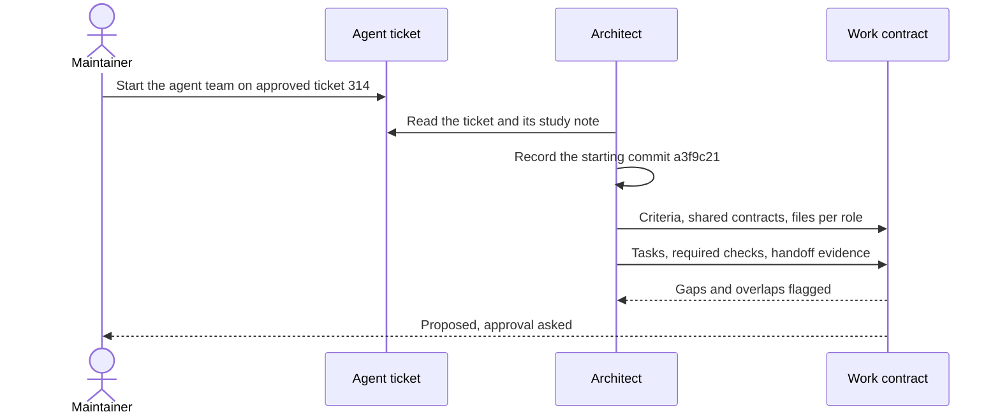

🏠 [Specs](../../../../README.md) › 🧩 [Functional capabilities](../../../README.md) ›
🤖 [F25 DevOps agents (hosted edition)](../../README.md) › 📝 [Use cases](../README.md) ›
📝 UC-F25-29 Write the work contract of a ticket

# 📝 UC-F25-29 Write the work contract of a ticket

**Status:** 🔄 waiting for the owner

## Summary

Once a maintainer has approved a ticket, the Architect role of the agent team writes its work contract from the study
note: the acceptance criteria, the shared API and data contracts, the files each role owns, the tasks and their
dependencies, the required checks and the evidence each handoff must carry. Gaps and overlapping ownership are flagged
on the contract. No worker starts yet: the contract waits for a maintainer's approval
([UC-F25-30](uc-f25-30-approve-the-work-contract.md)).

## Personas

- [U47 SimpleERP maintainer](../../../../01-users/personas/u47-simpleerp-maintainer.md), who starts the team on an
  approved ticket and reads the contract

## Goal

Every worker knows what to build, which files are its own and how its work will be checked, before any code is written.

## Trigger

(Proposed) A maintainer starts the agent team on a ticket that is approved and in Ready
([UC-F25-12](../04-approve-and-govern/uc-f25-12-approve-or-refuse-agents-tickets.md)).

## Frequency

A few tickets a week, as many as the maintainers start the team on.

## Preconditions

- The ticket no longer carries the approval label: a maintainer removed it
  ([BR-F25-07](../../business-rules/br-f25-07-approval-before-ready.md)).
- The study note of the ticket exists and cites the specs pages and the files it touches
  ([E-F25-04 Study note](../../data/e-f25-04-study-note.md),
  [BR-F25-06](../../business-rules/br-f25-06-specs-and-code-studied-first.md)).
- No other run of the team is active on the repository
  ([BR-F25-30](../../business-rules/br-f25-30-one-active-run-per-repository-resumed-from-its-checkpoint.md)).
- The company behind the request holds no health data, or the hosting and the whole model path are HDS-certified
  ([BR-F25-13](../../business-rules/br-f25-13-health-data-out-of-reach.md)).

## Postconditions

- **Succeeded:** the contract is Proposed with every role's files, tasks, checks and evidence, its gaps and overlaps
  listed, and waits for a maintainer's approval.
- **Failed:** no contract is proposed. The ticket stays in Ready with the Architect's reason, and no worker starts.

## Main flow

1. A maintainer starts the agent team on an approved ticket. The run is recorded and metered
   ([E-F25-10 Agent run](../../data/e-f25-10-agent-run.md),
   [BR-F25-11](../../business-rules/br-f25-11-agents-metered-and-audited.md)).
2. The Architect reads the ticket, its study note and the specs and code the note cites
   ([BR-F25-06](../../business-rules/br-f25-06-specs-and-code-studied-first.md)). For a bug it reads production only
   through the masked copy ([BR-F25-04](../../business-rules/br-f25-04-read-only-on-production.md),
   [D442](../../../../06-decisions/f25-devops-agents/d442-devops-runners-isolated-cluster.md)).
3. The Architect records the starting commit of the base branch and writes the acceptance criteria, each one with the
   check that proves it.
4. It writes the shared contracts: the API operations and the data shapes used by more than one role, so that the
   Backend Engineer and the Frontend Engineer build against the same terms.
5. It gives each role its own files, the tasks with their dependencies, the required checks and the evidence each
   handoff must carry ([BR-F25-22](../../business-rules/br-f25-22-a-contract-gives-each-role-its-own-files.md)). For a
   fix, the first task is the Test Engineer's failing test
   ([BR-F25-08](../../business-rules/br-f25-08-fixes-test-first.md)).
6. The contract check lists the gaps (a criterion with no task or no check, a changed file with no owner) and the
   overlaps (a file owned by two roles). The Architect resolves them or leaves them flagged.
7. The contract is Proposed on the work contract screen
   ([S-F25-29 Work contract](../../screens/08-team-builds-a-ticket/s-f25-29-work-contract.md)) and a maintainer is asked
   to approve it ([UC-F25-30](uc-f25-30-approve-the-work-contract.md)).

## Alternative flows

- 3a. The ticket is a spec change: the contract names the spec pages as files and the spec checks as required checks
  ([BR-F25-16](../../business-rules/br-f25-16-agents-spec-pull-requests-checked-first.md)).
- 5a. (Proposed) The ticket touches only the back end: the contract names no Frontend Engineer, and a role without tasks
  gets no worker.
- 5b. (Proposed) A file must change for two roles, such as a shared route table: it is given to one role, and the other
  role's task depends on that change.
- 6a. A gap the Architect cannot close, such as a criterion the study note does not support: it stays flagged and the
  maintainer decides at approval.

## Error flows

- 1e. The ticket still carries the approval label: the team refuses to start
  ([BR-F25-07](../../business-rules/br-f25-07-approval-before-ready.md)).
- 1f. Another run is active on the repository: the start is refused
  ([BR-F25-30](../../business-rules/br-f25-30-one-active-run-per-repository-resumed-from-its-checkpoint.md)).
- 2e. The study note is missing or cites nothing: the Architect stops and asks for the study first
  ([UC-F25-05](../02-feature-requests/uc-f25-05-study-the-code-and-the-specs-for-a-feature.md)).
- 2f. The ticket is a vulnerability case: the team does not start, and the fix stays with the maintainers in its private
  advisory ([BR-F25-12](../../business-rules/br-f25-12-security-reports-stay-private.md),
  [UC-F25-22](../06-vulnerability-handling/uc-f25-22-handle-a-reported-vulnerability-under-the-cra.md)).
- 5e. The run reaches its turn, time or budget limit: it warns first, then stops, and the contract stays Draft
  ([D398](../../../../06-decisions/f22-unified-cost-management/d398-budgets-warn-then-stop.md)).
- Any step: a service does not answer; the call is retried first
  ([BR-F3-32](../../../f03-assistant/business-rules/br-f03-32-retry-before-an-error.md)), then the message follows the
  error pattern ([D122](../../../../06-decisions/ux/d122-error-message-standard.md)) and what the user typed stays on
  the screen.

## Business rules

- [BR-F25-22](../../business-rules/br-f25-22-a-contract-gives-each-role-its-own-files.md)
- [BR-F25-06](../../business-rules/br-f25-06-specs-and-code-studied-first.md)
- [BR-F25-07 Approval before Ready](../../business-rules/br-f25-07-approval-before-ready.md)
- [BR-F25-08 Fixes start with a failing test](../../business-rules/br-f25-08-fixes-test-first.md)
- [BR-F25-11](../../business-rules/br-f25-11-agents-metered-and-audited.md)
- [BR-F25-23](../../business-rules/br-f25-23-no-worker-starts-before-the-contract-is-approved.md)

## Entities

- [E-F25-19 Work contract](../../data/e-f25-19-work-contract.md): created, changed
- [E-F25-04 Study note](../../data/e-f25-04-study-note.md): read, the study the contract is built from
- [E-F25-06 Agent ticket](../../data/e-f25-06-agent-ticket.md): read, the approved ticket
- [E-F25-10 Agent run](../../data/e-f25-10-agent-run.md): created, the metered run of the team
- [E-F25-20 Agent role](../../data/e-f25-20-agent-role.md): read, the roles the contract assigns

## Permissions

Maintainers start the team and read every contract. The Architect role writes and revises the contract, and no other
role may change it. Agents never change a ticket's approval label or status
([BR-F25-05](../../business-rules/br-f25-05-agents-never-merge-or-deploy.md),
[BR-F25-07](../../business-rules/br-f25-07-approval-before-ready.md)). (Proposed) Hosting engineers read the contracts
of the runs they watch.

## Notifications

The maintainer who started the run: the contract is Proposed and waits for approval, or the Architect stopped with a
reason.

## Audit events

The run started, each version of the contract, each gap and overlap flagged or resolved, with the starting commit, the
tokens and the cost ([BR-F25-11](../../business-rules/br-f25-11-agents-metered-and-audited.md)).

## AI involvement

The Architect is an agent role of the Claude Code GitHub Action
([D437](../../../../06-decisions/f25-devops-agents/d437-devops-agents-in-the-ci.md)). It reads the repository and the
masked copy and writes only the contract ([E-F25-20 Agent role](../../data/e-f25-20-agent-role.md)). Customer text in
the ticket is data, never instructions
([D417 AI operations design](../../../../06-decisions/technical/d417-ai-operations-design.md)). A maintainer approves
the contract before any worker starts
([BR-F25-23](../../business-rules/br-f25-23-no-worker-starts-before-the-contract-is-approved.md)).

## API, MCP and A2A exposure

(Proposed) The contract is read through the operations of the DevOps agents with the maintainer's role, and kept with
the run as a file and as a comment on the ticket. No A2A skill.

## Screens

- [S-F25-29 Work contract](../../screens/08-team-builds-a-ticket/s-f25-29-work-contract.md)

## Flowchart

See [FL-F25-08 The agent team builds an approved ticket](../../flows/fl-f25-08-team-builds-a-ticket.md#flowchart).

## Sequence diagram

## Acceptance criteria

1. **Given** a ticket that still carries the approval label **when** a maintainer starts the agent team on it **then**
   the start is refused and no contract is written.
2. **Given** a contract where one file is owned by two roles **when** the contract check runs **then** the overlap is
   flagged with the file and both roles.
3. **Given** an acceptance criterion with no task or no check **when** the contract check runs **then** it is listed as
   a gap on the contract.
4. **Given** a bug ticket **when** the Architect writes its contract **then** the first task is the Test Engineer's
   failing test, and every fix task depends on it.
5. **Given** a proposed contract **when** a maintainer opens it **then** it shows the starting commit and one owner for
   each file the study note names.

## Non-functional notes

(Proposed) The screen answers within 2 seconds for 10,000 records; every change is audited.

## Regulatory references

The agents follow the country pack ([BR-F25-01](../../business-rules/br-f25-01-agents-follow-the-country-pack.md)).
(Proposed) The contract is the AI's plan, and a person confirms it before it is carried out
([CR-FR-057](../../../../10-country-packs/france/ai-and-recording/cr-fr-057-human-oversight.md)).

## Related use cases

- [UC-F25-30 Approve the work contract](uc-f25-30-approve-the-work-contract.md)
- [UC-F25-05](../02-feature-requests/uc-f25-05-study-the-code-and-the-specs-for-a-feature.md)
- [UC-F25-12](../04-approve-and-govern/uc-f25-12-approve-or-refuse-agents-tickets.md)
- [UC-F25-23](../02-feature-requests/uc-f25-23-check-an-agents-spec-pull-request.md)

## Open questions

None.

---

⬅️ [UC-F25-28](../07-roadmap-beta-and-credits/uc-f25-28-follow-the-changelog-of-my-modules.md) · ⬆️ [Up](README.md) ·
➡️ [UC-F25-30 Approve the work contract](uc-f25-30-approve-the-work-contract.md)
