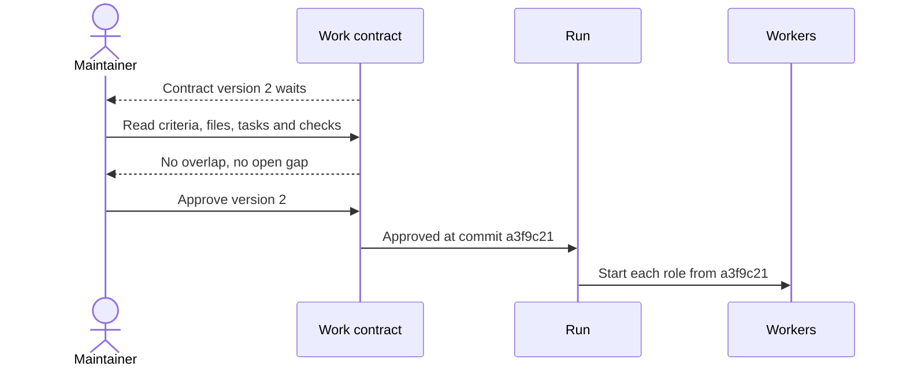

🏠 [Specs](../../../../README.md) › 🧩 [Functional capabilities](../../../README.md) ›
🤖 [F25 DevOps agents (hosted edition)](../../README.md) › 📝 [Use cases](../README.md) ›
📝 UC-F25-30 Approve the work contract

# 📝 UC-F25-30 Approve the work contract

**Status:** 🔄 waiting for the owner

## Summary

A maintainer reads the proposed work contract of a ticket and approves it, asks for a revision or refuses it. Only an
approved contract lets the workers start, and an overlap must be resolved first. An approval belongs to one version of
the contract: a later change needs a new approval. It adds to the ticket's approval
([BR-F25-07](../../business-rules/br-f25-07-approval-before-ready.md)) and to the review of the pull request
([D434](../../../../06-decisions/f25-devops-agents/d434-maintainer-approval-label.md)), and replaces neither.

## Personas

- [U47 SimpleERP maintainer](../../../../01-users/personas/u47-simpleerp-maintainer.md), who approves, sends back or
  refuses the contract

## Goal

No worker writes code on a plan a maintainer has not seen, and the maintainer decides once, on one page, how the work is
shared.

## Trigger

The Architect proposes a contract ([UC-F25-29](uc-f25-29-write-the-work-contract-of-a-ticket.md)), or a new version
after a revision or a conflict
([BR-F25-26](../../business-rules/br-f25-26-a-conflict-goes-back-to-the-architect-never-guessed.md)).

## Frequency

Once or twice per ticket the team works on.

## Preconditions

- A contract is Proposed with its starting commit ([E-F25-19 Work contract](../../data/e-f25-19-work-contract.md)).
- The ticket is still approved and in Ready ([BR-F25-07](../../business-rules/br-f25-07-approval-before-ready.md)).
- The user is a maintainer ([U47 SimpleERP maintainer](../../../../01-users/personas/u47-simpleerp-maintainer.md)).

## Postconditions

- **Succeeded:** the contract is Approved for its version, and the workers start from its starting commit
  ([UC-F25-31](uc-f25-31-build-in-isolated-worktrees.md)).
- **Failed:** the contract goes back to Draft with the maintainer's comment, or is Refused and the run stops. No worker
  starts.

## Main flow

1. The maintainer is told that a contract waits, and opens the contract approval screen
   ([S-F25-30](../../screens/08-team-builds-a-ticket/s-f25-30-contract-approval.md)).
2. The screen shows the criteria with their checks, the roles with their files and tasks, the dependency order, the
   required checks, the evidence asked and the run's cost so far
   ([BR-F25-11](../../business-rules/br-f25-11-agents-metered-and-audited.md)).
3. The maintainer checks that no overlap is left
   ([BR-F25-22](../../business-rules/br-f25-22-a-contract-gives-each-role-its-own-files.md)).
4. The maintainer approves the contract. The approval records the maintainer, the version and the starting commit
   ([BR-F25-23](../../business-rules/br-f25-23-no-worker-starts-before-the-contract-is-approved.md)).
5. The workers of the roles that have tasks start, each from the starting commit
   ([UC-F25-31](uc-f25-31-build-in-isolated-worktrees.md)).

## Alternative flows

- 3a. The maintainer wants a change: they ask for a revision with a comment. The contract goes back to Draft and the
  Architect writes a new version ([UC-F25-29](uc-f25-29-write-the-work-contract-of-a-ticket.md)).
- 3b. (Proposed) The maintainer accepts a flagged gap on purpose, such as a criterion checked by hand: they write why,
  and the gap is shown as accepted. An overlap can never be accepted.
- 4a. (Proposed) The base branch moved since the starting commit: the maintainer approves as is, or asks the Architect
  to record the new head and check the contract again.
- 4b. A new version after a conflict ([UC-F25-33](uc-f25-33-integrate-the-workers-commits.md)): the changed parts are
  highlighted, and the earlier approval no longer counts.

## Error flows

- 3e. An overlap remains: Approve is refused and the overlap is shown
  ([BR-F25-22](../../business-rules/br-f25-22-a-contract-gives-each-role-its-own-files.md)).
- 4e. An agent role, or a user who is not a maintainer, tries to approve: refused and audited
  ([BR-F25-05](../../business-rules/br-f25-05-agents-never-merge-or-deploy.md)).
- 4f. The ticket got its approval label back or left Ready: the approval is refused and the run stops
  ([BR-F25-07](../../business-rules/br-f25-07-approval-before-ready.md)).
- Any step: a service does not answer; the call is retried first
  ([BR-F3-32](../../../f03-assistant/business-rules/br-f03-32-retry-before-an-error.md)), then the message follows the
  error pattern ([D122](../../../../06-decisions/ux/d122-error-message-standard.md)) and what the user typed stays on
  the screen.

## Business rules

- [BR-F25-23](../../business-rules/br-f25-23-no-worker-starts-before-the-contract-is-approved.md)
- [BR-F25-05](../../business-rules/br-f25-05-agents-never-merge-or-deploy.md)
- [BR-F25-07 Approval before Ready](../../business-rules/br-f25-07-approval-before-ready.md)
- [BR-F25-22](../../business-rules/br-f25-22-a-contract-gives-each-role-its-own-files.md)

## Entities

- [E-F25-19 Work contract](../../data/e-f25-19-work-contract.md): changed, the contract approved, sent back or refused
- [E-F25-08 Approval](../../data/e-f25-08-approval.md): read, the ticket's approval it relies on
- [E-F25-10 Agent run](../../data/e-f25-10-agent-run.md): read, the run's cost so far

## Permissions

Only maintainers approve, send back or refuse a contract. Agent roles, hosting engineers and the requester cannot.
(Proposed) The maintainer who approved the ticket may also approve its contract, and no second maintainer is required.

## Notifications

The maintainer who started the run: a contract waits for approval. The Architect: the comment of a revision. (Proposed)
A reminder to the maintainers after 2 working days without a decision.

## Audit events

Each approval, revision asked and refusal, with the maintainer, the contract version, the starting commit and the
comment.

## AI involvement

No AI decides here: the approval is a maintainer's
([D434](../../../../06-decisions/f25-devops-agents/d434-maintainer-approval-label.md)). The AI assistant may summarise
the contract and its flags for the maintainer, and it cannot approve.

## API, MCP and A2A exposure

(Proposed) Approving is a maintainer's operation of the DevOps agents, refused to agent tokens and to the MCP tools. The
agents' GitHub App cannot approve
([D434](../../../../06-decisions/f25-devops-agents/d434-maintainer-approval-label.md)). No A2A skill.

## Screens

- [S-F25-30](../../screens/08-team-builds-a-ticket/s-f25-30-contract-approval.md)

## Flowchart

See [FL-F25-08 The agent team builds an approved ticket](../../flows/fl-f25-08-team-builds-a-ticket.md#flowchart).

## Sequence diagram

## Acceptance criteria

1. **Given** a proposed contract with an overlap **when** the maintainer approves it **then** the approval is refused
   and the overlap is shown.
2. **Given** an approved contract **when** the Architect changes it **then** it goes back to Draft and no worker starts
   a new task until a maintainer approves the new version.
3. **Given** a proposed contract **when** an agent role or a user who is not a maintainer tries to approve it **then**
   it is refused and the attempt is audited.
4. **Given** an approved contract **when** the workers start **then** each worker starts from the recorded starting
   commit.
5. **Given** a ticket whose approval label was put back **when** the maintainer approves its contract **then** the
   approval is refused and the run stops.

## Non-functional notes

(Proposed) The screen answers within 2 seconds for 10,000 records; every change is audited.

## Regulatory references

(Proposed) The contract is the AI's plan, and the maintainer's approval is the person confirming it before it is carried
out ([CR-FR-057](../../../../10-country-packs/france/ai-and-recording/cr-fr-057-human-oversight.md)).

## Related use cases

- [UC-F25-29](uc-f25-29-write-the-work-contract-of-a-ticket.md)
- [UC-F25-31 Build in isolated worktrees](uc-f25-31-build-in-isolated-worktrees.md)
- [UC-F25-12](../04-approve-and-govern/uc-f25-12-approve-or-refuse-agents-tickets.md)
- [UC-F25-13](../04-approve-and-govern/uc-f25-13-ask-the-agents-for-changes.md)

## Open questions

None.

---

⬅️ [UC-F25-29 Write the work contract of a ticket](uc-f25-29-write-the-work-contract-of-a-ticket.md) ·
⬆️ [Up](README.md) · ➡️ [UC-F25-31 Build in isolated worktrees](uc-f25-31-build-in-isolated-worktrees.md)
