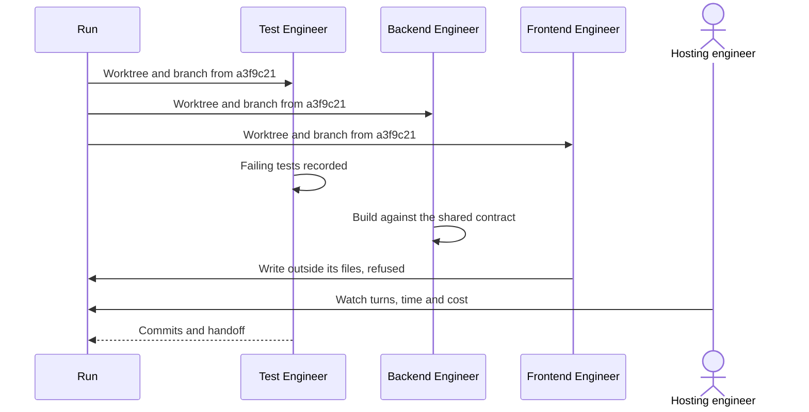

🏠 [Specs](../../../../README.md) › 🧩 [Functional capabilities](../../../README.md) ›
🤖 [F25 DevOps agents (hosted edition)](../../README.md) › 📝 [Use cases](../README.md) ›
📝 UC-F25-31 Build in isolated worktrees

# 📝 UC-F25-31 Build in isolated worktrees

**Status:** ✅ specified

## Summary

Once the contract is approved, each implementation role (Test Engineer, Backend Engineer, Frontend Engineer) works in
its own git worktree and branch, created from the contract's starting commit, and edits only the files its role owns.
The Test Engineer writes the failing tests first. Workers build against the shared contracts, not against each other's
code, so they can run side by side. The maintainer and the hosting engineer follow each worker's tools, turns, time and
cost.

## Personas

- [U47 SimpleERP maintainer](../../../../01-users/personas/u47-simpleerp-maintainer.md), who follows the workers and
  stops one when needed
- [U48 Hosting engineer](../../../../01-users/personas/u48-hosting-engineer.md), who watches the runners, the limits and
  the costs

## Goal

Workers never step on each other's files, every change starts from the same known commit, and a failed worker can be
thrown away without touching the others.

## Trigger

A maintainer approves the work contract ([UC-F25-30](uc-f25-30-approve-the-work-contract.md)).

## Frequency

Two to four workers per ticket the team builds.

## Preconditions

- The work contract is Approved
  ([BR-F25-23](../../business-rules/br-f25-23-no-worker-starts-before-the-contract-is-approved.md)).
- The roles and their tools are set ([E-F25-20 Agent role](../../data/e-f25-20-agent-role.md),
  [UC-F25-17](../04-approve-and-govern/uc-f25-17-control-the-agents-rights-and-audit.md)).
- Runners of the isolated cluster are free
  ([D442](../../../../06-decisions/f25-devops-agents/d442-devops-runners-isolated-cluster.md)).

## Postconditions

- **Succeeded:** each worker has committed on its own branch from the starting commit, only in its own files, and hands
  over its result ([UC-F25-32](uc-f25-32-hand-over-a-workers-result.md)).
- **Failed:** the worker stops with its blockers. Its worktree and its commits are kept for the handoff, and the other
  workers are not touched.

## Main flow

1. For each role with tasks, the run creates one worktree and one branch from the contract's starting commit, and
   records both ([BR-F25-24](../../business-rules/br-f25-24-one-role-one-worktree-one-starting-commit.md)).
2. The Test Engineer writes the tests of the acceptance criteria first and records them failing
   ([BR-F25-08](../../business-rules/br-f25-08-fixes-test-first.md)).
3. The Backend Engineer and the Frontend Engineer build against the shared contracts, each in its own worktree.
4. Each worker edits only the files its role owns. A write outside them is refused by the tool and recorded as a blocker
   ([BR-F25-22](../../business-rules/br-f25-22-a-contract-gives-each-role-its-own-files.md)).
5. Each worker runs the required checks of its role in its worktree, with the test and check commands only
   ([D437](../../../../06-decisions/f25-devops-agents/d437-devops-agents-in-the-ci.md)).
6. The maintainer and the hosting engineer follow the workers on the agent workers screen
   ([S-F25-31 Agent workers](../../screens/08-team-builds-a-ticket/s-f25-31-agent-workers.md)): role, branch, task,
   tools, turns, cost and blockers.
7. Each worker commits on its branch and hands over ([UC-F25-32](uc-f25-32-hand-over-a-workers-result.md)).

## Alternative flows

- 1a. A role has no task in the contract: no worktree is created for it.
- 2a. A bug: the Test Engineer reproduces it on the masked copy, read-only, before writing the failing test
  ([BR-F25-04](../../business-rules/br-f25-04-read-only-on-production.md),
  [UC-F25-08](../03-bugs/uc-f25-08-reproduce-a-bug-on-the-managed-simpleerp.md)).
- 3a. A task depends on another role's task: the worker builds against the shared contract, and the dependency sets the
  order of integration ([UC-F25-33](uc-f25-33-integrate-the-workers-commits.md)).
- 6a. The hosting engineer sees a worker stuck or a runner short of resources: they stop that worker, whose
  worktree and commits are kept for its handoff with a blocker.

## Error flows

- 2e. The new test passes at once: the bug is not reproduced. The Test Engineer reports a blocker and no fix is written
  ([BR-F25-08](../../business-rules/br-f25-08-fixes-test-first.md)).
- 2f. A worker would read the masked copy of a company holding health data: refused, and the request goes to a person
  ([BR-F25-13](../../business-rules/br-f25-13-health-data-out-of-reach.md)).
- 4e. A worker tries to edit a file of another role: the write is refused and recorded as a blocker
  ([BR-F25-22](../../business-rules/br-f25-22-a-contract-gives-each-role-its-own-files.md)).
- 5e. A worker reaches its turn, time or budget limit: it is warned, then stopped, and hands over with the blocker
  ([D398](../../../../06-decisions/f22-unified-cost-management/d398-budgets-warn-then-stop.md),
  [BR-F25-11](../../business-rules/br-f25-11-agents-metered-and-audited.md)).
- Any step: a service does not answer; the call is retried first
  ([BR-F3-32](../../../f03-assistant/business-rules/br-f03-32-retry-before-an-error.md)), then the message follows the
  error pattern ([D122](../../../../06-decisions/ux/d122-error-message-standard.md)) and what the user typed stays on
  the screen.

## Business rules

- [BR-F25-24](../../business-rules/br-f25-24-one-role-one-worktree-one-starting-commit.md)
- [BR-F25-04 Read-only on production](../../business-rules/br-f25-04-read-only-on-production.md)
- [BR-F25-08 Fixes start with a failing test](../../business-rules/br-f25-08-fixes-test-first.md)
- [BR-F25-11](../../business-rules/br-f25-11-agents-metered-and-audited.md)
- [BR-F25-13](../../business-rules/br-f25-13-health-data-out-of-reach.md)
- [BR-F25-22](../../business-rules/br-f25-22-a-contract-gives-each-role-its-own-files.md)

## Entities

- [E-F25-20 Agent role](../../data/e-f25-20-agent-role.md): read, the roles with their tools and limits
- [E-F25-19 Work contract](../../data/e-f25-19-work-contract.md): read, the approved contract
- [E-F25-10 Agent run](../../data/e-f25-10-agent-run.md): created, one metered run per worker
- [E-F25-07 Reproduction](../../data/e-f25-07-reproduction.md): created, the reproduction of a bug

## Permissions

Maintainers follow and stop workers and change the roles' tools and limits. Hosting engineers follow and stop workers
and set the runners' limits ([UC-F25-17](../04-approve-and-govern/uc-f25-17-control-the-agents-rights-and-audit.md)).
Each agent role holds only the tools its record lists. No role may merge, deploy or move a ticket
([BR-F25-05](../../business-rules/br-f25-05-agents-never-merge-or-deploy.md)).

## Notifications

The maintainer: a worker stopped with a blocker, a limit reached. The hosting engineer: a runner short of resources, a
budget warning ([D398](../../../../06-decisions/f22-unified-cost-management/d398-budgets-warn-then-stop.md)).

## Audit events

Each worktree and branch created with its starting commit, each worker started and stopped, each write refused, each
check run with its exit code, and the turns and cost of each worker
([BR-F25-11](../../business-rules/br-f25-11-agents-metered-and-audited.md)).

## AI involvement

The workers are agent roles of the Claude Code GitHub Action, each with the tools of its role
([D437](../../../../06-decisions/f25-devops-agents/d437-devops-agents-in-the-ci.md)). Customer text is data, never
instructions ([D417 AI operations design](../../../../06-decisions/technical/d417-ai-operations-design.md)). A worker's
code reaches the product only through the maintainer's review
([D434](../../../../06-decisions/f25-devops-agents/d434-maintainer-approval-label.md)).

## API, MCP and A2A exposure

Workers are read and stopped through the operations of the DevOps agents with the maintainer's or the hosting
engineer's role. No A2A skill.

## Screens

- [S-F25-31 Agent workers](../../screens/08-team-builds-a-ticket/s-f25-31-agent-workers.md)

## Flowchart

See [FL-F25-08 The agent team builds an approved ticket](../../flows/fl-f25-08-team-builds-a-ticket.md#flowchart).

## Sequence diagram

## Acceptance criteria

1. **Given** an approved contract with three roles that have tasks **when** the workers start **then** each has its own
   worktree and branch from the same recorded starting commit.
2. **Given** a worker **when** it tries to write a file its role does not own **then** the write is refused and recorded
   as a blocker.
3. **Given** a bug ticket **when** the Test Engineer writes its test **then** the test is recorded failing before any
   fix commit exists.
4. **Given** a worker that reaches its budget **when** the limit passes **then** it is warned, then stopped, and its
   commits stay on its branch.
5. **Given** the Code Reviewer's role record **when** a maintainer opens it **then** its tools are listed and none of
   them writes a file or commits.

## Non-functional notes

The screen answers within 2 seconds for 10,000 records; every change is audited.

## Regulatory references

The agents read production only on a masked copy
([BR-F25-04](../../business-rules/br-f25-04-read-only-on-production.md)) and follow the country pack
([BR-F25-01](../../business-rules/br-f25-01-agents-follow-the-country-pack.md)). Health data stays out of their reach
([BR-F25-13](../../business-rules/br-f25-13-health-data-out-of-reach.md)).

## Related use cases

- [UC-F25-30 Approve the work contract](uc-f25-30-approve-the-work-contract.md)
- [UC-F25-32 Hand over a worker's result](uc-f25-32-hand-over-a-workers-result.md)
- [UC-F25-08](../03-bugs/uc-f25-08-reproduce-a-bug-on-the-managed-simpleerp.md)
- [UC-F25-10](../03-bugs/uc-f25-10-propose-the-fix-as-a-pull-request-tests-first.md)
- [UC-F25-17](../04-approve-and-govern/uc-f25-17-control-the-agents-rights-and-audit.md)
- [UC-F25-18](../04-approve-and-govern/uc-f25-18-follow-the-agents-costs-and-budgets.md)

## Open questions

None.

---

⬅️ [UC-F25-30 Approve the work contract](uc-f25-30-approve-the-work-contract.md) · ⬆️ [Up](README.md) ·
➡️ [UC-F25-32 Hand over a worker's result](uc-f25-32-hand-over-a-workers-result.md)
