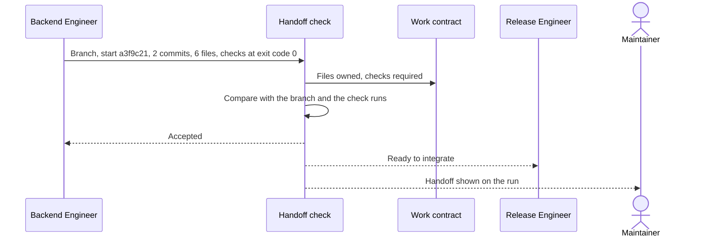

🏠 [Specs](../../../../README.md) › 🧩 [Functional capabilities](../../../README.md) ›
🤖 [F25 DevOps agents (hosted edition)](../../README.md) › 📝 [Use cases](../README.md) ›
📝 UC-F25-32 Hand over a worker's result

# 📝 UC-F25-32 Hand over a worker's result

**Status:** 🔄 waiting for the owner

## Summary

When a worker finishes or stops, it hands over a structured result: its role, worktree, branch and starting commit, its
commits in order, the files it changed, each check it ran with its exit code, and its blockers. The handoff is checked
against the branch, the recorded check runs and the contract. A missing commit, a missing check, a file of another role
or a different starting commit refuses it. The maintainer reads every handoff of the run.

## Personas

- [U47 simple-ERP maintainer](../../../../01-users/personas/u47-simple-erp-maintainer.md), who reads the handoffs and
  decides on the blocked ones

## Goal

The Release Engineer and the maintainer rely on facts the tooling checked, not on a worker's own words.

## Trigger

A worker finishes its tasks, is stopped, or reaches a limit ([UC-F25-31](uc-f25-31-build-in-isolated-worktrees.md)).

## Frequency

Once per worker, and again after each repair cycle ([UC-F25-35](uc-f25-35-repair-a-rejected-candidate.md)).

## Preconditions

- The worker ran from the contract's starting commit in its own worktree
  ([BR-F25-24](../../business-rules/br-f25-24-one-role-one-worktree-one-starting-commit.md)).
- The approved contract lists the evidence a handoff must carry
  ([E-F25-19 Work contract](../../data/e-f25-19-work-contract.md)).

## Postconditions

- **Succeeded:** the handoff is Accepted, and its commits wait for integration
  ([UC-F25-33](uc-f25-33-integrate-the-workers-commits.md)).
- **Failed:** the handoff is Refused with the reason, or Blocked for a maintainer to decide. Nothing of it is
  integrated.

## Main flow

1. The worker writes its handoff: role, worktree, branch, starting commit, commits in order, changed files, checks with
   their commands and exit codes, and blockers
   ([BR-F25-25](../../business-rules/br-f25-25-a-handoff-without-its-commits-and-checks-is-refused.md)).
2. The handoff check compares it with the facts: the branch's commits after the starting commit, the files they change
   and the recorded check runs.
3. It checks every changed file against the role's ownership
   ([BR-F25-22](../../business-rules/br-f25-22-a-contract-gives-each-role-its-own-files.md)) and every required check of
   the role against its recorded exit code.
4. For a fix, it checks that the failing test was recorded before the fix commit
   ([BR-F25-08](../../business-rules/br-f25-08-fixes-test-first.md)).
5. The handoff is Accepted and shown on the worker handoff screen
   ([S-F25-32 Worker handoff](../../screens/08-team-builds-a-ticket/s-f25-32-worker-handoff.md)).
6. When every handoff a task depends on is Accepted, the integration may start
   ([UC-F25-33](uc-f25-33-integrate-the-workers-commits.md)).

## Alternative flows

- 1a. The worker stopped at a limit or on a blocker it cannot clear: the handoff carries its commits so far and the
  blocker, and is Blocked. The maintainer clears the blocker or stops the run.
- 2a. The Test Engineer's handoff carries the failing run of each new test with the commit that adds it.
- 6a. A repair cycle gives a new handoff for the same role: it is checked the same way, and the earlier one stays in the
  history ([UC-F25-35](uc-f25-35-repair-a-rejected-candidate.md)).

## Error flows

- 1e. The starting commit differs from the contract's: Refused
  ([BR-F25-24](../../business-rules/br-f25-24-one-role-one-worktree-one-starting-commit.md)).
- 2e. A listed commit is not on the branch, or a commit on the branch is not listed: Refused, and the commit is named
  ([BR-F25-25](../../business-rules/br-f25-25-a-handoff-without-its-commits-and-checks-is-refused.md)).
- 3e. A changed file belongs to another role: Refused, and the file and its owner are named
  ([BR-F25-22](../../business-rules/br-f25-22-a-contract-gives-each-role-its-own-files.md)).
- 3f. A required check is missing or has no exit code: Refused.
- 4e. The fix commit comes before the failing test: Refused
  ([BR-F25-08](../../business-rules/br-f25-08-fixes-test-first.md)).
- Any step: a service does not answer; the call is retried first
  ([BR-F3-32](../../../f03-assistant/business-rules/br-f03-32-retry-before-an-error.md)), then the message follows the
  error pattern ([D122](../../../../06-decisions/ux/d122-error-message-standard.md)) and what the user typed stays on
  the screen.

## Business rules

- [BR-F25-25](../../business-rules/br-f25-25-a-handoff-without-its-commits-and-checks-is-refused.md)
- [BR-F25-08 Fixes start with a failing test](../../business-rules/br-f25-08-fixes-test-first.md)
- [BR-F25-11](../../business-rules/br-f25-11-agents-metered-and-audited.md)
- [BR-F25-22](../../business-rules/br-f25-22-a-contract-gives-each-role-its-own-files.md)
- [BR-F25-24](../../business-rules/br-f25-24-one-role-one-worktree-one-starting-commit.md)

## Entities

- [E-F25-21 Worker handoff](../../data/e-f25-21-worker-handoff.md): created, changed
- [E-F25-19 Work contract](../../data/e-f25-19-work-contract.md): read, the evidence asked and the files owned
- [E-F25-20 Agent role](../../data/e-f25-20-agent-role.md): read, the role that hands over
- [E-F25-10 Agent run](../../data/e-f25-10-agent-run.md): read, the worker's metered run

## Permissions

A worker writes its own handoff only, and the handoff check accepts or refuses it. Maintainers read every handoff and
decide on the blocked ones. Nobody edits a handoff once it is Accepted. (Proposed) Hosting engineers read the handoffs
of the runs they watch.

## Notifications

The maintainer: a handoff Blocked, or Refused twice for the same worker. The Release Engineer: each handoff it waits for
is Accepted.

## Audit events

Each handoff submitted, checked, accepted, refused or blocked, with the reason, the commits, the files and the exit
codes ([BR-F25-11](../../business-rules/br-f25-11-agents-metered-and-audited.md)).

## AI involvement

The handoff is written by an agent role and checked by a deterministic check, not by an AI
([D417 AI operations design](../../../../06-decisions/technical/d417-ai-operations-design.md)). The AI assistant may
summarise the blockers for the maintainer.

## API, MCP and A2A exposure

(Proposed) Handoffs are read through the operations of the DevOps agents with the maintainer's role and attached to the
run as a file. An agent token may submit its own handoff and nothing else. No A2A skill.

## Screens

- [S-F25-32 Worker handoff](../../screens/08-team-builds-a-ticket/s-f25-32-worker-handoff.md)

## Flowchart

See [FL-F25-08 The agent team builds an approved ticket](../../flows/fl-f25-08-team-builds-a-ticket.md#flowchart).

## Sequence diagram

## Acceptance criteria

1. **Given** a handoff that lists 2 commits while its branch holds 3 after the starting commit **when** it is checked
   **then** it is refused and the missing commit is named.
2. **Given** a handoff with a required check that has no exit code **when** it is checked **then** it is refused.
3. **Given** a handoff whose commits change a file another role owns **when** it is checked **then** it is refused and
   the file and its owner are named.
4. **Given** a complete handoff with every required check at exit code 0 **when** it is checked **then** it is Accepted
   and the Release Engineer is told.
5. **Given** a fix handoff whose fix commit comes before the failing test **when** it is checked **then** it is refused.

## Non-functional notes

(Proposed) The screen answers within 2 seconds for 10,000 records; every change is audited.

## Regulatory references

None specific to this use case beyond the rules above. Each handoff is part of what a run keeps of what it read and
wrote ([BR-F25-11](../../business-rules/br-f25-11-agents-metered-and-audited.md)).

## Related use cases

- [UC-F25-31 Build in isolated worktrees](uc-f25-31-build-in-isolated-worktrees.md)
- [UC-F25-33 Integrate the workers' commits](uc-f25-33-integrate-the-workers-commits.md)
- [UC-F25-10](../03-bugs/uc-f25-10-propose-the-fix-as-a-pull-request-tests-first.md)
- [UC-F25-34 Verify the candidate commit](uc-f25-34-verify-the-candidate-commit.md)
- [UC-F25-35 Repair a rejected candidate](uc-f25-35-repair-a-rejected-candidate.md)

## Open questions

None.

---

⬅️ [UC-F25-31 Build in isolated worktrees](uc-f25-31-build-in-isolated-worktrees.md) · ⬆️ [Up](README.md) ·
➡️ [UC-F25-33 Integrate the workers' commits](uc-f25-33-integrate-the-workers-commits.md)
