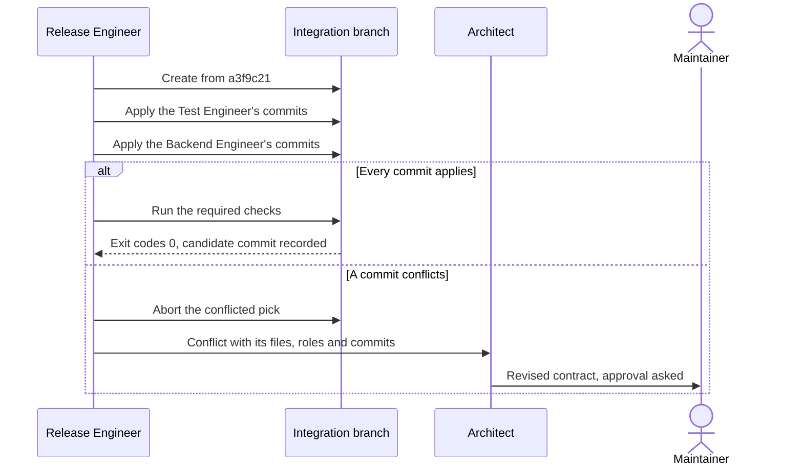

🏠 [Specs](../../../../README.md) › 🧩 [Functional capabilities](../../../README.md) ›
🤖 [F25 DevOps agents (hosted edition)](../../README.md) › 📝 [Use cases](../README.md) ›
📝 UC-F25-33 Integrate the workers' commits

# 📝 UC-F25-33 Integrate the workers' commits

**Status:** ✅ specified

## Summary

When the handoffs are Accepted, the Release Engineer creates an integration branch from the starting commit and applies
each worker's commits in the dependency order of the contract. It never resolves a conflict itself: the conflicted pick
is aborted, the integration stops, and the conflict goes back to the Architect, whose revised contract needs a
maintainer's approval. A clean integration gives one candidate commit for verification
([UC-F25-34](uc-f25-34-verify-the-candidate-commit.md)).

## Personas

- [U47 SimpleERP maintainer](../../../../01-users/personas/u47-simpleerp-maintainer.md), who follows the integration
  and approves a revised contract after a conflict

## Goal

One candidate commit holds every worker's change, in a known order, with no guessed merge.

## Trigger

Every handoff the integration needs is Accepted ([UC-F25-32](uc-f25-32-hand-over-a-workers-result.md)).

## Frequency

Once per run, and again after a repair cycle or a revised contract.

## Preconditions

- Every handoff of the contract's roles is Accepted
  ([BR-F25-25](../../business-rules/br-f25-25-a-handoff-without-its-commits-and-checks-is-refused.md)).
- The contract is Approved and has not changed since the workers started
  ([BR-F25-23](../../business-rules/br-f25-23-no-worker-starts-before-the-contract-is-approved.md)).

## Postconditions

- **Succeeded:** the integration branch holds every accepted commit in dependency order. Its head is the candidate
  commit, recorded for verification.
- **Failed:** the conflicted pick is aborted, the integration branch keeps only the commits applied cleanly before it,
  and the conflict is with the Architect. No candidate commit is recorded.

## Main flow

1. The Release Engineer creates the integration branch from the contract's starting commit
   ([BR-F25-24](../../business-rules/br-f25-24-one-role-one-worktree-one-starting-commit.md)).
2. It orders the accepted handoffs by the tasks' dependencies, as the contract sets them: the Test Engineer's tests
   first in the example.
3. It applies the commits in that order, one at a time, keeping each commit's role and message.
4. After the last commit it runs the required checks once on the integration branch and records their exit codes.
5. It records the head of the integration branch as the candidate commit, shown on the integration screen
   ([S-F25-33 Integration](../../screens/08-team-builds-a-ticket/s-f25-33-integration.md)).
6. The verification of the candidate starts ([UC-F25-34](uc-f25-34-verify-the-candidate-commit.md)).

## Alternative flows

- 1a. The base branch moved since the starting commit: the integration still starts from the starting commit,
  and bringing the branch up to date is left to the maintainer's review
  ([D434](../../../../06-decisions/f25-devops-agents/d434-maintainer-approval-label.md)).
- 2a. Two handoffs do not depend on each other: their commits are applied in the order of the contract's task
  numbers.
- 4a. A required check fails after a clean integration: the head is recorded as a rejected candidate and a
  repair cycle starts ([UC-F25-35](uc-f25-35-repair-a-rejected-candidate.md)).

## Error flows

- 1e. A handoff is not Accepted: the integration does not start
  ([BR-F25-25](../../business-rules/br-f25-25-a-handoff-without-its-commits-and-checks-is-refused.md)).
- 3e. A commit does not apply cleanly: the pick is aborted, the integration stops, and the conflict, with its files,
  roles and commits, goes to the Architect
  ([BR-F25-26](../../business-rules/br-f25-26-a-conflict-goes-back-to-the-architect-never-guessed.md)).
- 3f. The Architect's answer to the conflict changes the contract: it goes back to Draft and needs a new approval before
  any worker resumes ([BR-F25-23](../../business-rules/br-f25-23-no-worker-starts-before-the-contract-is-approved.md)).
- 4e. The run reaches its time or budget limit: it warns first, then stops, and keeps the integration branch for a
  resume from its checkpoint ([UC-F25-37](uc-f25-37-resume-an-interrupted-run.md),
  [D398](../../../../06-decisions/f22-unified-cost-management/d398-budgets-warn-then-stop.md)).
- Any step: a service does not answer; the call is retried first
  ([BR-F3-32](../../../f03-assistant/business-rules/br-f03-32-retry-before-an-error.md)), then the message follows the
  error pattern ([D122](../../../../06-decisions/ux/d122-error-message-standard.md)) and what the user typed stays on
  the screen.

## Business rules

- [BR-F25-26](../../business-rules/br-f25-26-a-conflict-goes-back-to-the-architect-never-guessed.md)
- [BR-F25-05](../../business-rules/br-f25-05-agents-never-merge-or-deploy.md)
- [BR-F25-11](../../business-rules/br-f25-11-agents-metered-and-audited.md)
- [BR-F25-23](../../business-rules/br-f25-23-no-worker-starts-before-the-contract-is-approved.md)
- [BR-F25-25](../../business-rules/br-f25-25-a-handoff-without-its-commits-and-checks-is-refused.md)

## Entities

- [E-F25-21 Worker handoff](../../data/e-f25-21-worker-handoff.md): changed, the handoffs integrated
- [E-F25-19 Work contract](../../data/e-f25-19-work-contract.md): read, the dependency order, and changed back to Draft
  on a conflict
- [E-F25-20 Agent role](../../data/e-f25-20-agent-role.md): read, the Release Engineer's tools
- [E-F25-10 Agent run](../../data/e-f25-10-agent-run.md): created, the metered run of the Release Engineer

## Permissions

The Release Engineer writes the integration branch only. It never merges into the base branch, never deploys and never
resolves a conflict ([BR-F25-05](../../business-rules/br-f25-05-agents-never-merge-or-deploy.md)). Maintainers follow
the integration and approve a revised contract. Hosting engineers read the integration of the runs they
watch.

## Notifications

The maintainer: a conflict sent to the Architect, a candidate commit recorded. The Architect: the conflict with its
files, roles and commits.

## Audit events

The integration branch created, each commit applied with its place in the order, each aborted pick with its conflict,
the checks with their exit codes, and the candidate commit
([BR-F25-11](../../business-rules/br-f25-11-agents-metered-and-audited.md)).

## AI involvement

The Release Engineer is an agent role with the tools of its record
([E-F25-20 Agent role](../../data/e-f25-20-agent-role.md)). It applies commits and runs checks, and it never edits a
file to make a commit apply
([BR-F25-26](../../business-rules/br-f25-26-a-conflict-goes-back-to-the-architect-never-guessed.md)).

## API, MCP and A2A exposure

The integration is read through the operations of the DevOps agents with the maintainer's role. No A2A skill.

## Screens

- [S-F25-33 Integration](../../screens/08-team-builds-a-ticket/s-f25-33-integration.md)

## Flowchart

See [FL-F25-08 The agent team builds an approved ticket](../../flows/fl-f25-08-team-builds-a-ticket.md#flowchart).

## Sequence diagram

## Acceptance criteria

1. **Given** three accepted handoffs where T0 comes before T1 and T1 before T3 **when** the Release Engineer integrates
   **then** their commits are applied in that order on a branch created from the starting commit.
2. **Given** a commit that conflicts **when** the Release Engineer applies it **then** the pick is aborted, no file is
   edited to resolve it, and the conflict goes to the Architect.
3. **Given** a conflict that leads the Architect to change the contract **when** the new version is proposed **then** no
   worker resumes before a maintainer approves it.
4. **Given** a clean integration with every required check at exit code 0 **when** the last commit is applied **then**
   the head is recorded as the candidate commit.
5. **Given** an integration that has ended **when** the maintainer opens the base branch **then** it is unchanged:
   nothing was merged or deployed.

## Non-functional notes

The screen answers within 2 seconds for 10,000 records; every change is audited.

## Regulatory references

None specific to this use case beyond the rules above.

## Related use cases

- [UC-F25-32 Hand over a worker's result](uc-f25-32-hand-over-a-workers-result.md)
- [UC-F25-34 Verify the candidate commit](uc-f25-34-verify-the-candidate-commit.md)
- [UC-F25-29](uc-f25-29-write-the-work-contract-of-a-ticket.md)
- [UC-F25-35 Repair a rejected candidate](uc-f25-35-repair-a-rejected-candidate.md)
- [UC-F25-37 Resume an interrupted run](uc-f25-37-resume-an-interrupted-run.md)

## Open questions

None.

---

⬅️ [UC-F25-32 Hand over a worker's result](uc-f25-32-hand-over-a-workers-result.md) · ⬆️ [Up](README.md) ·
➡️ [UC-F25-34 Verify the candidate commit](uc-f25-34-verify-the-candidate-commit.md)
