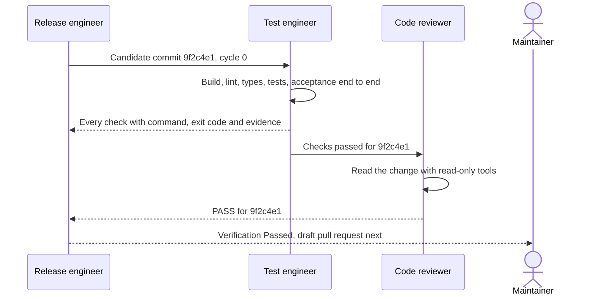

🏠 [Specs](../../../../README.md) › 🧩 [Functional capabilities](../../../README.md) ›
🤖 [F25 DevOps agents (hosted edition)](../../README.md) › 📝 [Use cases](../README.md) ›
📝 UC-F25-34 Verify the candidate commit

# 📝 UC-F25-34 Verify the candidate commit

**Status:** ✅ specified

## Summary

Once the release engineer has integrated the workers' commits into one candidate commit
([UC-F25-33](uc-f25-33-integrate-the-workers-commits.md)), the test engineer runs every required check of the approved
work contract on that exact commit: build, lint, types, tests, the acceptance criteria, and the real interactions
between the front end and the back end, not only mocks. Then the code reviewer, with read-only tools, returns PASS or
CHANGES_REQUESTED for that commit, with the file locations, the consequences and the required corrections. A PASS is an
extra gate before the maintainer, never a replacement.

## Personas

- [U47 SimpleERP maintainer](../../../../01-users/personas/u47-simpleerp-maintainer.md), who follows the verification
  and receives the blockers

## Goal

The maintainer receives only a commit that the team has checked as a whole and reviewed, with the proof, and never a
result that only looks green.

## Trigger

The release engineer names a candidate commit, first or after a repair
([UC-F25-35](uc-f25-35-repair-a-rejected-candidate.md)).

## Frequency

Once per candidate commit: one to three times per ticket.

## Preconditions

- The ticket is approved by a maintainer ([BR-F25-07](../../business-rules/br-f25-07-approval-before-ready.md)) and its
  work contract is approved
  ([BR-F25-23](../../business-rules/br-f25-23-no-worker-starts-before-the-contract-is-approved.md)).
- The contract ([E-F25-19 Work contract](../../data/e-f25-19-work-contract.md)) lists the required checks and the
  acceptance criteria.
- The release engineer has integrated the workers' commits into one candidate commit
  ([BR-F25-26](../../business-rules/br-f25-26-a-conflict-goes-back-to-the-architect-never-guessed.md)).

## Postconditions

- **Succeeded:** the verification is Passed for the candidate commit: every required check passed with its command, exit
  code and evidence, and the code reviewer returned PASS for that commit; the draft pull request may be opened
  ([UC-F25-36](uc-f25-36-open-the-draft-pull-request-with-its-evidence.md)).
- **Failed:** the verification is Changes requested or Blocked; the candidate goes to repair
  ([UC-F25-35](uc-f25-35-repair-a-rejected-candidate.md)) or its blockers go to the maintainer; nothing is offered for
  review.

## Main flow

1. The release engineer names the candidate commit by its full identifier; a verification opens for it on the candidate
   verification screen ([S-F25-34](../../screens/08-team-builds-a-ticket/s-f25-34-candidate-verification.md)).
2. The test engineer checks out that commit and runs each required check of the contract: build, lint, types, unit
   tests, then the acceptance criteria end to end on the built front end and back end with test data
   ([BR-F25-27](../../business-rules/br-f25-27-an-approval-belongs-to-one-commit.md)).
3. For each check it records the command, the exit code and the evidence (the raw output, the report, the screenshots of
   a screen). It never edits a source file and never weakens a test during the verification.
4. It lists the false-confidence signals it finds: a front end that passed only with mocks, unit tests without the full
   flow, an unchanged suite that does not cover the new acceptance criteria.
5. When every required check passed, the code reviewer reads the change with read-only tools and returns PASS or
   CHANGES_REQUESTED for that commit. Each finding gives the file and line, the consequence and the required correction.
6. A PASS makes the verification Passed for that commit only; the run goes on to the draft pull request
   ([UC-F25-36](uc-f25-36-open-the-draft-pull-request-with-its-evidence.md)).

## Alternative flows

- 2a. A fix of a bug: the test engineer also checks that the failing test recorded before the fix exists and now passes
  ([BR-F25-08](../../business-rules/br-f25-08-fixes-test-first.md)).
- 2b. A spec change in the ticket: the spec checks run first and their findings count as a failed check
  ([BR-F25-16](../../business-rules/br-f25-16-agents-spec-pull-requests-checked-first.md),
  [UC-F25-23](../02-feature-requests/uc-f25-23-check-an-agents-spec-pull-request.md)).
- 4a. A false-confidence signal is found while every check passed: the code reviewer cannot return PASS until a test
  covers the missing flow; the verification becomes Changes requested.
- 6a. Someone pushes a new commit to the branch after the PASS: the verification becomes Superseded and the new commit
  is verified again from step 1.

## Error flows

- 2e. A required check cannot run (a missing tool, a service of the test stack down, a test that crashes before it
  starts): the verification is Blocked, never Passed, and the reason is shown.
- 2f. A required check fails: the verification becomes Changes requested with the failing command, its exit code and its
  evidence, and goes to repair ([UC-F25-35](uc-f25-35-repair-a-rejected-candidate.md)).
- 3e. The test engineer edits a source file or a test during the verification: the edit is refused and recorded, and the
  verification starts again on the candidate commit.
- 5e. The code reviewer returns CHANGES_REQUESTED: the findings go to repair
  ([UC-F25-35](uc-f25-35-repair-a-rejected-candidate.md)).
- Any step: a service does not answer; the call is retried first
  ([BR-F3-32](../../../f03-assistant/business-rules/br-f03-32-retry-before-an-error.md)), then the message follows the
  error pattern ([D122](../../../../06-decisions/ux/d122-error-message-standard.md)) and what the user typed stays on
  the screen.

## Business rules

- [BR-F25-27](../../business-rules/br-f25-27-an-approval-belongs-to-one-commit.md)
- [BR-F25-05](../../business-rules/br-f25-05-agents-never-merge-or-deploy.md)
- [BR-F25-08 Fixes start with a failing test](../../business-rules/br-f25-08-fixes-test-first.md)
- [BR-F25-11](../../business-rules/br-f25-11-agents-metered-and-audited.md)
- [BR-F25-16](../../business-rules/br-f25-16-agents-spec-pull-requests-checked-first.md)

## Entities

- [E-F25-22 Verification](../../data/e-f25-22-verification.md): created, changed
- [E-F25-19 Work contract](../../data/e-f25-19-work-contract.md): read, the required checks and the acceptance criteria
- [E-F25-20 Agent role](../../data/e-f25-20-agent-role.md): read, the test engineer and the code reviewer and their
  tools
- [E-F25-10 Agent run](../../data/e-f25-10-agent-run.md): changed, the run that is metered and audited

## Permissions

The test engineer runs the required checks and writes the verification; it may not write to the branch. The code
reviewer reads the repository and the evidence and writes only its verdict. Maintainers read every verification.
The hosting engineer reads the Blocked verifications whose cause is the test stack.

## Notifications

The maintainer: a verification Blocked, with its reason; none for a PASS, which the draft pull request announces
([UC-F25-36](uc-f25-36-open-the-draft-pull-request-with-its-evidence.md)).

## Audit events

Each verification opened, each check run with its command, exit code and evidence, each verdict with its commit, each
refused edit and each verification superseded, with the agent role and when
([BR-F25-11](../../business-rules/br-f25-11-agents-metered-and-audited.md)).

## AI involvement

The test engineer and the code reviewer are AI agents of the team
([E-F25-20 Agent role](../../data/e-f25-20-agent-role.md)). The checks themselves are commands whose exit codes decide;
the agents run them and read their output, they do not judge a check passed. The code reviewer's verdict is a review,
never an approval: the maintainer approves
([BR-F25-05](../../business-rules/br-f25-05-agents-never-merge-or-deploy.md)).

## API, MCP and A2A exposure

The verification is read through the API (T5) by the maintainers and written only by the test engineer and
the code reviewer of the run. No MCP tool may write it. No A2A skill.

## Screens

- [S-F25-34](../../screens/08-team-builds-a-ticket/s-f25-34-candidate-verification.md)

## Flowchart

See [FL-F25-08 The agent team builds an approved ticket](../../flows/fl-f25-08-team-builds-a-ticket.md#flowchart).

## Sequence diagram

## Acceptance criteria

1. **Given** a candidate commit whose checks all pass and a PASS from the code reviewer **when** the verification ends
   **then** it is Passed for that commit and names its full identifier.
2. **Given** a required check that cannot run **when** the test engineer records it **then** the verification is Blocked
   and never Passed.
3. **Given** a front end whose tests passed only with mocks **when** the code reviewer reads the evidence **then** it
   returns CHANGES_REQUESTED with the missing full-flow test as a finding.
4. **Given** a Passed verification **when** a new commit is pushed to the branch **then** the verification becomes
   Superseded and the new commit is verified again.
5. **Given** a verification in progress **when** the test engineer changes a test **then** the change is refused and
   recorded.

## Non-functional notes

The screen answers within 2 seconds for 10,000 records; every change is audited.

## Regulatory references

None specific to this use case beyond the rules above.

## Related use cases

- [UC-F25-33 Integrate the workers' commits](uc-f25-33-integrate-the-workers-commits.md)
- [UC-F25-35 Repair a rejected candidate](uc-f25-35-repair-a-rejected-candidate.md)
- [UC-F25-10](../03-bugs/uc-f25-10-propose-the-fix-as-a-pull-request-tests-first.md)
- [UC-F25-23](../02-feature-requests/uc-f25-23-check-an-agents-spec-pull-request.md)
- [UC-F25-12](../04-approve-and-govern/uc-f25-12-approve-or-refuse-agents-tickets.md)

## Open questions

None.

---

⬅️ [UC-F25-33 Integrate the workers' commits](uc-f25-33-integrate-the-workers-commits.md) · ⬆️ [Up](README.md) ·
➡️ [UC-F25-35 Repair a rejected candidate](uc-f25-35-repair-a-rejected-candidate.md)
