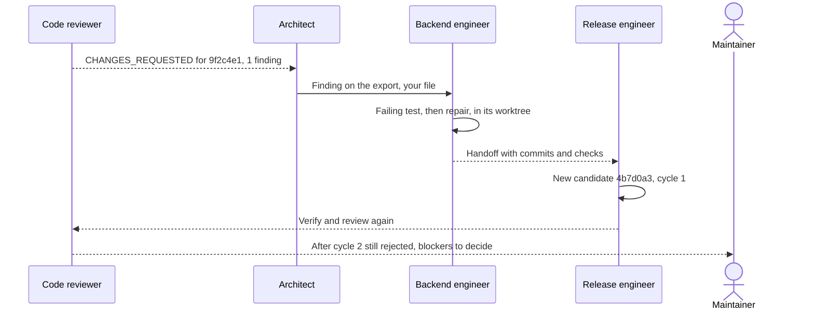

🏠 [Specs](../../../../README.md) › 🧩 [Functional capabilities](../../../README.md) ›
🤖 [F25 DevOps agents (hosted edition)](../../README.md) › 📝 [Use cases](../README.md) ›
📝 UC-F25-35 Repair a rejected candidate

# 📝 UC-F25-35 Repair a rejected candidate

**Status:** ✅ specified

## Summary

When the code reviewer returns CHANGES_REQUESTED or a required check fails, the team repairs the candidate: the
architect gives each finding to the role that owns the file in the work contract, the worker repairs it in its own
worktree, hands over again, and the release engineer integrates a new candidate commit, which is verified again. At most
two repair cycles are allowed; after the second, the blockers go to the maintainer, who decides.

## Personas

- [U47 SimpleERP maintainer](../../../../01-users/personas/u47-simpleerp-maintainer.md), who receives the blockers
  after the second cycle and decides

## Goal

A rejected candidate is repaired by the role that owns the code, without endless loops and without weakening a test to
make it pass.

## Trigger

A verification becomes Changes requested ([UC-F25-34](uc-f25-34-verify-the-candidate-commit.md)).

## Frequency

Zero to two times per ticket.

## Preconditions

- A verification of the run is Changes requested, with its findings
  ([E-F25-22 Verification](../../data/e-f25-22-verification.md)).
- The run has used fewer than two repair cycles
  ([BR-F25-28](../../business-rules/br-f25-28-two-repair-cycles-at-most-then-a-maintainer-decides.md)).

## Postconditions

- **Succeeded:** a repaired candidate commit is named and verified again
  ([UC-F25-34](uc-f25-34-verify-the-candidate-commit.md)); the cycle count goes up by one.
- **Failed:** no repair cycle is left or the finding cannot be repaired within the contract: the run stops and its
  blockers go to the maintainer, who decides.

## Main flow

1. The repair opens on the repair cycles screen
   ([S-F25-35 Repair cycles](../../screens/08-team-builds-a-ticket/s-f25-35-repair-cycles.md)) with the findings of the
   verification and the cycle number.
2. The architect gives each finding to the role whose files it touches, as the work contract sets them
   ([BR-F25-22](../../business-rules/br-f25-22-a-contract-gives-each-role-its-own-files.md)).
3. Each worker repairs its findings in its own worktree
   ([BR-F25-24](../../business-rules/br-f25-24-one-role-one-worktree-one-starting-commit.md)): a wrong behaviour starts
   with a test that shows it, seen failing ([BR-F25-08](../../business-rules/br-f25-08-fixes-test-first.md)).
4. Each worker hands over its new commits and their checks ([UC-F25-32](uc-f25-32-hand-over-a-workers-result.md)).
5. The release engineer integrates them in dependency order into a new candidate commit
   ([UC-F25-33](uc-f25-33-integrate-the-workers-commits.md)).
6. The new candidate is verified from the start ([UC-F25-34](uc-f25-34-verify-the-candidate-commit.md)); the previous
   verification becomes Superseded.

## Alternative flows

- 2a. A finding touches the files of two roles: the architect splits it, and the handoffs are integrated in the order
  the contract gives.
- 2b. A finding needs a file no role owns: the architect proposes a change of the contract, which the maintainer
  approves again before any worker starts
  ([BR-F25-23](../../business-rules/br-f25-23-no-worker-starts-before-the-contract-is-approved.md)).
- 6a. The second repair cycle ends with PASS: the run goes on to the draft pull request
  ([UC-F25-36](uc-f25-36-open-the-draft-pull-request-with-its-evidence.md)).

## Error flows

- 1e. Two repair cycles are already used: no third starts; the blockers go to the maintainer with every verification,
  its findings and its evidence
  ([BR-F25-28](../../business-rules/br-f25-28-two-repair-cycles-at-most-then-a-maintainer-decides.md)).
- 3e. A worker makes a test pass by weakening it (a removed assertion, a skipped test, a looser expected value): the
  handoff is refused and the finding stays open.
- 3f. A finding asks for a change that contradicts the approved contract or a decision: it goes to the maintainer, not
  to a worker.
- Any step: a service does not answer; the call is retried first
  ([BR-F3-32](../../../f03-assistant/business-rules/br-f03-32-retry-before-an-error.md)), then the message follows the
  error pattern ([D122](../../../../06-decisions/ux/d122-error-message-standard.md)) and what the user typed stays on
  the screen.

## Business rules

- [BR-F25-28](../../business-rules/br-f25-28-two-repair-cycles-at-most-then-a-maintainer-decides.md)
- [BR-F25-08 Fixes start with a failing test](../../business-rules/br-f25-08-fixes-test-first.md)
- [BR-F25-22](../../business-rules/br-f25-22-a-contract-gives-each-role-its-own-files.md)
- [BR-F25-24](../../business-rules/br-f25-24-one-role-one-worktree-one-starting-commit.md)

## Entities

- [E-F25-22 Verification](../../data/e-f25-22-verification.md): read and changed, the verification and its findings
- [E-F25-19 Work contract](../../data/e-f25-19-work-contract.md): read, who owns which file
- [E-F25-21 Worker handoff](../../data/e-f25-21-worker-handoff.md): created, the handoff of each repair

## Permissions

The architect assigns the findings. Each worker writes only in its own worktree and its own files. The release engineer
integrates. Maintainers read every cycle and decide after the second. Only a maintainer may change the
contract during a repair.

## Notifications

The maintainer: the blockers after the second cycle, with the choices below; a contract change to approve.

## Audit events

Each repair cycle opened, each finding assigned, each refused handoff, each new candidate commit and each hand-over of
the blockers to the maintainer, with the role and when.

## AI involvement

The architect and the workers are AI agents of the team ([E-F25-20 Agent role](../../data/e-f25-20-agent-role.md)); a
person decides once the cycles are used
([BR-F25-28](../../business-rules/br-f25-28-two-repair-cycles-at-most-then-a-maintainer-decides.md)).

## API, MCP and A2A exposure

The repair cycles are read through the API (T5). The maintainer's decision after the second cycle is written
only by a maintainer. No A2A skill.

## Screens

- [S-F25-35 Repair cycles](../../screens/08-team-builds-a-ticket/s-f25-35-repair-cycles.md)

## Flowchart

See [FL-F25-08 The agent team builds an approved ticket](../../flows/fl-f25-08-team-builds-a-ticket.md#flowchart).

## Sequence diagram

## Acceptance criteria

1. **Given** a verification with CHANGES_REQUESTED and no cycle used **when** the repair runs **then** the findings go
   to the roles that own the files and a new candidate is verified.
2. **Given** a run with two repair cycles used **when** the code reviewer rejects again **then** no third cycle starts
   and the blockers go to the maintainer.
3. **Given** a worker that removes a failing assertion **when** it hands over **then** the handoff is refused and the
   finding stays open.
4. **Given** a finding in a file no role owns **when** the architect assigns it **then** a contract change is asked and
   no worker starts before the maintainer approves it.

## Non-functional notes

The screen answers within 2 seconds for 10,000 records; every change is audited.

## Regulatory references

None specific to this use case beyond the rules above.

## Related use cases

- [UC-F25-34 Verify the candidate commit](uc-f25-34-verify-the-candidate-commit.md)
- [UC-F25-36](uc-f25-36-open-the-draft-pull-request-with-its-evidence.md)
- [UC-F25-13](../04-approve-and-govern/uc-f25-13-ask-the-agents-for-changes.md)
- [UC-F25-32 Hand over a worker's result](uc-f25-32-hand-over-a-workers-result.md)
- [UC-F25-33 Integrate the workers' commits](uc-f25-33-integrate-the-workers-commits.md)

## Open questions

None.

---

⬅️ [UC-F25-34 Verify the candidate commit](uc-f25-34-verify-the-candidate-commit.md) · ⬆️ [Up](README.md) ·
➡️ [UC-F25-36](uc-f25-36-open-the-draft-pull-request-with-its-evidence.md)
