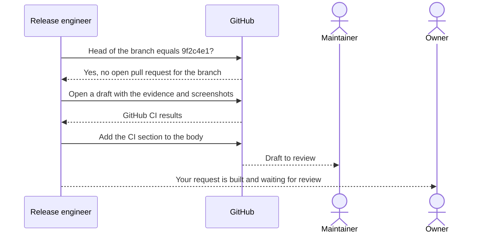

🏠 [Specs](../../../../README.md) › 🧩 [Functional capabilities](../../../README.md) ›
🤖 [F25 DevOps agents (hosted edition)](../../README.md) › 📝 [Use cases](../README.md) ›
📝 UC-F25-36 Open the draft pull request with its evidence

# 📝 UC-F25-36 Open the draft pull request with its evidence

**Status:** 🔄 waiting for the owner

## Summary

After a PASS, the release engineer opens a DRAFT pull request whose head is the verified commit. Its body carries the
issue and the problem, the changes, the acceptance results, the exact verified commit, the commands with their exit
codes and evidence, the known limits and how to review it. A FRONTEND ticket's contract and pull request show the
screenshots of its specification. The GitHub CI results are reported apart from the local checks. An existing pull
request of the branch is updated, never a second one opened, and no agent ever merges it. The reporting company's owner
follows the draft of their request in plain words on a phone.

## Personas

- [U47 SimpleERP maintainer](../../../../01-users/personas/u47-simpleerp-maintainer.md), who reviews the draft and its
  evidence on a desktop
- [U13 Owner](../../../../01-users/personas/u13-owner.md), who follows the draft of their company's request on a phone

## Goal

The maintainer reviews a pull request that proves what was checked, on which commit, and the requester knows where their
request stands.

## Trigger

A verification is Passed ([UC-F25-34](uc-f25-34-verify-the-candidate-commit.md)).

## Frequency

Once per ticket, and again when a later run updates the same branch.

## Preconditions

- A verification is Passed for the candidate commit
  ([BR-F25-27](../../business-rules/br-f25-27-an-approval-belongs-to-one-commit.md)).
- The ticket is not a vulnerability case, or its advisory is private as set
  ([BR-F25-12](../../business-rules/br-f25-12-security-reports-stay-private.md)).

## Postconditions

- **Succeeded:** the draft pull request exists once for the branch, its head is the verified commit, its body carries
  the evidence; the maintainer is asked to review it in
  [FL-F25-04 Approve and govern](../../flows/fl-f25-04-approve-and-govern.md); the requester's status says the work is
  waiting for review.
- **Failed:** no pull request is opened or changed; the run keeps its verified commit and says why.

## Main flow

1. The release engineer reads the Passed verification and the branch's head; both name the same commit
   ([BR-F25-29](../../business-rules/br-f25-29-a-draft-pull-request-carries-its-evidence-and-screenshots.md)).
2. It looks for an open pull request of the branch: none is found, so it opens one as a draft.
3. The body, written outside every tracked source file, gives the issue and the problem, the changes, the acceptance
   results, the verified commit, the commands with exit codes and evidence, the known limits and the instructions for
   the review ([S-F25-36](../../screens/08-team-builds-a-ticket/s-f25-36-draft-pull-request.md)).
4. For a FRONTEND ticket, the body shows the screenshots of the specification the ticket references, as the work
   contract did.
5. When the GitHub CI of the pull request ends, its results are added in their own section, apart from the local checks.
6. The maintainer reviews, approves and merges in
   [FL-F25-04 Approve and govern](../../flows/fl-f25-04-approve-and-govern.md)
   ([UC-F25-12](../04-approve-and-govern/uc-f25-12-approve-or-refuse-agents-tickets.md)); the reporting company's owner
   sees on a phone that their request is built and waiting for the maintainers
   ([UC-F25-14](../05-tell-the-customer/uc-f25-14-follow-my-request-s-status.md)).

## Alternative flows

- 2a. A pull request of the branch is already open: it is updated with the new verified commit and body; no second one
  is opened.
- 4a. A ticket with a spec change: the spec check report is linked in the body
  ([BR-F25-16](../../business-rules/br-f25-16-agents-spec-pull-requests-checked-first.md)).
- 5a. The GitHub CI fails while the local checks passed: the body says so in the CI section and the maintainer is told;
  the draft stays a draft.
- 6a. The maintainer asks for changes ([UC-F25-13](../04-approve-and-govern/uc-f25-13-ask-the-agents-for-changes.md)): a
  new run of the team starts from the branch and earns a new PASS before the pull request is updated.

## Error flows

- 1e. The branch's head differs from the verified commit: the pull request is not opened or updated; the head is
  verified first ([UC-F25-34](uc-f25-34-verify-the-candidate-commit.md)).
- 3e. The body misses a required section or an exit code: the pull request stays unopened and the missing parts are
  listed.
- 4e. A FRONTEND ticket without the screenshots of its specification: refused, as for any FRONTEND ticket.
- 6e. Any agent tries to mark the pull request ready, approve it or merge it: refused by GitHub and reported
  ([BR-F25-05](../../business-rules/br-f25-05-agents-never-merge-or-deploy.md),
  [D441](../../../../06-decisions/f25-devops-agents/d441-approval-label-reported-and-reverted.md)).
- Any step: a service does not answer; the call is retried first
  ([BR-F3-32](../../../f03-assistant/business-rules/br-f03-32-retry-before-an-error.md)), then the message follows the
  error pattern ([D122](../../../../06-decisions/ux/d122-error-message-standard.md)) and what the user typed stays on
  the screen.

## Business rules

- [BR-F25-29](../../business-rules/br-f25-29-a-draft-pull-request-carries-its-evidence-and-screenshots.md)
- [BR-F25-05](../../business-rules/br-f25-05-agents-never-merge-or-deploy.md)
- [BR-F25-07 Approval before Ready](../../business-rules/br-f25-07-approval-before-ready.md)
- [BR-F25-09](../../business-rules/br-f25-09-customer-told-in-plain-words.md)
- [BR-F25-12](../../business-rules/br-f25-12-security-reports-stay-private.md)

## Entities

- [E-F25-05 Agent pull request](../../data/e-f25-05-agent-pull-request.md): created or changed, the draft pull request
- [E-F25-22 Verification](../../data/e-f25-22-verification.md): read, the verified commit and its evidence
- [E-F25-23 Run checkpoint](../../data/e-f25-23-run-checkpoint.md): changed, the pull request recorded in the run's
  checkpoint
- [E-F25-09 Request status](../../data/e-f25-09-request-status.md): changed, what the requester sees

## Permissions

The release engineer opens or updates the draft and writes its body; no agent marks it ready, approves or merges it.
Maintainers review, approve and merge ([BR-F25-05](../../business-rules/br-f25-05-agents-never-merge-or-deploy.md)). The
requesting company's owner reads the plain-words status of their own request only. (Proposed) The requester never sees
the code, the commits or the commands.

## Notifications

The maintainer: a draft pull request to review, and a GitHub CI failure on it. The requesting company's owner: their
request is built and waiting for the maintainers' review, in plain words
([BR-F25-09](../../business-rules/br-f25-09-customer-told-in-plain-words.md)).

## Audit events

Each draft opened or updated, with its head commit, the verified commit, the body's version and the GitHub CI results
added; each refused attempt to mark it ready, approve or merge it.

## AI involvement

The release engineer, an AI agent ([E-F25-20 Agent role](../../data/e-f25-20-agent-role.md)), writes the body from the
verification's records; the commands, exit codes and evidence are copied, never rewritten. The plain-words status of the
requester is written as for any request ([BR-F25-09](../../business-rules/br-f25-09-customer-told-in-plain-words.md)).

## API, MCP and A2A exposure

(Proposed) The draft pull request is opened by a workflow step with the per-job App token, as for the agents' other pull
requests ([D437](../../../../06-decisions/f25-devops-agents/d437-devops-agents-in-the-ci.md)). The requester's status is
read through the API (T5). No A2A skill.

## Screens

- [S-F25-36](../../screens/08-team-builds-a-ticket/s-f25-36-draft-pull-request.md)

## Flowchart

See [FL-F25-08 The agent team builds an approved ticket](../../flows/fl-f25-08-team-builds-a-ticket.md#flowchart).

## Sequence diagram

## Acceptance criteria

1. **Given** a Passed verification and a branch head equal to its commit **when** the release engineer opens the draft
   **then** the pull request is a draft whose head is the verified commit and whose body has every section.
2. **Given** a branch with an open pull request **when** a new verified commit is ready **then** the same pull request
   is updated and no second one exists.
3. **Given** a FRONTEND ticket **when** its draft pull request is opened **then** the body shows the screenshots of its
   specification.
4. **Given** a draft pull request **when** an agent tries to merge it **then** it is refused and reported.
5. **Given** the requesting company's owner on a phone **when** the draft is opened **then** they see in plain words
   that their request waits for the maintainers, without code or commits.

## Non-functional notes

(Proposed) The screen answers within 2 seconds for 10,000 records; every change is audited.

## Regulatory references

(Proposed) The body never carries a customer's details: the USER ticket holds a sanitised summary, as the build study
sets. A vulnerability fix stays in its private advisory until disclosure
([BR-F25-12](../../business-rules/br-f25-12-security-reports-stay-private.md),
[BR-F25-15](../../business-rules/br-f25-15-vulnerabilities-handled-under-the-cra.md)).

## Related use cases

- [UC-F25-35 Repair a rejected candidate](uc-f25-35-repair-a-rejected-candidate.md)
- [UC-F25-37 Resume an interrupted run](uc-f25-37-resume-an-interrupted-run.md)
- [UC-F25-12](../04-approve-and-govern/uc-f25-12-approve-or-refuse-agents-tickets.md)
- [UC-F25-13](../04-approve-and-govern/uc-f25-13-ask-the-agents-for-changes.md)
- [UC-F25-14](../05-tell-the-customer/uc-f25-14-follow-my-request-s-status.md)

## Open questions

None.

---

⬅️ [UC-F25-35 Repair a rejected candidate](uc-f25-35-repair-a-rejected-candidate.md) · ⬆️ [Up](README.md) ·
➡️ [UC-F25-37 Resume an interrupted run](uc-f25-37-resume-an-interrupted-run.md)
