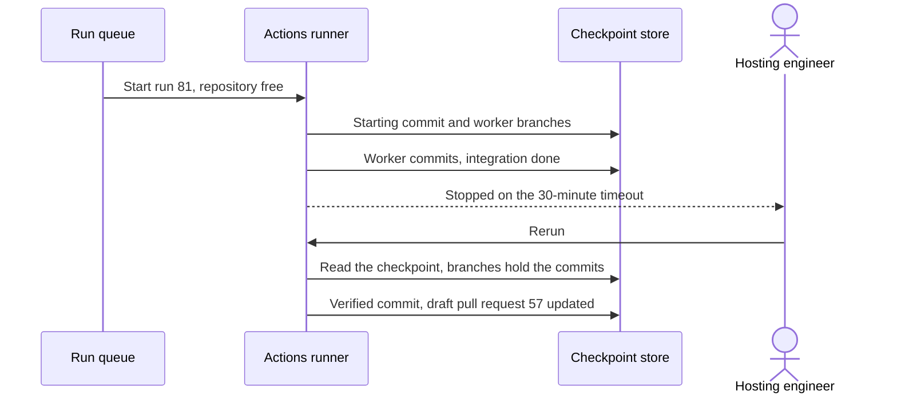

🏠 [Specs](../../../../README.md) › 🧩 [Functional capabilities](../../../README.md) ›
🤖 [F25 DevOps agents (hosted edition)](../../README.md) › 📝 [Use cases](../README.md) ›
📝 UC-F25-37 Resume an interrupted run

# 📝 UC-F25-37 Resume an interrupted run

**Status:** ✅ specified

## Summary

An agent team's run works unattended in GitHub Actions and saves a checkpoint after each stage: the starting commit and
the worker branches, the worker commits, the integration status, the verified commit, the results and the verdict, and
the draft pull request. The checkpoint is stored apart from the verified code. When a run stops (a lost runner, the
30-minute timeout, the turn limit or the budget), the hosting engineer reruns it and it resumes from the checkpoint
without losing a commit or opening a second pull request. One run is active per repository; the others wait in a queue,
and a run in progress is never cancelled by a new one.

## Personas

- [U48 Hosting engineer](../../../../01-users/personas/u48-hosting-engineer.md), who runs the runners, reruns an
  interrupted run and watches the queue

## Goal

An interrupted run costs only the stage it was in, never the work already done, and two runs never fight over one
repository.

## Trigger

A run stops before its draft pull request, or a run is asked while another is active on the repository.

## Frequency

A few times a week, when runners or limits stop a run.

## Preconditions

- The run has a checkpoint with its starting commit
  ([BR-F25-24](../../business-rules/br-f25-24-one-role-one-worktree-one-starting-commit.md)).
- The hosting engineer runs the agents' runners in their isolated cluster
  ([D442](../../../../06-decisions/f25-devops-agents/d442-devops-runners-isolated-cluster.md)).

## Postconditions

- **Succeeded:** the run resumes at its first unfinished stage with every recorded commit on its branch, and ends with
  one draft pull request ([UC-F25-36](uc-f25-36-open-the-draft-pull-request-with-its-evidence.md)); its metrics are
  recorded.
- **Failed:** the run stays Interrupted or is Abandoned; the commits stay on their branches and the checkpoint says what
  was done.

## Main flow

1. A run starts: its checkpoint records the starting commit, the worker branches and the limits of the run
   ([BR-F25-30](../../business-rules/br-f25-30-one-active-run-per-repository-resumed-from-its-checkpoint.md)).
2. After each stage (worker commits, handoffs, integration, verification, draft pull request) the checkpoint is saved
   outside the repository's tracked files.
3. The run stops on the 30-minute timeout; the hosting engineer sees it Interrupted on the run resume screen
   ([S-F25-37 Run resume](../../screens/08-team-builds-a-ticket/s-f25-37-run-resume.md)) with its cause and its last
   checkpoint.
4. The hosting engineer reruns it; the rerun reads the checkpoint and checks that each worker branch still holds the
   recorded commits.
5. It skips the finished stages and resumes at the first unfinished one; a verification of a commit that changed starts
   again ([BR-F25-27](../../business-rules/br-f25-27-an-approval-belongs-to-one-commit.md)).
6. At the end it updates the draft pull request the checkpoint names, or opens it if none exists; the metrics of the
   ticket are recorded: elapsed time, AI cost, repair cycles and maintainer interventions.

## Alternative flows

- 1a. Another run is active on the repository: the new run is Queued and starts when the active one ends; the active run
  is never cancelled.
- 3a. The run stops on its budget
  ([D398](../../../../06-decisions/f22-unified-cost-management/d398-budgets-warn-then-stop.md)): it resumes only after a
  maintainer or the hosting engineer raises the budget
  ([UC-F25-18](../04-approve-and-govern/uc-f25-18-follow-the-agents-costs-and-budgets.md)).
- 3b. The run stops on its turn limit: the hosting engineer may rerun it once with the same limit; a second stop goes to
  the maintainer.
- 6a. The maintainer abandons the run: the checkpoint and the branches are kept for a person to go on.

## Error flows

- 4e. A recorded commit is missing from its branch (a force-push, a deleted branch): the run does not resume; the
  hosting engineer and the maintainer are told which commit is missing.
- 4f. The checkpoint cannot be read: the run does not guess; it is Interrupted with the reason and the maintainer
  decides.
- 6e. The checkpoint names a pull request that was closed by a maintainer: no new one is opened; the maintainer is
  asked.
- Any step: a service does not answer; the call is retried first
  ([BR-F3-32](../../../f03-assistant/business-rules/br-f03-32-retry-before-an-error.md)), then the message follows the
  error pattern ([D122](../../../../06-decisions/ux/d122-error-message-standard.md)) and what the user typed stays on
  the screen.

## Business rules

- [BR-F25-30](../../business-rules/br-f25-30-one-active-run-per-repository-resumed-from-its-checkpoint.md)
- [BR-F25-11](../../business-rules/br-f25-11-agents-metered-and-audited.md)
- [BR-F25-05](../../business-rules/br-f25-05-agents-never-merge-or-deploy.md)
- [BR-F25-04 Read-only on production](../../business-rules/br-f25-04-read-only-on-production.md)

## Entities

- [E-F25-23 Run checkpoint](../../data/e-f25-23-run-checkpoint.md): created, changed
- [E-F25-10 Agent run](../../data/e-f25-10-agent-run.md): changed, the run that is metered and audited
- [E-F25-05 Agent pull request](../../data/e-f25-05-agent-pull-request.md): read, the draft pull request the checkpoint
  names
- [E-F25-22 Verification](../../data/e-f25-22-verification.md): read, the verified commit

## Permissions

The hosting engineer reads every checkpoint, reruns an interrupted run and changes the queue order. Maintainers abandon
a run and raise budgets. Agents write their run's checkpoint only. No one edits a checkpoint by hand: a wrong
checkpoint is abandoned.

## Notifications

The hosting engineer: a run Interrupted, with its cause. The maintainer: a run that cannot resume, a budget stop, a
second turn-limit stop.

## Audit events

Each checkpoint saved, each stop with its cause, each rerun and resume with the stage it resumed at, each queue change
and each abandonment, with who and when ([BR-F25-11](../../business-rules/br-f25-11-agents-metered-and-audited.md)).

## AI involvement

None of its own: the checkpoint is written by the workflow, not by the agents' judgement. The agents of the resumed run
are those of the contract ([E-F25-20 Agent role](../../data/e-f25-20-agent-role.md)).

## API, MCP and A2A exposure

The checkpoints are read through the API (T5) by the hosting engineer and the maintainers; the rerun is a
workflow run started from GitHub Actions. No A2A skill.

## Screens

- [S-F25-37 Run resume](../../screens/08-team-builds-a-ticket/s-f25-37-run-resume.md)

## Flowchart

See [FL-F25-08 The agent team builds an approved ticket](../../flows/fl-f25-08-team-builds-a-ticket.md#flowchart).

## Sequence diagram

## Acceptance criteria

1. **Given** a run interrupted after the integration **when** the hosting engineer reruns it **then** it resumes at the
   verification and no commit is lost.
2. **Given** a checkpoint naming draft pull request 57 **when** the resumed run ends **then** pull request 57 is updated
   and no second pull request exists.
3. **Given** an active run on the repository **when** a second run is asked **then** the second run is Queued and the
   active run goes on.
4. **Given** a recorded commit missing from its branch **when** the run is rerun **then** it does not resume and the
   missing commit is named.
5. **Given** a run stopped on its budget **when** the hosting engineer reruns it before the budget is raised **then** it
   does not resume.

## Non-functional notes

The screen answers within 2 seconds for 10,000 records; every change is audited.

## Regulatory references

None specific to this use case beyond the rules above.

## Related use cases

- [UC-F25-36](uc-f25-36-open-the-draft-pull-request-with-its-evidence.md)
- [UC-F25-17](../04-approve-and-govern/uc-f25-17-control-the-agents-rights-and-audit.md)
- [UC-F25-18](../04-approve-and-govern/uc-f25-18-follow-the-agents-costs-and-budgets.md)
- [UC-F25-19](../04-approve-and-govern/uc-f25-19-measure-the-quality-of-the-agents-work.md)
- [UC-F25-31 Build in isolated worktrees](uc-f25-31-build-in-isolated-worktrees.md)

## Open questions

None.

---

⬅️ [UC-F25-36](uc-f25-36-open-the-draft-pull-request-with-its-evidence.md) · ⬆️ [Up](README.md)
