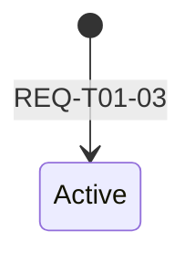

🏠 [Specs](../../../README.md) › ⚙️ [Technical capabilities](../../README.md) ›
🏢 [T1 Companies and data isolation](../README.md) › 🗃️ [Data](README.md) › 🗃️ E-T01-03 Provider session

# 🗃️ E-T01-03 Provider session

**Status:** ✅ specified

## Purpose

An IT provider's session in a client company.

## Fields

| Name | Type | Required | Validation | Default | Example | Personal data | Custom fields |
|---|---|---|---|---|---|---|---|
| provider, company, started, ended | records | yes | REQ-T01-03 | - | NetServ, Acme, 09:00, 09:40 | yes | no |

The main fields only; the rest is generated from the code (D406).

## Relations

As its interfaces.

The same item as [E-F1-12 Provider session](../../../02-functional/f01-administration/data/e-f01-12-provider-session.md)
([D516](../../../06-decisions/foundations/d516-naming-rules-and-the-seven-classes-of-names.md), rule 4).

## Lifecycle

## Indexes and search

By company and id.

## Retention

Kept for the period of its kind of record in the country pack (D293), or else its kind's default in the
[retention schedule](../../../05-non-functional/data-retention.md).

## Audit

Every change (T3).

## Import and export

With the company's export (T1).

## Used by

- [T1 requirements](../requirements/README.md)

## Open questions

None.

---

⬅️ [E-T01-02 Company stores](e-t01-02-company-stores.md) · ⬆️ [Up](README.md) ·
➡️ [E-T01-04 Copy or overlay](e-t01-04-copy-or-overlay.md)
