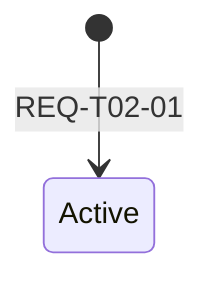

🏠 [Specs](../../../README.md) › ⚙️ [Technical capabilities](../../README.md) ›
🔐 [T2 Identity and access engine](../README.md) › 🗃️ [Data](README.md) › 🗃️ E-T02-01 User account

# 🗃️ E-T02-01 User account

**Status:** ✅ specified

## Purpose

A person who signs in.

## Fields

| Name | Type | Required | Validation | Default | Example | Personal data | Custom fields |
|---|---|---|---|---|---|---|---|
| id, email, company, roles, factors | records | yes | REQ-T02-01 | - | U-9, a@acme.example, Acme, sales, passkey | yes | no |

The main fields only; the rest is generated from the code (D406).

## Relations

As its interfaces.

## Lifecycle

## Indexes and search

By company and id.

## Retention

Kept for the period of its kind of record in the country pack (D293), or else its kind's default in the
[retention schedule](../../../05-non-functional/data-retention.md).

## Audit

Every change (T3).

## Import and export

With the company's export (T1).

## Used by

- [T2 requirements](../requirements/README.md)

## Open questions

None.

---

⬆️ [Up](README.md) · ➡️ [E-T02-02 Role and policy](e-t02-02-role-and-policy.md)
