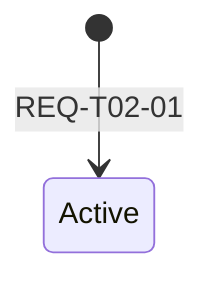

🏠 [Specs](../../../README.md) › ⚙️ [Technical capabilities](../../README.md) ›
🔐 [T2 Identity and access engine](../README.md) › 🗃️ [Data](README.md) › 🗃️ E-T02-02 Role and policy

# 🗃️ E-T02-02 Role and policy

**Status:** ✅ specified

## Purpose

A role and its policies.

## Fields

| Name | Type | Required | Validation | Default | Example | Personal data | Custom fields |
|---|---|---|---|---|---|---|---|
| role, actions, record rules | records | yes | REQ-T02-02 | - | sales, quotes write, own customers | no | no |

The main fields only; the rest is generated from the code (D406).

## Relations

As its interfaces.

## Lifecycle

## Indexes and search

By company and id.

## Retention

Kept for the period of its kind of record in the country pack (D293), or else its kind's default in the
[retention schedule](../../../05-non-functional/data-retention.md).

## Audit

Every change (T3).

## Import and export

With the company's export (T1).

## Used by

- [T2 requirements](../requirements/README.md)

## Open questions

None.

---

⬅️ [E-T02-01 User account](e-t02-01-user-account.md) · ⬆️ [Up](README.md) ·
➡️ [E-T02-03 Service account](e-t02-03-service-account.md)
