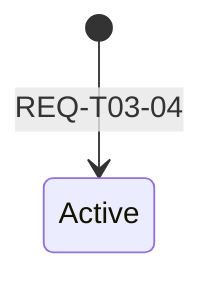

🏠 [Specs](../../../README.md) › ⚙️ [Technical capabilities](../../README.md) › 🧾 [T3 Audit trail](../README.md) ›
🗃️ [Data](README.md) › 🗃️ E-T03-02 AI action detail

# 🗃️ E-T03-02 AI action detail

**Status:** ✅ specified

## Purpose

How an AI action was taken.

## Fields

| Name | Type | Required | Validation | Default | Example | Personal data | Custom fields |
|---|---|---|---|---|---|---|---|
| entry, model, tools, confirmed by | records | yes | REQ-T03-04 | - | E-881, local model, send quote, U-9 | no | no |

The main fields only; the rest is generated from the code (D406).

## Relations

As its interfaces.

## Lifecycle

## Indexes and search

By company and id.

## Retention

Kept for the period of its kind of record in the country pack (D293), or else its kind's default in the
[retention schedule](../../../05-non-functional/data-retention.md).

## Audit

Every change (T3).

## Import and export

With the company's export (T1).

## Used by

- [T3 requirements](../requirements/README.md)

## Open questions

None.

---

⬅️ [E-T03-01 Audit entry](e-t03-01-audit-entry.md) · ⬆️ [Up](README.md) ·
➡️ [E-T03-03 Chain checkpoint](e-t03-03-chain-checkpoint.md)
