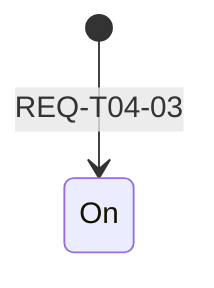

🏠 [Specs](../../../README.md) › ⚙️ [Technical capabilities](../../README.md) › 🔌 [T4 Plugin runtime](../README.md) ›
🗃️ [Data](README.md) › 🗃️ E-T04-03 Plugin installation

# 🗃️ E-T04-03 Plugin installation

**Status:** ✅ specified

## Purpose

A module or plugin in a company.

## Fields

| Name | Type | Required | Validation | Default | Example | Personal data | Custom fields |
|---|---|---|---|---|---|---|---|
| company, module or plugin, state | records | yes | REQ-T04-03 | - | Acme, F10, on | no | no |

The main fields only; the rest is generated from the code (D406).

## Relations

As its interfaces.

The same item as
[E-F14-02 Plugin installation](../../../02-functional/f14-plugin-store/data/e-f14-02-plugin-installation.md)
([D516](../../../06-decisions/foundations/d516-naming-rules-and-the-seven-classes-of-names.md), rule 4).

## Lifecycle

## Indexes and search

By company and id.

## Retention

Kept for the period of its kind of record in the country pack (D293), or else its kind's default in the
[retention schedule](../../../05-non-functional/data-retention.md).

## Audit

Every change (T3).

## Import and export

With the company's export (T1).

## Used by

- [T4 requirements](../requirements/README.md)

## Open questions

None.

---

⬅️ [E-T04-02 Plugin package](e-t04-02-plugin-package.md) · ⬆️ [Up](README.md) ·
➡️ [E-T04-04 Plugin limits](e-t04-04-plugin-limits.md)
