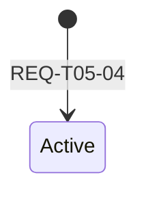

🏠 [Specs](../../../README.md) › ⚙️ [Technical capabilities](../../README.md) › 🔗 [T5 API and webhooks](../README.md) ›
🗃️ [Data](README.md) › 🗃️ E-T05-02 Webhook subscription

# 🗃️ E-T05-02 Webhook subscription

**Status:** ✅ specified

## Purpose

Where events are delivered.

## Fields

| Name | Type | Required | Validation | Default | Example | Personal data | Custom fields |
|---|---|---|---|---|---|---|---|
| client, events, URL, secret name | records | yes | REQ-T05-04 | - | shop, order.paid, https://shop.example/hook, shop_hook_key | no | no |

The main fields only; the rest is generated from the code (D406).

## Relations

As its interfaces.

The same item as
[E-F24-13 Webhook subscription](../../../02-functional/f24-integrations-hub/data/e-f24-13-webhook-subscription.md)
([D517](../../../06-decisions/foundations/d517-the-drafts-open-points-answered-on-2026-11-13.md), S0-3).

## Lifecycle

## Indexes and search

By company and id.

## Retention

Kept for the period of its kind of record in the country pack (D293), or else its kind's default in the
[retention schedule](../../../05-non-functional/data-retention.md).

## Audit

Every change (T3).

## Import and export

With the company's export (T1).

## Used by

- [T5 requirements](../requirements/README.md)

## Open questions

None.

---

⬅️ [E-T05-01 API client](e-t05-01-api-client.md) · ⬆️ [Up](README.md) ·
➡️ [E-T05-03 Webhook delivery](e-t05-03-webhook-delivery.md)
