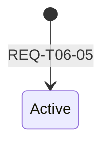

🏠 [Specs](../../../README.md) › ⚙️ [Technical capabilities](../../README.md) ›
🛰️ [T6 MCP and A2A gateway](../README.md) › 🗃️ [Data](README.md) › 🗃️ E-T06-03 Outside connection

# 🗃️ E-T06-03 Outside connection

**Status:** ✅ specified

## Purpose

An outside MCP server or agent.

## Fields

| Name | Type | Required | Validation | Default | Example | Personal data | Custom fields |
|---|---|---|---|---|---|---|---|
| kind, address, roles, credentials name | records | yes | REQ-T06-05 | - | MCP, https://mcp.example, sales, ext_key | no | no |

The main fields only; the rest is generated from the code (D406).

## Relations

As its interfaces.

## Lifecycle

## Indexes and search

By company and id.

## Retention

Kept for the period of its kind of record in the country pack (D293), or else its kind's default in the
[retention schedule](../../../05-non-functional/data-retention.md).

## Audit

Every change (T3).

## Import and export

With the company's export (T1).

## Used by

- [T6 requirements](../requirements/README.md)

## Open questions

None.

---

⬅️ [E-T06-02 Agent card](e-t06-02-agent-card.md) · ⬆️ [Up](README.md) ·
➡️ [E-T06-04 Tool call record](e-t06-04-tool-call-record.md)
