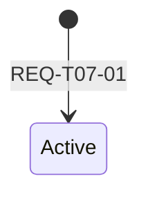

🏠 [Specs](../../../README.md) › ⚙️ [Technical capabilities](../../README.md) ›
🧠 [T7 AI providers and models](../README.md) › 🗃️ [Data](README.md) › 🗃️ E-T07-02 AI feature setting

# 🗃️ E-T07-02 AI feature setting

**Status:** ✅ specified

## Purpose

Which provider serves a feature.

## Fields

| Name | Type | Required | Validation | Default | Example | Personal data | Custom fields |
|---|---|---|---|---|---|---|---|
| company, feature, provider, model | records | yes | D82 | local | Acme, minutes, local, small-chat | no | no |

The main fields only; the rest is generated from the code (D406).

## Relations

As its interfaces.

The same item as
[E-F1-09 AI feature setting](../../../02-functional/f01-administration/data/e-f01-09-ai-feature-setting.md)
([D516](../../../06-decisions/foundations/d516-naming-rules-and-the-seven-classes-of-names.md), rule 4).

## Lifecycle

## Indexes and search

By company and id.

## Retention

Kept for the period of its kind of record in the country pack (D293), or else its kind's default in the
[retention schedule](../../../05-non-functional/data-retention.md).

## Audit

Every change (T3).

## Import and export

With the company's export (T1).

## Used by

- [T7 requirements](../requirements/README.md)

## Open questions

None.

---

⬅️ [E-T07-01 Model](e-t07-01-model.md) · ⬆️ [Up](README.md) ·
➡️ [E-T07-03 Prompt template version](e-t07-03-prompt-template-version.md)
