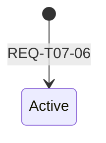

🏠 [Specs](../../../README.md) › ⚙️ [Technical capabilities](../../README.md) ›
🧠 [T7 AI providers and models](../README.md) › 🗃️ [Data](README.md) › 🗃️ E-T07-03 Prompt template version

# 🗃️ E-T07-03 Prompt template version

**Status:** ✅ specified

## Purpose

A versioned prompt.

## Fields

| Name | Type | Required | Validation | Default | Example | Personal data | Custom fields |
|---|---|---|---|---|---|---|---|
| feature, version, tests | records | yes | REQ-T07-06 | - | minutes, 7, passed | no | no |

The main fields only; the rest is generated from the code (D406).

## Relations

As its interfaces.

## Lifecycle

## Indexes and search

By company and id.

## Retention

Kept for the period of its kind of record in the country pack (D293), or else its kind's default in the
[retention schedule](../../../05-non-functional/data-retention.md).

## Audit

Every change (T3).

## Import and export

With the company's export (T1).

## Used by

- [T7 requirements](../requirements/README.md)

## Open questions

None.

---

⬅️ [E-T07-02 AI feature setting](e-t07-02-ai-feature-setting.md) · ⬆️ [Up](README.md) ·
➡️ [E-T07-04 Evaluation result](e-t07-04-evaluation-result.md)
