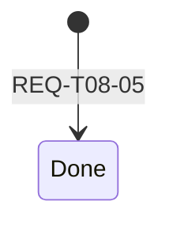

🏠 [Specs](../../../README.md) › ⚙️ [Technical capabilities](../../README.md) ›
📚 [T8 RAG platform (Milvus)](../README.md) › 🗃️ [Data](README.md) › 🗃️ E-T08-03 Index job

# 🗃️ E-T08-03 Index job

**Status:** ✅ specified

## Purpose

An indexing or rebuild run.

## Fields

| Name | Type | Required | Validation | Default | Example | Personal data | Custom fields |
|---|---|---|---|---|---|---|---|
| company, kind, state | records | yes | REQ-T08-05 | - | Acme, rebuild, done | no | no |

The main fields only; the rest is generated from the code (D406).

## Relations

As its interfaces.

## Lifecycle

## Indexes and search

By company and id.

## Retention

Kept for the period of its kind of record in the country pack (D293), or else its kind's default in the
[retention schedule](../../../05-non-functional/data-retention.md).

## Audit

Every change (T3).

## Import and export

With the company's export (T1).

## Used by

- [T8 requirements](../requirements/README.md)

## Open questions

None.

---

⬅️ [E-T08-02 Chunk](e-t08-02-chunk.md) · ⬆️ [Up](README.md)
