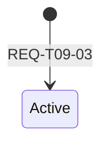

🏠 [Specs](../../../README.md) › ⚙️ [Technical capabilities](../../README.md) ›
🚀 [T9 Install, backups and updates](../README.md) › 🗃️ [Data](README.md) › 🗃️ E-T09-01 Server installation

# 🗃️ E-T09-01 Server installation

**Status:** ✅ specified

## Purpose

An install and its profile.

## Fields

| Name | Type | Required | Validation | Default | Example | Personal data | Custom fields |
|---|---|---|---|---|---|---|---|
| id, profile, version | records | yes | REQ-T09-03 | - | I-1, laptop, 3.4.0 | no | no |

The main fields only; the rest is generated from the code (D406).

## Relations

As its interfaces.

## Lifecycle

## Indexes and search

By company and id.

## Retention

Kept for the period of its kind of record in the country pack (D293), or else its kind's default in the
[retention schedule](../../../05-non-functional/data-retention.md).

## Audit

Every change (T3).

## Import and export

With the company's export (T1).

## Used by

- [T9 requirements](../requirements/README.md)

## Open questions

None.

---

⬆️ [Up](README.md) · ➡️ [E-T09-02 Restore point](e-t09-02-restore-point.md)
