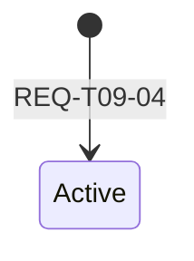

🏠 [Specs](../../../README.md) › ⚙️ [Technical capabilities](../../README.md) ›
🚀 [T9 Install, backups and updates](../README.md) › 🗃️ [Data](README.md) › 🗃️ E-T09-02 Restore point

# 🗃️ E-T09-02 Restore point

**Status:** ✅ specified

## Purpose

A backup point.

## Fields

| Name | Type | Required | Validation | Default | Example | Personal data | Custom fields |
|---|---|---|---|---|---|---|---|
| company, time, location | records | yes | REQ-T09-04 | - | Acme, 02:00, second region | no | no |

The main fields only; the rest is generated from the code (D406).

## Relations

As its interfaces.

## Lifecycle

## Indexes and search

By company and id.

## Retention

Kept for the period of its kind of record in the country pack (D293), or else its kind's default in the
[retention schedule](../../../05-non-functional/data-retention.md).

## Audit

Every change (T3).

## Import and export

With the company's export (T1).

## Used by

- [T9 requirements](../requirements/README.md)

## Open questions

None.

---

⬅️ [E-T09-01 Server installation](e-t09-01-server-installation.md) · ⬆️ [Up](README.md) ·
➡️ [E-T09-03 Upgrade run](e-t09-03-upgrade-run.md)
