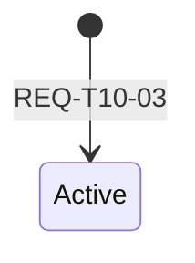

🏠 [Specs](../../../README.md) › ⚙️ [Technical capabilities](../../README.md) ›
🌐 [T10 Translations and notifications](../README.md) › 🗃️ [Data](README.md) › 🗃️ E-T10-02 Notification

# 🗃️ E-T10-02 Notification

**Status:** ✅ specified

## Purpose

A message and its deliveries.

## Fields

| Name | Type | Required | Validation | Default | Example | Personal data | Custom fields |
|---|---|---|---|---|---|---|---|
| user, event, channels, sent | records | yes | REQ-T10-04 | - | U-9, quote approved, chat, 10:03 | yes | no |

The main fields only; the rest is generated from the code (D406).

## Relations

As its interfaces.

## Lifecycle

## Indexes and search

By company and id.

## Retention

Kept for the period of its kind of record in the country pack (D293), or else its kind's default in the
[retention schedule](../../../05-non-functional/data-retention.md).

## Audit

Every change (T3).

## Import and export

With the company's export (T1).

## Used by

- [T10 requirements](../requirements/README.md)

## Open questions

None.

---

⬅️ [E-T10-01 Translation string](e-t10-01-translation-string.md) · ⬆️ [Up](README.md) ·
➡️ [E-T10-03 User preferences](e-t10-03-user-preferences.md)
