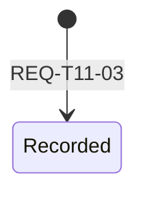

🏠 [Specs](../../../README.md) › ⚙️ [Technical capabilities](../../README.md) › 🏛️ [T11 Legal corpora](../README.md) ›
🗃️ [Data](README.md) › 🗃️ E-T11-03 Article version

# 🗃️ E-T11-03 Article version

**Status:** ✅ specified

## Purpose

A law article in force at a date.

## Fields

| Name | Type | Required | Validation | Default | Example | Personal data | Custom fields |
|---|---|---|---|---|---|---|---|
| source, article, valid from, text | records | yes | REQ-T11-03 | - | CGI, 278, 2014-01-01, ... | no | no |

The main fields only; the rest is generated from the code (D406).

## Relations

As its interfaces.

## Lifecycle

## Indexes and search

By company and id.

## Retention

Kept for the period of its kind of record in the country pack (D293), or else its kind's default in the
[retention schedule](../../../05-non-functional/data-retention.md).

## Audit

Every change (T3).

## Import and export

With the company's export (T1).

## Used by

- [T11 requirements](../requirements/README.md)

## Open questions

None.

---

⬅️ [E-T11-02 Country rule](e-t11-02-country-rule.md) · ⬆️ [Up](README.md) ·
➡️ [E-T11-04 Rule flag](e-t11-04-rule-flag.md)
