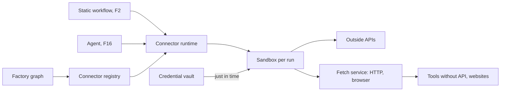
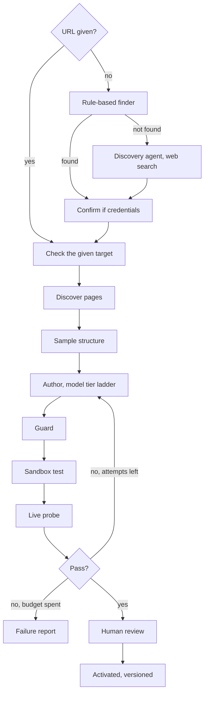

🏠 [Specs](../../README.md) › ⚙️ [Technical capabilities](../README.md) › 🕸️ [Connectors and scrapers](README.md) ›
🏗️ Architecture

# 🏗️ Architecture

**Status:** ✅ specified

## Overview

Connectors expose typed actions; a runtime executes them in sandboxes with credentials from the vault; static workflows
and agents are two drivers of the same actions; a factory generates new connectors and scrapers.

## Components

- **Connector registry:** connectors, versions, actions, health.
- **Connector runtime:** runs actions in sandboxes (REQ-T12-09).
- **Credential vault:** (REQ-T12-08).
- **Fetch service:** HTTP and headless browsers, self-hosted, behind MCP; stealth only for the company's own accounts,
  never public scraping (REQ-T12-07).
- **Factory:** the generation graph, its checkpoints, cost meter and progress stream (REQ-T12-06).
- **Drivers:** the workflow engine (F2) and the agent runtime (F16, F3).

## Diagram

## Decisions

- [D238](../../06-decisions/f16-customer-support-agents/d238-static-or-agentic.md)
- [D239](../../06-decisions/f16-customer-support-agents/d239-scraper-factory.md)
- [D240](../../06-decisions/security-and-compliance/d240-credential-vault.md)

---

⬆️ [Up](README.md) · ➡️ [Requirements](requirements/README.md)
