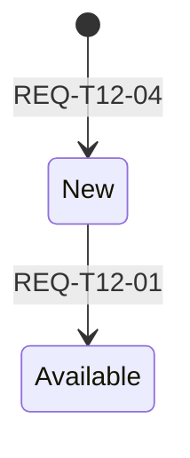

🏠 [Specs](../../../README.md) › ⚙️ [Technical capabilities](../../README.md) ›
🕸️ [T12 Connectors and scrapers](../README.md) › 🗃️ [Data](README.md) › 🗃️ E-T12-01 Connector

# 🗃️ E-T12-01 Connector

**Status:** 🔄 waiting for the owner

## Purpose

A connection to one outside system (REQ-T12-01, REQ-T12-04).

## Fields

| Name | Type | Required | Validation | Default | Example | Personal data | Custom fields |
|---|---|---|---|---|---|---|---|
| name | text | yes | unique | - | Zendesk | no | no |
| category | catalogue category (I-T12-01) | yes | - | - | CRM | no | no |
| kind | API, browser, scraper, mail, voice, file | yes | - | - | API | no | no |
| actions | list of action contracts | yes | REQ-T12-04 | - | read ticket, reply, tag | no | no |
| origin | shipped, plugin, generated | yes | - | - | generated | no | no |
| version | text | yes | - | - | 3 | no | no |
| health | ok, degraded, failing, paused | yes | - | ok | ok | no | no |

## Relations

See T12's architecture.

The same item as [E-F24-01 Connector](../../../02-functional/f24-integrations-hub/data/e-f24-01-connector.md)
([D516](../../../06-decisions/foundations/d516-naming-rules-and-the-seven-classes-of-names.md), rule 4).

## Lifecycle

## Indexes and search

(Proposed) By company and name.

## Retention

(Proposed) Runs 13 months; credentials until revoked, then destroyed.

## Audit

Every change and every use.

## Import and export

Never the secrets.

## Used by

- [F16 Customer support agents](../../../02-functional/f16-customer-support-agents/README.md)
- [T12 requirements](../requirements/README.md)

## Open questions

None.

---

⬆️ [Up](README.md) · ➡️ [E-T12-02 Credential](e-t12-02-credential.md)
