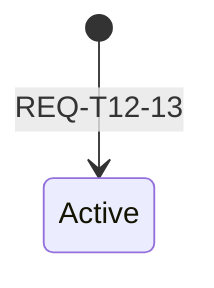

🏠 [Specs](../../../README.md) › ⚙️ [Technical capabilities](../../README.md) ›
🕸️ [T12 Connectors and scrapers](../README.md) › 🗃️ [Data](README.md) › 🗃️ E-T12-02 Credential

# 🗃️ E-T12-02 Credential

**Status:** 🔄 waiting for the owner

## Purpose

The metadata of a secret held in the vault; the secret itself never leaves the vault (REQ-T12-08).

## Fields

| Name | Type | Required | Validation | Default | Example | Personal data | Custom fields |
|---|---|---|---|---|---|---|---|
| handle | text | yes | unique per company | - | zendesk-support | no | no |
| kind | password, API key, OAuth token, TOTP seed, certificate | yes | - | - | OAuth token | no | no |
| last four | text | no | - | - | ...7f2a | no | no |
| connector | connector | yes | - | - | Zendesk | no | no |
| owner | user | yes | - | - | Claire Martin | yes | no |
| rotate by | date | no | - | - | 2027-02-10 | no | no |
| key | customer-managed or platform | yes | - | platform | platform | no | no |

## Relations

See T12's architecture.

## Lifecycle

## Indexes and search

(Proposed) By company and name.

## Retention

(Proposed) Runs 13 months; credentials until revoked, then destroyed.

## Audit

Every change and every use.

## Import and export

Never the secrets.

## Used by

- [F16 Customer support agents](../../../02-functional/f16-customer-support-agents/README.md)

## Open questions

None.

---

⬅️ [E-T12-01 Connector](e-t12-01-connector.md) · ⬆️ [Up](README.md) ·
➡️ [E-T12-03 Generated connector](e-t12-03-generated-connector.md)
