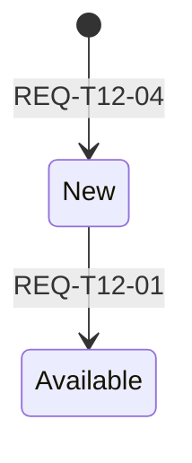

🏠 [Specs](../../../README.md) › ⚙️ [Technical capabilities](../../README.md) ›
🕸️ [T12 Connectors and scrapers](../README.md) › 🗃️ [Data](README.md) › 🗃️ E-T12-03 Generated connector

# 🗃️ E-T12-03 Generated connector

**Status:** ✅ specified

## Purpose

A connector or scraper produced by the factory, with its evidence (REQ-T12-06).

## Fields

| Name | Type | Required | Validation | Default | Example | Personal data | Custom fields |
|---|---|---|---|---|---|---|---|
| target | URL or tool | yes | - | - | https://portal.example | no | no |
| attempts | number | yes | within the run's limit | - | 3 | no | no |
| cost | money | yes | within the run's budget | - | 0.40 EUR | no | no |
| tests | evidence | yes | sandbox and live probe | - | passed | no | no |
| review | pending, approved, refused | yes | - | pending | approved | no | no |

## Relations

See T12's architecture.

## Lifecycle

## Indexes and search

By company and name.

## Retention

Runs 13 months; credentials until revoked, then destroyed.

## Audit

Every change and every use.

## Import and export

Never the secrets.

## Used by

- [F16 Customer support agents](../../../02-functional/f16-customer-support-agents/README.md)

## Open questions

None.

---

⬅️ [E-T12-02 Credential](e-t12-02-credential.md) · ⬆️ [Up](README.md) ·
➡️ [E-T12-04 Connector run](e-t12-04-connector-run.md)
