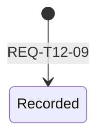

🏠 [Specs](../../../README.md) › ⚙️ [Technical capabilities](../../README.md) ›
🕸️ [T12 Connectors and scrapers](../README.md) › 🗃️ [Data](README.md) › 🗃️ E-T12-04 Connector run

# 🗃️ E-T12-04 Connector run

**Status:** 🔄 waiting for the owner

## Purpose

One execution of a connector action (REQ-T12-10).

## Fields

| Name | Type | Required | Validation | Default | Example | Personal data | Custom fields |
|---|---|---|---|---|---|---|---|
| action | action | yes | - | - | refund | no | no |
| driver | workflow, agent, MCP client, API | yes | - | - | agent | no | no |
| request | record | no | - | - | Ticket #4812 | no | no |
| mode | dry run, live | yes | - | - | live | no | no |
| outcome | done, refused, failed | yes | - | - | done | no | no |
| evidence | log, screenshot | yes | secrets redacted | - | - | maybe | no |

## Relations

See T12's architecture.

## Lifecycle

## Indexes and search

(Proposed) By company and name.

## Retention

(Proposed) Runs 13 months; credentials until revoked, then destroyed.

## Audit

Every change and every use.

## Import and export

Never the secrets.

## Used by

- [F16 Customer support agents](../../../02-functional/f16-customer-support-agents/README.md)

## Open questions

None.

---

⬅️ [E-T12-03 Generated connector](e-t12-03-generated-connector.md) · ⬆️ [Up](README.md) ·
➡️ [E-T12-05 Tool connection](e-t12-05-tool-connection.md)
