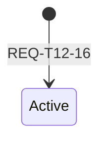

🏠 [Specs](../../../README.md) › ⚙️ [Technical capabilities](../../README.md) ›
🕸️ [T12 Connectors and scrapers](../README.md) › 🗃️ [Data](README.md) › 🗃️ E-T12-06 Sync state

# 🗃️ E-T12-06 Sync state

**Status:** ✅ specified

## Purpose

Where a sync stands, and its conflicts.

## Fields

| Name | Type | Required | Validation | Default | Example | Personal data | Custom fields |
|---|---|---|---|---|---|---|---|
| connection, cursor, conflicts | records | yes | REQ-T12-16 | - | Acme HubSpot, c-881, 1 | no | no |

The main fields only; the rest is generated from the code (D406).

## Relations

As its interfaces.

## Lifecycle

## Indexes and search

By company and id.

## Retention

Kept for the period of its kind of record in the country pack (D293), or else its kind's default in the
[retention schedule](../../../05-non-functional/data-retention.md).

## Audit

Every change (T3).

## Import and export

With the company's export (T1).

## Used by

- [T12 requirements](../requirements/README.md)

## Open questions

None.

---

⬅️ [E-T12-05 Tool connection](e-t12-05-tool-connection.md) · ⬆️ [Up](README.md) ·
➡️ [E-T12-07 Generated scraper version](e-t12-07-generated-scraper-version.md)
