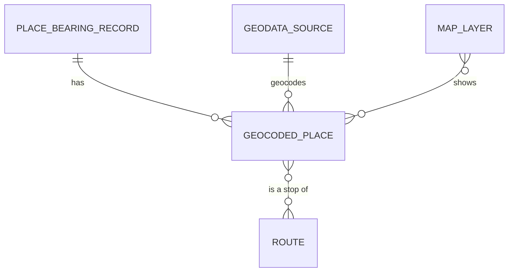
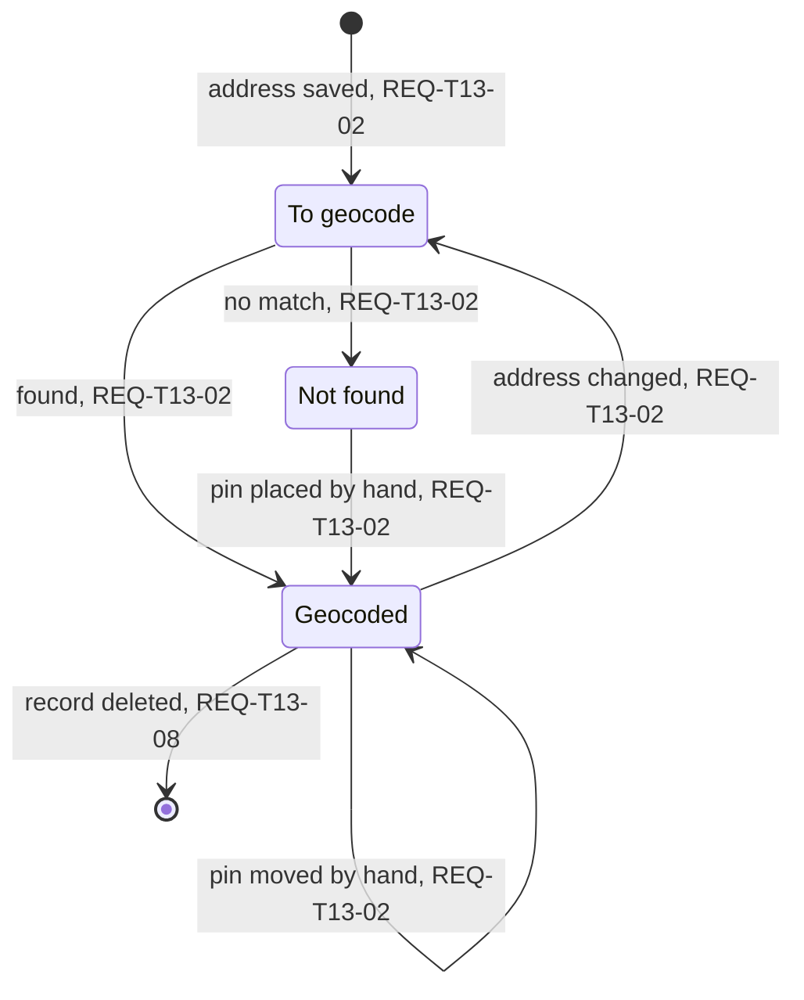

🏠 [Specs](../../../README.md) › ⚙️ [Technical capabilities](../../README.md) ›
🗺️ [T13 Maps and geodata](../README.md) › 🗃️ [Data](README.md) › 🗃️ E-T13-01 Geocoded place

# 🗃️ E-T13-01 Geocoded place

**Status:** 🔄 draft (GH-2 step S4b, from VD-18, VD-19 / D501)

## Purpose

The position of an address, or the outline of an area, that a record holds: a customer's home, a site, a store, a stop,
a plot, a delivery zone. Every address saved is geocoded on the company's own servers so that it can be shown on a map,
used for travel times and searched by area (REQ-T13-02, REQ-T13-04).

## Fields

| Name | Type | Required | Validation | Default | Example | Personal data | Custom fields |
|---|---|---|---|---|---|---|---|
| record | any place-bearing record | yes | - | - | Care recipient 118 | no | no |
| address | text | yes for a point | - | - | 12 rue des Lilas, 69003 Lyon | maybe | no |
| normalised address | text | no | from the source | - | 12 Rue des Lilas 69003 Lyon | maybe | no |
| shape | point or outline | yes | valid geometry | point | point | maybe | no |
| position | coordinates | yes for a point | WGS 84 | - | 45.7578, 4.8320 | maybe | no |
| outline | polygon | yes for an area | closed, not self-crossing | - | plot of 2.4 ha | no | no |
| precision | house, street, town, by hand | yes | - | - | house | no | no |
| source | E-T13-04 or by hand | yes | - | - | national address base | no | no |
| confidence | percent | no | - | - | 96 % | no | no |
| state | list | yes | the lifecycle below | to geocode | geocoded | no | no |
| geocoded at | date and time | no | - | - | 2026-12-01 09:12 | no | no |

The place is personal data when it is a person's home (a customer, a care recipient, an employee's home base).

## Relations

- [E-T13-04 Geodata source](e-t13-04-geodata-source.md)
- [E-T13-02 Route](e-t13-02-route.md)
- [E-T13-03 Map layer](e-t13-03-map-layer.md)
- [E-F16-12 Work request](../../../02-functional/f16-customer-support-agents/data/e-f16-12-work-request.md) and about
  40 place-bearing entities, such as
  [E-F1-02 Company site](../../../02-functional/f01-administration/data/e-f01-02-company-site.md).
- The "location" custom field type (D101) stores one.

## Lifecycle

## Indexes and search

- A spatial index on position and outline: within an area, nearest to a point, within a travel time.
- Filters: precision, source, state.

## Retention

As the record that holds it; deleted or anonymised with it.

## Audit

Pin moved by hand (who and when); the automatic geocoding is logged without its address.

## Import and export

Geocoded in bulk on import (REQ-T13-02); (Proposed) outlines imported and exported as GeoJSON.

## Used by

- [UC-F9-36](../../../02-functional/f09-hr-and-projects/use-cases/12-schedule-customer-requests/uc-f09-36-see-work-and-places-on-a-map.md)
- [UC-F16-16](../../../02-functional/f16-customer-support-agents/use-cases/06-take-in-every-request/uc-f16-16-turn-any-request-into-a-work-request.md)

## Open questions

None.

---

⬆️ [Up](README.md) · ➡️ [E-T13-02 Route](e-t13-02-route.md)
